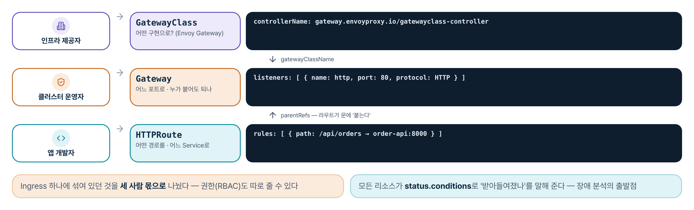

<sub>[🏠 과정 목차](../../README.md) › [4주차](../README.md) › [1일차](README.md) › 4/8교시</sub>

# 4교시 · Gateway API 구조

> [!NOTE]
> **이번 시간에 할 일**
>
> - Gateway API의 **역할별 리소스** — GatewayClass · Gateway · HTTPRoute — 와 각각의 주인을 구분합니다.
> - 라우트가 Gateway에 **붙는** 방법(parentRefs · allowedRoutes)과 다른 네임스페이스로 **보내는** 방법(ReferenceGrant)을 이해합니다.
> - 요청 하나가 **어느 규칙에 걸리는지** 정하는 우선순위를 읽습니다.
> - **CRD**가 무엇인지, 왜 Gateway API는 Kubernetes에 '기본으로' 들어 있지 않은지 확인합니다.

## 세 사람, 세 리소스



| 리소스 | 주인 | 정하는 것 | 범위 |
|---|---|---|---|
| **GatewayClass** | 인프라 제공자 (플랫폼 팀 · 클라우드) | "이 종류의 문은 **어느 구현**이 만든다" — `controllerName` | 클러스터 전체 |
| **Gateway** | 클러스터 운영자 | 문 하나 — **어느 포트 · 프로토콜**, 어느 네임스페이스의 라우트가 **붙어도 되나** | 네임스페이스 |
| **HTTPRoute** | 앱 개발자 | 어느 **Host · 경로 · 헤더**의 요청을 어느 **Service**로, 얼마의 **비율**로 | 네임스페이스 |

> [!IMPORTANT]
> **왜 나눴나**
>
> Ingress 하나에는 "어떤 로드 밸런서를 쓸지(인프라)", "어느 포트 · 인증서(운영)", "어느 경로를 어디로(앱)"가 **한 파일에** 섞여 있었습니다. 그래서 앱 개발자가 경로 하나 고치려면 인증서까지 만질 권한이 필요했습니다. Gateway API는 이를 세 리소스로 나눠 **각자 자기 것만** 고치게 합니다. 4주차 5일차 RBAC에서 "앱 팀은 HTTPRoute만 쓸 수 있다"를 실제로 만듭니다.

## 매니페스트 읽기

오늘 오후에 쓸 파일들을 미리 읽습니다.

```bash
cd ~/devops-lab/k8s/w4d1
cat gateway/gatewayclass.yaml gateway/gateway.yaml
```

```yaml
apiVersion: gateway.networking.k8s.io/v1
kind: GatewayClass
metadata:
  name: eg
spec:
  controllerName: gateway.envoyproxy.io/gatewayclass-controller   # 이 컨트롤러가 맡는다
---
apiVersion: gateway.networking.k8s.io/v1
kind: Gateway
metadata:
  name: devmart
  namespace: devmart
spec:
  gatewayClassName: eg                 # 위의 GatewayClass
  infrastructure:
    parametersRef: { group: gateway.envoyproxy.io, kind: EnvoyProxy, name: devmart-proxy }   # 5교시
  listeners:
    - name: http
      protocol: HTTP
      port: 80
      allowedRoutes:
        namespaces:
          from: All                    # 모든 네임스페이스의 라우트가 붙을 수 있다
```

```bash
sed -n '1,16p' gateway/devmart-routes.yaml
```

```yaml
apiVersion: gateway.networking.k8s.io/v1
kind: HTTPRoute
metadata:
  name: orders
  namespace: devmart
spec:
  parentRefs:
    - name: devmart                    # 이 Gateway에 붙는다
  rules:
    - matches:
        - path: { type: PathPrefix, value: /api/orders }
      backendRefs:
        - name: order-api              # 이 Service의
          port: 8000                   # 이 포트로
```

3주차 5일차 nginx 설정의 `location /api/orders { proxy_pass http://order-api:8000; }` 한 줄이 **표준 리소스 하나**가 되었습니다.

## 붙기와 보내기 — 두 개의 허락

Gateway API는 **네임스페이스 경계**를 진지하게 다룹니다. 남의 네임스페이스에 함부로 연결되지 않도록, 두 군데에서 **허락**을 받습니다.

| 방향 | 누가 허락 | 리소스 · 칸 | 오늘 |
|---|---|---|---|
| 라우트 → Gateway에 **붙기** | Gateway 주인 | Gateway의 `listeners[].allowedRoutes.namespaces` — `Same`(기본) · `All` · `Selector` | `All` — default 네임스페이스의 podinfo 라우트도 붙게 |
| 라우트 → 다른 네임스페이스 Service로 **보내기** | Service 쪽 네임스페이스 주인 | **ReferenceGrant** — "devmart의 HTTPRoute가 우리 Service를 가리켜도 된다" | 7교시에 일부러 없이 해 본다 |

> **🧩 비유 — 건물 출입과 사무실 출입**
>
> 건물(Gateway)에 들어오려면 **건물 관리소**의 허락이 필요하고(allowedRoutes), 남의 회사 사무실(다른 네임스페이스의 Service)에 들어가려면 **그 회사**의 허락이 필요합니다(ReferenceGrant). 관리소가 허락했다고 남의 사무실까지 들어갈 수 있는 것은 아닙니다.

## 요청 하나는 어느 규칙에 걸리나

여러 라우트의 규칙이 한 Gateway에 모이면, 요청 하나에 여러 규칙이 맞을 수 있습니다. 예를 들어 `/api/orders`는 `/api/orders` 규칙에도, `/api/` 규칙에도, `/` 규칙에도 맞습니다. Gateway API는 우선순위를 표준으로 정해 두었습니다(줄인 것).

1. **Host가 더 구체적인 것** — `podinfo.localhost` > `*.localhost` > (Host 지정 없음)
2. **경로가 정확히 일치(Exact)** > 앞부분 일치(PathPrefix)
3. PathPrefix끼리는 **더 긴 것**
4. 메서드 · 헤더 · 쿼리 조건이 **더 많은 것**
5. 그래도 같으면 **먼저 만들어진 것**, 그다음 이름 순

그래서 nginx 설정처럼 `location`의 **순서**를 신경 쓸 필요가 없습니다. `/api/orders/12`는 가장 긴 `/api/orders` 규칙으로 갑니다.

> **📘 예시 — 어디로 갈까 (오늘의 라우트 기준)**
>
> | 요청 | 가는 곳 | 이유 |
> |---|---|---|
> | `GET /api/orders` | order-api | `/api/orders`가 가장 긴 앞부분 일치 |
> | `GET /api/products/3` | catalog-api | `/api/`가 `/`보다 길다 |
> | `GET /index.html` | web | `/`만 맞는다 |
> | `GET /` + `Host: podinfo.localhost` | podinfo | Host가 지정된 라우트가 더 구체적 |
> | `GET /api/orders` + `Host: podinfo.localhost` | **podinfo** | Host 우선 — podinfo 라우트에 `/` 규칙만 있어도 그쪽 |
>
> 마지막 줄이 함정입니다. Host가 먼저 갈립니다. 6교시에 직접 확인합니다.

## 실습 6 · CRD — Kubernetes가 모르는 리소스

Gateway API는 Kubernetes에 **기본으로 들어 있지 않습니다.** 확인합니다.

```bash
kubectl api-resources | grep -i gateway
kubectl apply -f gateway/gatewayclass.yaml
```

> **🟢 확인: 보이는 것**
>
> ```text
> (아무것도 없다)
> error: resource mapping not found for name: "eg" namespace: "" from "gateway/gatewayclass.yaml": no matches for kind "GatewayClass" in version "gateway.networking.k8s.io/v1"
> ensure CRDs are installed first
> ```
> apiserver가 `GatewayClass`라는 **종류 자체를 모릅니다.** 3주차 3일차 7교시 `api-resources`에서 본 목록에 없기 때문입니다.

> **📖 용어 — CRD (CustomResourceDefinition)**
>
> Kubernetes에 **새 리소스 종류를 추가하는** 리소스입니다. "이제부터 `GatewayClass`라는 종류가 있고, 칸은 이렇게 생겼다"를 apiserver에 알려 줍니다. CRD를 설치하면 `kubectl get gatewayclass`가 되고, etcd에 저장되고, `kubectl explain`도 됩니다. 하지만 **CRD만으로는 아무 일도 일어나지 않습니다.** 그 리소스를 지켜보다 실제로 일하는 **컨트롤러**(오늘은 Envoy Gateway)가 함께 있어야 합니다 — 3주차 3일차 4교시의 reconcile이 새 종류에 대해서도 그대로 일어납니다. 4주차에 설치하는 도구 대부분이 **CRD + 컨트롤러** 묶음입니다(Prometheus · Argo CD · Istio · Kyverno).

> **❓ 오해 — Gateway API는 Kubernetes 버전을 올리면 생긴다**
>
> Gateway API는 Kubernetes 본체와 **따로** 릴리스됩니다(SIG Network의 별도 프로젝트). 그래서 Kubernetes v1.37이라고 Gateway API v1.6이 들어 있는 것이 아니라, **CRD를 설치한 버전**이 그 클러스터의 Gateway API 버전입니다. 오늘은 Envoy Gateway 차트가 자기가 지원하는 버전(v1.6.1)의 CRD를 함께 설치합니다. 한 클러스터에 CRD는 **하나만** 있을 수 있어서, 여러 구현을 섞어 쓸 때 버전 충돌이 생기기도 합니다(1교시 학술 노트의 '클러스터 전체가 하나만 가지는 것').

## 표준 채널과 실험 채널

Gateway API의 기능은 성숙도에 따라 두 **채널**로 나뉩니다.

| 채널 | 뜻 | 예 (v1.6 기준) |
|---|---|---|
| **Standard** | 안정. 하위 호환 약속 | GatewayClass · Gateway · HTTPRoute · GRPCRoute · ReferenceGrant · TLSRoute · ListenerSet · TCPRoute · UDPRoute |
| **Experimental** | 바뀔 수 있음. 이름에 `X` 접두사가 붙기도 한다 | XBackend 등 |

그리고 구현마다 **어디까지 지원하는지**가 다릅니다. Gateway API 프로젝트는 **적합성 시험**(conformance test)을 두고, 구현마다 통과한 기능을 공개합니다. "Gateway API를 지원한다"는 말은 "**어느 버전의 어느 기능**을 지원한다"로 읽어야 합니다.

> **🎓 학술 노트 — 역할 기반 설계와 '관심사의 분리'**
>
> Dijkstra는 1974년 *On the role of scientific thought*에서 한 번에 한 측면에만 집중하는 **관심사의 분리**(separation of concerns)를 좋은 사고의 핵심으로 꼽았습니다. Gateway API는 이를 **사람의 역할** 단위로 적용했습니다 — 인프라 · 운영 · 앱이 각자 자기 리소스만 다룹니다. 이는 Conway의 법칙(1968, "시스템의 구조는 그것을 만든 조직의 소통 구조를 닮는다")을 의도적으로 이용한 설계이기도 합니다. Ingress가 '한 사람이 다 아는' 작은 팀을 가정했다면, Gateway API는 1주차 5일차의 **플랫폼 팀 + 여러 앱 팀** 구조를 가정합니다.

> **📈 트렌드 2026 — 메시와 입구가 같은 API로**
>
> Gateway API는 클러스터 **입구**(남북 트래픽)뿐 아니라, 서비스끼리 오가는 **내부 트래픽**(동서 트래픽)에도 쓰입니다. HTTPRoute의 `parentRefs`에 Gateway 대신 **Service**를 적으면 "이 Service로 가는 요청을 이렇게 나눠라"가 되는데, 이를 **GAMMA**라고 부릅니다. Istio · Linkerd · Cilium이 이를 지원해, 4주차 4일차 서비스 메시에서도 오늘 배운 HTTPRoute를 그대로 씁니다. 같은 API를 한 번 배우면 입구와 메시를 모두 다루는 방향으로 수렴하고 있습니다.

> **✅ 확인 문제**
>
> 1. 앱 개발자가 주로 쓰는 리소스는? 포트와 프로토콜은 어느 리소스에서 정하나요?
> 2. default 네임스페이스의 HTTPRoute가 devmart 네임스페이스의 Gateway에 붙으려면 무엇이 필요한가요?
> 3. devmart의 HTTPRoute가 default의 Service로 보내려면 무엇이 필요한가요?
> 4. `/api/orders/7` 요청은 `/api/`, `/api/orders`, `/` 규칙 중 어디로 가나요? 왜?
> 5. CRD만 설치하고 컨트롤러를 설치하지 않으면 어떻게 되나요?
>
> <details><summary>정답</summary>
>
> 1. HTTPRoute. 포트 · 프로토콜은 Gateway의 listeners
> 2. Gateway 리스너의 `allowedRoutes.namespaces`가 `All`(또는 default를 고르는 `Selector`)이어야 하고, 라우트의 `parentRefs`에 `namespace: devmart`를 적는다
> 3. default 네임스페이스에 ReferenceGrant — "devmart의 HTTPRoute가 우리 Service를 가리켜도 된다"
> 4. `/api/orders` — PathPrefix끼리는 더 긴 것이 이긴다
> 5. 리소스는 만들어지고 저장되지만, 그것을 보고 일하는 주체가 없어 **아무 일도 일어나지 않는다** (status도 비어 있다)
>
> </details>

## 참고 문헌

- Gateway API. *API Overview* · *Security Model* · *HTTPRoute — Matching precedence*. gateway-api.sigs.k8s.io
- Gateway API. *Versioning — Release channels* · *Conformance*. gateway-api.sigs.k8s.io/concepts
- Kubernetes Blog (2026-08-03). *Gateway API v1.6: TCPRoute and UDPRoute Graduate to Standard*. kubernetes.io/blog
- Kubernetes Docs. *Custom Resources*. kubernetes.io/docs/concepts/extend-kubernetes/api-extension
- Dijkstra, E. W. (1974/1982). On the role of scientific thought. In *Selected Writings on Computing: A Personal Perspective*. Springer.
- Conway, M. E. (1968). How Do Committees Invent? *Datamation*, 14(4).

---

| 이전 | 목차 | 다음 |
|:--|:--:|--:|
| ⬅️ [3교시 · Ingress의 역사와 ingress-nginx 은퇴](lesson-03.md) | [⬆️ 1일차 목차](README.md) | [5교시 · Envoy Gateway 설치와 Gateway](lesson-05.md) ➡️ |
