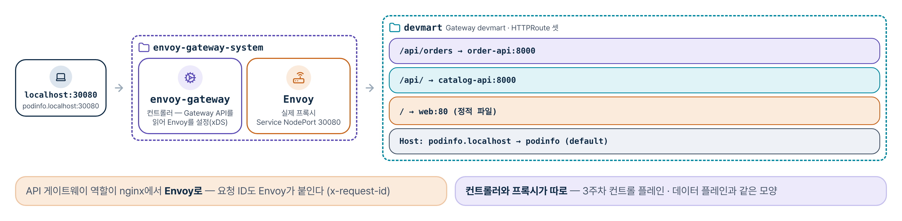

<sub>[🏠 과정 목차](../../README.md) › [4주차](../README.md) › [1일차](README.md) › 5/7교시</sub>

# 5교시 · Envoy Gateway 설치와 Gateway

> [!NOTE]
> **이번 시간에 할 일**
>
> - DevMart의 입구였던 NodePort 30080을 **비웁니다.**
> - **Envoy Gateway**를 Helm으로 설치하고, CRD와 컨트롤러가 생긴 것을 확인합니다.
> - GatewayClass → EnvoyProxy → Gateway 순서로 **문**을 만듭니다.
> - 컨트롤러와 프록시가 **따로** 돈다는 것을 Pod 목록으로 확인합니다.

## Envoy와 Envoy Gateway

| 이름 | 무엇 | 비유 |
|---|---|---|
| **Envoy** | C++로 만든 고성능 **프록시**. 요청을 받아 규칙대로 뒤로 넘긴다. 2016년 Lyft가 공개, CNCF 졸업 프로젝트 | 실제로 손님을 안내하는 **안내원** |
| **Envoy Gateway** | Gateway API 리소스를 읽어 **Envoy를 설정하는 컨트롤러**. Envoy 프로젝트의 공식 하위 프로젝트 | 규정집을 읽고 안내원에게 지시하는 **관리소** |

Envoy는 설정 파일 대신 **xDS**라는 API로 설정을 받습니다. 실행 중에 라우트를 바꿔도 Envoy를 다시 시작하지 않습니다 — 3주차 5일차 nginx는 설정을 바꾸면 다시 시작해야 했습니다(2교시 실습 9). 4주차 4일차 Istio도 같은 Envoy를 프록시로 씁니다.

## 실습 7 · 30080 비우기

Gateway가 30080을 쓸 수 있도록, DevMart의 web Service를 **ClusterIP**로 바꿉니다. 파일을 고쳐 적용합니다(3주차의 원칙).

```bash
cd ~/devops-lab/k8s/day5
sed -i 's/type: NodePort/type: ClusterIP/; /nodePort: 30080/d' devmart/web.yaml     # Mac: sed -i ''
grep -A8 'kind: Service' devmart/web.yaml
kubectl apply -k devmart/
kubectl get service web -n devmart
```

> **🟢 확인: 보이는 것**
>
> ```text
> kind: Service
> metadata:
>   name: web
>   namespace: devmart
> spec:
>   type: ClusterIP
>   selector: { app: web }
>   ports:
>     - port: 80
> ...
> service/web configured
> NAME   TYPE        CLUSTER-IP     EXTERNAL-IP   PORT(S)   AGE
> web    ClusterIP   10.96.188.42   <none>        80/TCP    6d
> ```

```bash
curl -s -m 3 localhost:30080 || echo "  → 응답 없음"
```

> **🟢 확인: 보이는 것**
>
> ```text
>   → 응답 없음
> ```
> kind의 포트 통로(30080)는 그대로지만, 노드의 30080에서 듣는 것이 없어졌습니다. 이제 이 자리에 Gateway를 세웁니다. **오늘 6교시가 끝날 때까지 DevMart는 브라우저로 열리지 않습니다** — 실제 입구 교체 작업이라면 이런 공백이 없게 순서를 짜야 합니다(아래 '팁').

> [!TIP]
> **실무라면 — 공백 없는 입구 교체**
>
> 운영 중인 서비스의 입구를 바꿀 때는 **새 입구를 먼저 세워 시험하고**(다른 포트나 다른 도메인), 문제가 없을 때 DNS나 로드 밸런서를 옮깁니다. 옛 입구는 한동안 남겨 두었다가 트래픽이 완전히 빠진 것을 확인한 뒤 지웁니다. 오늘은 kind에 문이 30080 하나뿐이라 잠깐 닫고 바꿉니다.

## 실습 8 · Envoy Gateway 설치

### 단계 1 — 차트 살펴보기

```bash
cd ~/devops-lab/k8s/w4d1
EG=oci://docker.io/envoyproxy/gateway-helm
helm show chart $EG --version v1.10.0 | grep -E '^(name|version|appVersion)'
cat gateway/envoy-gateway-values.yaml
```

> **🟢 확인: 보이는 것**
>
> ```text
> appVersion: v1.10.0
> name: gateway-helm
> version: v1.10.0
> ```
> ```yaml
> deployment:
>   envoyGateway:
>     resources:
>       requests: { cpu: 50m, memory: 128Mi }
>       limits: { memory: 512Mi }
> ```
> v1.10은 2026년 11월 5일에 나온 최신 버전으로, Kubernetes v1.34~v1.37을 지원하고 Gateway API **v1.6.1**을 함께 설치합니다. 우리 클러스터 v1.37에 맞습니다 — 도구를 고를 때 **호환 표**를 먼저 보는 습관입니다.

### 단계 2 — 설치

```bash
helm install eg $EG --version v1.10.0 \
  -n envoy-gateway-system --create-namespace \
  -f gateway/envoy-gateway-values.yaml
kubectl wait --timeout=5m -n envoy-gateway-system deployment/envoy-gateway --for=condition=Available
```

- `-n … --create-namespace` : 이 도구만의 네임스페이스에 설치한다 (3주차 5일차의 칸막이)

> **🟢 확인: 보이는 것**
>
> ```text
> Pulled: docker.io/envoyproxy/gateway-helm:v1.10.0
> NAME: eg
> NAMESPACE: envoy-gateway-system
> STATUS: deployed
> REVISION: 1
> ...
> deployment.apps/envoy-gateway condition met
> ```

### 단계 3 — CRD가 생겼다

4교시에 실패했던 명령을 다시 합니다.

```bash
kubectl api-resources | grep -E 'gateway.networking|gateway.envoyproxy' | awk '{print $1, $(NF-2), $NF}' | column -t
```

> **🟢 확인: 보이는 것 (일부)**
>
> ```text
> gatewayclasses          gateway.networking.k8s.io/v1          GatewayClass
> gateways                gateway.networking.k8s.io/v1          Gateway
> grpcroutes              gateway.networking.k8s.io/v1          GRPCRoute
> httproutes              gateway.networking.k8s.io/v1          HTTPRoute
> referencegrants         gateway.networking.k8s.io/v1          ReferenceGrant
> tcproutes               gateway.networking.k8s.io/v1          TCPRoute
> tlsroutes               gateway.networking.k8s.io/v1          TLSRoute
> udproutes               gateway.networking.k8s.io/v1          UDPRoute
> backendtrafficpolicies  gateway.envoyproxy.io/v1alpha1        BackendTrafficPolicy
> envoyproxies            gateway.envoyproxy.io/v1alpha1        EnvoyProxy
> ...
> ```
> 두 묶음이 생겼습니다. **`gateway.networking.k8s.io`** 는 표준 Gateway API, **`gateway.envoyproxy.io`** 는 Envoy Gateway만의 확장(타임아웃 · 재시도 정책, 프록시 설정 등)입니다. 표준으로 안 되는 것을 확장으로 하되, **확장도 어노테이션이 아니라 정식 리소스**라는 점이 Ingress 시절과 다릅니다.

## 실습 9 · 문 만들기

### 단계 1 — GatewayClass

```bash
kubectl apply -f gateway/gatewayclass.yaml
kubectl get gatewayclass
```

> **🟢 확인: 보이는 것**
>
> ```text
> gatewayclass.gateway.networking.k8s.io/eg created
> NAME   CONTROLLER                                      ACCEPTED   AGE
> eg     gateway.envoyproxy.io/gatewayclass-controller   True       3s
> ```
> **ACCEPTED True** — Envoy Gateway 컨트롤러가 "이 클래스는 내가 맡는다"고 답했습니다. 컨트롤러 이름이 틀렸다면 아무도 답하지 않아 이 칸이 `Unknown`으로 남습니다.

### 단계 2 — EnvoyProxy: NodePort 30080

kind에는 클라우드 로드 밸런서가 없습니다. Envoy Gateway는 기본으로 Envoy의 Service를 **LoadBalancer**로 만드는데, kind에서는 주소를 영원히 못 받습니다(`<pending>`). 그래서 Envoy Gateway의 확장 리소스 **EnvoyProxy**로 Service를 NodePort 30080으로 바꿉니다.

```bash
cat gateway/envoyproxy.yaml | sed -n '/spec:/,$p'
kubectl apply -f gateway/envoyproxy.yaml
```

```yaml
spec:
  provider:
    type: Kubernetes
    kubernetes:
      envoyService:
        type: NodePort              # LoadBalancer 대신
        patch:
          type: StrategicMerge
          value:
            spec:
              ports:
                - port: 80
                  nodePort: 30080   # 3주차 3일차 kind 설정의 포트 통로
```

> [!WARNING]
> **이 설정은 kind 전용이다**
>
> 5주차 EKS에서는 이 EnvoyProxy를 쓰지 않습니다. 기본값(LoadBalancer) 그대로 두면 AWS가 **로드 밸런서(NLB)**를 만들어 줍니다. 환경마다 달라지는 것은 이렇게 **따로 떼어 둔 파일 하나**로 모읍니다.

### 단계 3 — Gateway

```bash
kubectl apply -f gateway/gateway.yaml
kubectl get gateway -n devmart -w
```

> **🟢 확인: 30초쯤 안에**
>
> ```text
> NAME      CLASS   ADDRESS   PROGRAMMED   AGE
> devmart   eg                Unknown      2s
> devmart   eg      …         True         25s
> ```
> **PROGRAMMED True** — 컨트롤러가 이 Gateway를 위한 Envoy를 띄우고 설정을 마쳤다는 뜻입니다. `ADDRESS` 칸은 구현과 Service 종류에 따라 비어 있거나 노드 IP가 보입니다. Ctrl+C로 멈춥니다.

### 단계 4 — 무엇이 생겼나

```bash
kubectl get deployment,pod,service -n envoy-gateway-system
```

> **🟢 확인: 보이는 것 (이름 뒷부분은 다름)**
>
> ```text
> NAME                                             READY   UP-TO-DATE   AVAILABLE   AGE
> deployment.apps/envoy-devmart-devmart-7f3a9c21   1/1     1            1           40s
> deployment.apps/envoy-gateway                    1/1     1            1           5m
>
> NAME                                                  READY   STATUS    RESTARTS   AGE
> pod/envoy-devmart-devmart-7f3a9c21-6d9b8c7f5-x2kq4    2/2     Running   0          40s
> pod/envoy-gateway-5b8d7c9f6-m4n7p                     1/1     Running   0          5m
>
> NAME                                     TYPE        CLUSTER-IP      PORT(S)                                   AGE
> service/envoy-devmart-devmart-7f3a9c21   NodePort    10.96.214.77    80:30080/TCP                              40s
> service/envoy-gateway                    ClusterIP   10.96.120.15    18000/TCP,18001/TCP,18002/TCP,19001/TCP,…  5m
> ```



| 보이는 것 | 정체 | 3주차와 비교 |
|---|---|---|
| `envoy-gateway` (1/1) | **컨트롤러** — Gateway API 리소스를 지켜보고 Envoy 설정을 만든다 | 컨트롤 플레인 (3일차 2교시) |
| `envoy-devmart-devmart-…` (2/2) | 우리 Gateway를 위한 **Envoy 프록시** — 실제 요청이 지나간다. 컨테이너 둘: envoy + 종료 관리(shutdown-manager) | 데이터 플레인 |
| `service/envoy-devmart-devmart-…` | `80:30080` — 아까 비운 자리 | 3주차 5일차 web의 NodePort 자리 |

Gateway는 `devmart` 네임스페이스에 만들었지만, Envoy Pod는 **컨트롤러의 네임스페이스**(`envoy-gateway-system`)에 생겼습니다. 이름의 `devmart-devmart`는 "devmart 네임스페이스의 devmart Gateway"라는 뜻입니다.

### 단계 5 — 문을 두드려 보기

```bash
curl -s -o /dev/null -w '%{http_code}\n' localhost:30080/
curl -s -o /dev/null -w '%{http_code}\n' localhost:30080/api/products
```

> **🟢 확인: 보이는 것**
>
> ```text
> 404
> 404
> ```
> 아까는 응답이 없었습니다. 이제 **Envoy가 대답합니다** — 그런데 404입니다. **문은 열렸는데 길(라우트)이 하나도 없기** 때문입니다. 6교시에 길을 냅니다.

> **🎓 학술 노트 — 데이터 플레인 API와 '설정의 분리'**
>
> Envoy의 xDS(x Discovery Service)는 리스너 · 라우트 · 클러스터 · 엔드포인트 설정을 **API로 실시간 배포**하는 방식입니다. 프록시 설정을 파일이 아니라 **API로 주고받는** 생각은 SDN(소프트웨어 정의 네트워킹) 연구에서 왔습니다 — McKeown 외의 *OpenFlow: Enabling Innovation in Campus Networks*(ACM SIGCOMM CCR, 2008)는 네트워크 장비의 **제어(무엇을 할지)**와 **전달(실제 패킷 처리)**을 떼어, 중앙의 컨트롤러가 표준 API로 장비를 설정하게 했습니다. Envoy Gateway(컨트롤러) + Envoy(데이터 플레인) + xDS(API)는 그 구조를 L7 프록시에 옮긴 것입니다. 3주차 3일차의 컨트롤 플레인 · 데이터 플레인 구분과 같은 계보입니다.

> **📈 트렌드 2026 — 입구에 AI가 붙는다**
>
> Envoy Gateway 프로젝트는 LLM API 앞에 서는 **AI Gateway**(토큰 단위 요청 제한, 여러 모델 제공자 사이 전환, 비용 추적)를 하위 프로젝트로 키우고 있고, Gateway API에도 추론 서버로 요청을 나누는 **Inference Extension**이 생겼습니다. 3주차 3일차의 CNCF 조사가 말한 "AI 추론을 Kubernetes에서" 흐름의 입구 쪽 모습입니다. 오늘 배우는 GatewayClass · Gateway · HTTPRoute 구조가 그대로 그 바탕이 됩니다.

> **✅ 확인 문제**
>
> 1. Envoy와 Envoy Gateway는 각각 무엇인가요?
> 2. Envoy Gateway를 설치하자 생긴 두 API 묶음은?
> 3. kind에서 EnvoyProxy로 Service를 NodePort로 바꾼 이유는? EKS에서는?
> 4. GatewayClass의 ACCEPTED와 Gateway의 PROGRAMMED는 각각 무엇을 뜻하나요?
> 5. 라우트가 없을 때 `localhost:30080`의 응답이 '응답 없음'에서 404로 바뀐 이유는?
>
> <details><summary>정답</summary>
>
> 1. Envoy — 요청을 실제로 넘기는 프록시(데이터 플레인). Envoy Gateway — Gateway API 리소스를 읽어 Envoy를 설정하는 컨트롤러
> 2. `gateway.networking.k8s.io`(표준 Gateway API), `gateway.envoyproxy.io`(Envoy Gateway 확장)
> 3. kind에는 LoadBalancer를 만들어 줄 클라우드가 없어 주소가 `<pending>`으로 남기 때문. EKS에서는 기본값(LoadBalancer)대로 두면 AWS 로드 밸런서가 생긴다
> 4. ACCEPTED — 컨트롤러가 이 클래스를 맡겠다고 했다. PROGRAMMED — 이 Gateway를 위한 프록시가 뜨고 설정이 끝났다
> 5. 이제 Envoy가 30080에서 듣고 있다. 다만 맞는 라우트가 없어 404를 돌려준다
>
> </details>

## 참고 문헌

- Envoy Gateway Docs. *Quickstart* · *Customize EnvoyProxy* · *Compatibility Matrix*. gateway.envoyproxy.io
- Envoy Gateway. *Release Announcements — v1.10*. gateway.envoyproxy.io/news/releases
- Envoy Proxy Docs. *xDS REST and gRPC protocol*. envoyproxy.io/docs
- McKeown, N. 외 (2008). OpenFlow: Enabling Innovation in Campus Networks. *ACM SIGCOMM Computer Communication Review*, 38(2).

---

| 이전 | 목차 | 다음 |
|:--|:--:|--:|
| ⬅️ [4교시 · Gateway API 구조](lesson-04.md) | [⬆️ 1일차 목차](README.md) | [6교시 · HTTPRoute — 경로 · Host · 가중치](lesson-06.md) ➡️ |
