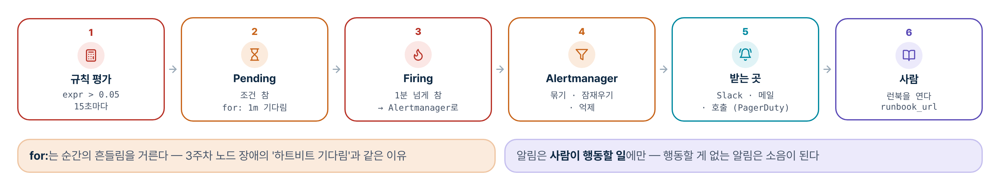

<sub>[🏠 과정 목차](../../README.md) › [4주차](../README.md) › [2일차](README.md) › 6/8교시</sub>

# 6교시 · 알림

> [!NOTE]
> **이번 시간에 할 일**
>
> - 알림이 **규칙 → Pending → Firing → Alertmanager → 받는 곳**으로 흘러가는 과정을 이해합니다.
> - **PrometheusRule**로 DevMart 알림 두 개를 만들고, 장애를 넣어 **실제로 울려 봅니다.**
> - Alertmanager에서 알림을 **잠재웁니다**(silence).
> - 언제나 울려 있는 **Watchdog** 알림의 정체를 압니다.
> - 좋은 알림과 나쁜 알림을 구분합니다.

## 알림의 흐름



| 단계 | 누가 | 하는 일 |
|---|---|---|
| 규칙 평가 | Prometheus | PromQL 식을 주기마다 계산. 결과가 있으면(조건이 참이면) 알림 후보 |
| **Pending** | Prometheus | 조건이 참이지만 `for:` 시간이 아직 안 지남 — 순간의 흔들림일 수 있다 |
| **Firing** | Prometheus → Alertmanager | `for:` 동안 계속 참 → Alertmanager로 보낸다 |
| 묶기 · 잠재우기 · 억제 | Alertmanager | 같은 원인의 알림 100개를 **하나로 묶고**, 작업 중인 것은 **잠재우고**, 더 큰 알림이 있으면 작은 것을 **억제**한다 |
| 받는 곳 | Alertmanager | Slack · 메일 · 호출 시스템(PagerDuty 등) |

## 규칙 읽기

```bash
cd ~/devops-lab/k8s/w4d2
sed -n '/groups:/,$p' monitoring/devmart-rules.yaml
```

```yaml
  groups:
    - name: devmart.gateway
      rules:
        - record: devmart:gateway_5xx_ratio:rate1m          # 기록 규칙 — 계산을 미리 해 둔다
          expr: |
            sum by (envoy_cluster_name) (rate(…_rq_xx{envoy_response_code_class="5", …}[1m]))
            /
            sum by (envoy_cluster_name) (rate(…_rq_total{…}[1m]))
        - alert: DevMartHighErrorRate                        # 알림 규칙
          expr: devmart:gateway_5xx_ratio:rate1m > 0.05      # 5xx가 5%를 넘으면
          for: 1m                                            # 1분 넘게 계속되면
          labels:
            severity: critical
            team: devmart
          annotations:
            summary: "{{ $labels.envoy_cluster_name }}의 5xx 비율이 {{ $value | humanizePercentage }}"
            runbook_url: "https://github.com/…/runbooks/devmart-high-error-rate.md"    # 7교시
        - alert: DevMartSlowResponses                        # p95 > 1초가 5분 넘게
          …
```

| 칸 | 뜻 |
|---|---|
| `record:` | **기록 규칙** — 자주 쓰는 긴 계산을 새 지표 이름으로 미리 저장. 대시보드 · 알림이 같은 숫자를 쓰게 된다 |
| `expr:` | 이 식에 결과가 **있으면** 알림 (결과가 없으면 조용) |
| `for:` | 이만큼 계속 참이어야 Firing — 3주차 3일차 노드 장애의 '하트비트를 기다리는 시간'과 같은 이유 |
| `labels.severity` | 얼마나 급한가 — Alertmanager가 받는 곳을 고를 때 쓴다 |
| `annotations` | 사람이 읽을 설명 — 무엇이 · 얼마나 · **어디를 보라**(runbook_url) |

> [!IMPORTANT]
> **증상에 알림을 걸어라**
>
> DevMartHighErrorRate는 "catalog-api Pod가 0개"(원인)가 아니라 "**손님의 5%가 실패**"(증상)에 걸려 있습니다. 원인은 수십 가지(Pod 없음, DB 비밀번호, 이미지 오류 …)지만 증상은 하나입니다. 원인마다 알림을 걸면 알림이 수십 개가 되고, 그래도 처음 보는 원인은 놓칩니다. **증상으로 깨우고, 원인은 대시보드 · 런북으로 찾는다** — 구글 SRE 책의 원칙입니다.

## 실습 12 · 규칙 적용

```bash
kubectl apply -f monitoring/devmart-rules.yaml
```

Prometheus 화면(3교시의 port-forward 9090 — 꺼졌다면 다시)에서 위쪽 **Alerts** 메뉴.

> **🟢 확인: 보이는 것**
>
> `devmart.gateway` 그룹 아래 **DevMartHighErrorRate**, **DevMartSlowResponses** — 둘 다 **Inactive**(초록). 차트에 딸린 기본 규칙 수십 개도 함께 보입니다.

### Watchdog — 늘 울리는 알림

Alertmanager 화면을 엽니다.

```bash
kubectl port-forward -n monitoring service/kps-alertmanager 9093:9093
```

브라우저 **http://localhost:9093**.

> **🟢 확인: 보이는 것**
>
> 아무 장애도 없는데 **Watchdog**이라는 알림이 하나 울려 있습니다. 설명: *"This is an alert meant to ensure that the entire alerting pipeline is functional."*

> **📖 용어 — Watchdog (생존 신호)**
>
> **언제나 울리도록** 만든 알림입니다. 이것이 Alertmanager를 거쳐 바깥(예: 외부 감시 서비스)에 **계속 도착하는 한**, Prometheus → Alertmanager → 받는 곳의 길이 살아 있다는 뜻입니다. 반대로 이것이 **끊기면** 모니터링 자체가 죽은 것입니다. "알림이 안 온다"가 "문제가 없다"인지 "알림 시스템이 죽었다"인지 구분하게 해 줍니다. 이런 장치를 **데드맨 스위치**(dead man's switch)라고 부릅니다.

## 실습 13 · 알림을 울려 보기

### 단계 1 — 손님 만들기

알림 식은 **비율**입니다. 요청이 하나도 없으면 분모가 0이라 결과가 없고, 장애가 있어도 알림이 울리지 않습니다. 먼저 손님을 만듭니다.

```bash
# 터미널 A
while true; do curl -s -o /dev/null localhost:30080/api/products; sleep 0.2; done
```

> [!WARNING]
> **손님이 없으면 알림도 없다**
>
> 밤 3시처럼 요청이 거의 없을 때 오류율 알림은 **침묵**합니다. 그 시간에 서비스가 죽어 있어도 모릅니다. 그래서 실무에서는 오류율 알림과 함께, **가짜 손님을 정기적으로 보내는 감시**(합성 모니터링, blackbox 감시 — 위 CRD 목록의 `Probe`)를 둡니다.

### 단계 2 — 장애

```bash
# 터미널 B
date +%T; kubectl scale deployment catalog-api -n devmart --replicas=0
```

Prometheus **Alerts** 화면을 15초마다 새로 고칩니다.

> **🟢 확인: 시간에 따라**
>
> | 경과 | DevMartHighErrorRate |
> |---|---|
> | 0~30초 | Inactive — 1분짜리 rate가 아직 덜 올랐다 |
> | 30초 무렵 | **Pending** (노랑) — 조건 참, `for: 1m` 기다리는 중 |
> | 1분 30초 무렵 | **Firing** (빨강) — `envoy_cluster_name="httproute/devmart/catalog/rule/0"` |
>
> Alertmanager 화면에도 **DevMartHighErrorRate**가 나타납니다. 펼치면 `summary`에 *"httproute/devmart/catalog/rule/0의 5xx 비율이 100%"* 같은 문장이 보입니다.

> **📘 예시 — 장애에서 알림까지 걸린 시간**
>
> 장애 시작 → Firing까지 약 **1분 30초**: rate 창(1m)이 차는 시간 + `for: 1m` + 평가 주기(15초). 이 시간을 줄이면 빨리 알지만 순간의 흔들림에도 울리고, 늘리면 조용하지만 늦게 압니다. 정답은 없고, **"사람이 깨어나서 행동해야 할 만큼 확실한가"**로 정합니다.

### 단계 3 — 잠재우기

장애를 알고 고치는 중인데 알림이 계속 울리면 방해가 됩니다. **잠재우기**(silence)를 겁니다.

```bash
kubectl exec -n monitoring alertmanager-kps-alertmanager-0 -c alertmanager -- \
  amtool silence add alertname=DevMartHighErrorRate \
  --duration=10m --author="$(whoami)" --comment="catalog-api 복구 작업 중 (4주차 2일차 실습)" \
  --alertmanager.url=http://localhost:9093
```

- `amtool` : Alertmanager 명령줄 도구 (화면의 **New Silence** 버튼과 같은 일)
- `--comment` : **왜** 잠재웠는지 — 다음 사람이 읽는다

> **🟢 확인: 보이는 것**
>
> 잠재우기 ID 한 줄(예: `5f2c1a9e-…`)이 출력되고, Alertmanager 화면에서 알림이 사라집니다. 위쪽 **Silences** 탭에 내 이름 · 사유 · 남은 시간이 보입니다.

### 단계 4 — 복구

```bash
date +%T; kubectl scale deployment catalog-api -n devmart --replicas=2
```

1~2분 뒤 Prometheus **Alerts**에서 DevMartHighErrorRate가 **Inactive**로 돌아갑니다. 터미널 A의 루프를 Ctrl+C로 멈춥니다. 남은 잠재우기는 화면의 Silences 탭에서 **Expire**로 일찍 끝낼 수 있습니다.

> [!WARNING]
> **잠재우기를 끝내는 것을 잊지 않는다**
>
> 잠재우기에는 **반드시 기한**을 둡니다. 기한 없이 잠재운 알림은 다음 진짜 장애 때도 조용합니다. "작업이 끝나면 잠재우기를 끝낸다"를 작업 절차의 마지막 줄에 적습니다.

## 받는 곳 정하기 (읽기만)

오늘은 Slack 등을 연결하지 않았습니다. 실제로는 values 파일에 이렇게 적습니다. **웹훅 주소는 비밀**이라 Secret으로 둡니다.

```yaml
alertmanager:
  config:
    route:
      receiver: default
      group_by: [alertname, team]
      group_wait: 30s          # 처음 알림을 30초 모았다가 한 번에
      repeat_interval: 4h      # 해결 안 되면 4시간마다 다시
      routes:
        - matchers: [ 'severity="critical"' ]
          receiver: devmart-oncall
    receivers:
      - name: default
      - name: devmart-oncall
        slack_configs:
          - channel: '#devmart-alerts'
            api_url_file: /etc/alertmanager/secrets/slack/url      # Secret에서
            send_resolved: true                                     # 해결되면 '해결됨'도
```

> **❓ 오해 — 알림은 많을수록 안전하다**
>
> 알림이 하루 수십 번 울리고 대부분 "괜찮은 것"이면, 사람은 알림을 **무시하는 법**을 배웁니다 — **알림 피로**(alert fatigue). 그러다 진짜 장애도 무시합니다. 의료 현장의 경보 피로 연구들이 같은 현상을 보고합니다. 좋은 알림의 기준: (1) **긴급하다** — 지금 사람이 일어나야 한다, (2) **행동할 수 있다** — 무엇을 할지 런북이 있다, (3) **사용자 영향**이 있다(증상). 셋 중 하나라도 아니면 알림이 아니라 대시보드나 티켓으로 보냅니다.

> **🎓 학술 노트 — 알림과 사람**
>
> 구글 SRE 책 6장은 "모든 호출(page)은 **행동할 수 있어야** 하고, 매번 새로운 판단이 필요해야 한다. 기계적으로 대응할 수 있는 알림은 자동화하라"고 했습니다. 의료 분야의 **경보 피로** 연구(예: Cvach, 2012, *Biomedical Instrumentation & Technology*)는 병동 경보의 72~99%가 거짓 경보라 의료진이 경보에 둔감해지는 현상을 정리했습니다. 운영 알림도 같은 인간 요인을 가집니다. 알림 수를 줄이는 것은 게으름이 아니라 **안전 설계**입니다.

> **📈 트렌드 2026 — SLO 기반 알림**
>
> 오늘의 "5xx가 5%를 넘으면"은 고정 임계값 알림입니다. 요즘은 7교시의 **SLO**에서 출발해, "이 속도로 실패하면 이번 달 오류 예산을 며칠 만에 다 쓴다"를 계산하는 **소진율(burn rate) 알림**이 표준처럼 쓰입니다(SRE Workbook 5장). Sloth · Pyrra 같은 도구는 SLO 정의 하나로 PrometheusRule을 자동 생성합니다. 오늘 손으로 쓴 규칙이 그 도구들이 만들어 내는 것의 가장 단순한 형태입니다.

> **✅ 확인 문제**
>
> 1. Pending과 Firing의 차이는? `for:`를 두는 이유는?
> 2. DevMartHighErrorRate가 원인이 아니라 증상에 걸려 있다는 것은 무슨 뜻인가요? 왜 그게 좋은가요?
> 3. 요청이 하나도 없을 때 오류율 알림은 어떻게 되나요? 대책은?
> 4. Watchdog 알림이 늘 울리는 이유는?
> 5. 잠재우기에 기한과 사유를 꼭 적는 이유는?
>
> <details><summary>정답</summary>
>
> 1. Pending — 조건이 참이지만 `for:` 시간이 안 지남, Firing — 그 시간 동안 계속 참이라 Alertmanager로 보냄. 순간의 흔들림에 울리지 않게
> 2. 'Pod가 0개' 같은 원인이 아니라 '손님이 실패한다'는 사용자 영향에 걸려 있다. 원인이 무엇이든(처음 보는 원인이라도) 한 알림으로 잡힌다
> 3. 분모가 0이라 결과가 없어 울리지 않는다(침묵). 가짜 손님을 정기적으로 보내는 합성 모니터링(Probe)을 둔다
> 4. 알림 경로가 살아 있음을 계속 증명하는 데드맨 스위치 — 이것이 끊기면 모니터링이 죽은 것
> 5. 기한이 없으면 다음 진짜 장애 때도 조용하고, 사유가 없으면 다음 사람이 왜 잠재웠는지 모른다
>
> </details>

## 참고 문헌

- Prometheus Docs. *Alerting rules* · *Recording rules*. prometheus.io/docs/prometheus/latest/configuration
- Prometheus Docs. *Alertmanager — Grouping, Inhibition, Silences* · *amtool*. prometheus.io/docs/alerting
- Beyer, B. 외 (2016). *Site Reliability Engineering*, Ch. 6 "Monitoring Distributed Systems". O'Reilly.
- Beyer, B. 외 (2018). *The Site Reliability Workbook*, Ch. 5 "Alerting on SLOs". O'Reilly.
- Cvach, M. (2012). Monitor Alarm Fatigue: An Integrative Review. *Biomedical Instrumentation & Technology*, 46(4).

---

| 이전 | 목차 | 다음 |
|:--|:--:|--:|
| ⬅️ [5교시 · k6 부하 테스트](lesson-05.md) | [⬆️ 2일차 목차](README.md) | [7교시 · 관찰 런북과 SLO](lesson-07.md) ➡️ |
