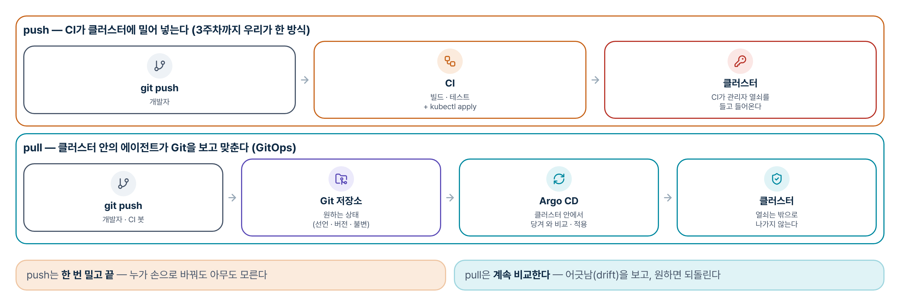
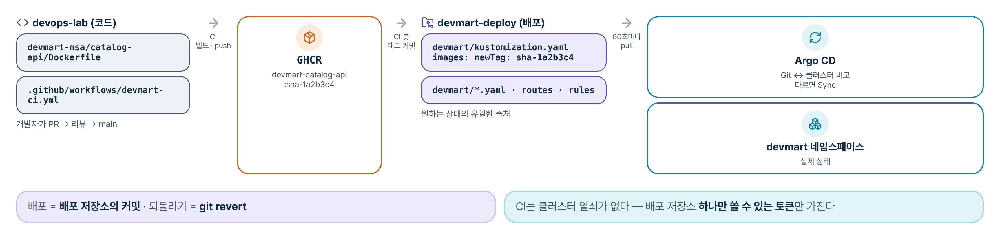

[🏠 과정 목차](../../README.md) › [4주차](../README.md) › [3일차](README.md)

# 1교시 · 2일차 요약 + GitOps

> [!NOTE]
> **이번 시간에 할 일**
>
> - 어제 만든 관찰 도구가 살아 있는지 손으로 확인합니다.
> - 3주차부터 해 온 배포 방식(**push**)의 약점을 짚습니다.
> - **GitOps**의 네 원칙과 **pull** 배포를 이해합니다.
> - 오늘 무엇을 어디에 둘지(저장소 둘) 그림으로 정리합니다.

## 2일차 요약 — 손으로 다시 확인

```bash
kubectl get pods -n monitoring
kubectl get configmap -n devmart -l grafana_dashboard=1
kubectl get prometheusrule -n devmart
kubectl port-forward -n monitoring svc/kps-grafana 3000:80 >/dev/null 2>&1 &
sleep 2; curl -s -o /dev/null -w 'grafana %{http_code}\n' localhost:3000/login
kill %1
```

> **🟢 확인: 이렇게 나오면 준비 완료**
>
> ```text
> alertmanager-kps-alertmanager-0     2/2   Running   0   1d
> kps-grafana-6c9d8b7f5-q2m4x         3/3   Running   0   1d
> kps-kube-state-metrics-…            1/1   Running   0   1d
> kps-operator-…                      1/1   Running   0   1d
> kps-prometheus-node-exporter-…      1/1   Running   0   1d   (× 3)
> prometheus-kps-prometheus-0         2/2   Running   0   1d
> NAME                DATA   AGE
> devmart-dashboard   1      1d
> NAME            AGE
> devmart         1d
> grafana 200
> ```

| 2일차 | 오늘 이어지는 곳 |
|---|---|
| 대시보드 · 알림 규칙을 **파일(코드)**로 만들어 Git에 올렸다 | 오늘은 그 파일들이 **스스로 클러스터에 적용**된다 |
| 장애는 배포 직후에 많다 — 되돌리기부터 | 배포 = 커밋, 되돌리기 = `git revert` |
| 런북을 PR로 고쳤다 | 클러스터 변경도 **PR로만** |
| 오늘 대시보드로 볼 것 | 7교시 배포 중의 요청 · 오류 그래프 |

## 3주차의 배포를 돌아보면

3주차 5일차에 DevMart를 이렇게 올렸습니다.

```bash
kubectl apply -k devmart/                 # 내 노트북에서, 내 관리자 열쇠로
kubectl set env deploy/order-worker QUEUE_NAME=order -n devmart   # 장애 훈련
kubectl scale deploy/redis --replicas=0 -n devmart                # 장애 훈련
```

이 방식에는 세 가지 약점이 있습니다.

| 약점 | 3주차에서 본 장면 | 운영에서 벌어지는 일 |
|---|---|---|
| **기록이 없다** | `set env`로 바꾼 값은 파일 어디에도 없다 | "누가 언제 왜 바꿨지?"에 답할 수 없다 |
| **어긋나도 모른다** | `fix.sh`가 없었다면 잘못된 큐 이름이 계속 남았다 | 파일과 클러스터가 조금씩 달라진다 (**drift**) |
| **열쇠가 밖에 있다** | 내 노트북의 kubeconfig가 관리자 권한 | CI에 kubeconfig를 넣으면, CI가 털리는 순간 클러스터도 털린다 |

> **📖 어긋남 (drift, 구성 표류)**
>
> **원하는 상태**(파일 · Git)와 **실제 상태**(클러스터)가 서로 달라진 것. 대개 급한 손 수정, 실수, 지운 줄 알았던 리소스에서 생깁니다. 처음엔 작지만 쌓이면 "Git의 파일로 다시 만들면 운영과 다르게 뜨는" 상태가 됩니다 — 재해 복구가 불가능해지는 지점입니다.

## push와 pull



| | push 배포 | pull 배포 (GitOps) |
|---|---|---|
| 누가 적용하나 | CI(또는 사람)가 `kubectl apply` · `helm upgrade` | 클러스터 **안의 에이전트**(Argo CD · Flux) |
| 클러스터 열쇠 | CI 비밀 값에 kubeconfig — **밖에** 있다 | 에이전트가 클러스터 안에서 자기 ServiceAccount로 — **밖으로 안 나간다** |
| 한 번 적용한 뒤 | 끝. 그 뒤의 변화는 모른다 | **계속 비교**한다 — 어긋나면 표시하고, 원하면 되돌린다 |
| 배포 이력 | CI 실행 로그 (보관 기간이 지나면 사라짐) | **Git 커밋 이력** 그 자체 |
| 되돌리기 | 이전 버전으로 다시 파이프라인 실행 | `git revert` |
| 클러스터 여러 개 | CI가 클러스터마다 접속 정보를 가져야 한다 | 각 클러스터가 **같은 Git**을 본다 |

> **🧩 비유 — 온도 조절기**
>
> push 배포는 난로를 **한 번 켜고 나가는** 것입니다. 누가 창문을 열어도 모릅니다. pull 배포는 **온도 조절기**입니다. 원하는 온도(Git)를 정해 두면, 조절기(Argo CD)가 계속 실내 온도(클러스터)를 재고 맞춥니다. 3주차 4일차에 본 **Deployment 컨트롤러의 reconcile 루프**를 "Git 저장소 전체" 크기로 키운 것입니다.

## GitOps의 네 원칙

CNCF의 OpenGitOps 작업 그룹이 정리한 원칙(v1.0.0, 2021)입니다.

| 원칙 | 뜻 | DevMart에서 |
|---|---|---|
| 1. **선언적** (Declarative) | 원하는 상태를 "어떻게"가 아니라 "무엇"으로 적는다 | Deployment YAML · kustomization — 3주차부터 이미 그렇다 |
| 2. **버전 관리 · 불변** (Versioned and Immutable) | 원하는 상태는 버전이 붙고, 바꾼 이력이 지워지지 않는 곳에 둔다 | 배포 저장소의 커밋 이력 |
| 3. **자동으로 당겨 옴** (Pulled Automatically) | 에이전트가 원하는 상태를 **스스로 가져온다** | Argo CD가 60초마다 Git을 본다 |
| 4. **계속 맞춤** (Continuously Reconciled) | 실제 상태를 계속 관찰하고 원하는 상태로 맞추려 한다 | selfHeal — 손 수정이 되돌려진다 (6교시) |

> **❓ 오해 — Git에 YAML을 올리면 GitOps다**
>
> YAML을 Git에 올리고 CI가 `kubectl apply`를 하면 **Git을 쓰는 push 배포**입니다. 원칙 3 · 4가 빠졌습니다. 반대로 원칙만 지키면 도구는 Argo CD가 아니어도 됩니다(Flux도 같은 일을 합니다). GitOps는 도구 이름이 아니라 **운영 방식**입니다.

> **❓ 오해 — GitOps면 kubectl을 아예 못 쓴다**
>
> **읽기**(`get` · `describe` · `logs`)는 그대로 씁니다. 장애 중에 급히 손대는 것도 막지는 않습니다 — 다만 Argo CD가 그것을 **어긋남으로 표시**하고, selfHeal이 켜져 있으면 **되돌립니다.** 그래서 급한 수정도 결국 "Git에 PR"로 남겨야 합니다. 5 · 6교시에 직접 봅니다.

## 오늘의 그림 — 저장소 둘



| 저장소 | 담는 것 | 바뀌는 계기 | 오늘 |
|---|---|---|---|
| `devops-lab` (코드) | `devmart-msa/` 소스 · Dockerfile, CI 워크플로 | 개발자의 PR | 7교시에 Dockerfile 한 줄 |
| `devmart-deploy` (배포) | `devmart/` 매니페스트 묶음 | CI 봇의 태그 커밋, 운영자의 설정 PR | 2교시에 새로 만든다 |

왜 둘로 나누는지는 2교시에 자세히 봅니다.

> **🎓 학술 노트 — 원하는 상태와 수렴**
>
> "원하는 상태를 적어 두고 에이전트가 계속 그쪽으로 맞춘다"는 생각은 Kubernetes보다 훨씬 오래되었습니다. Mark Burgess의 CFEngine(1993)과 그가 정리한 **수렴(convergence)** 개념 — 어떤 상태에서 시작하든 같은 작업을 반복하면 원하는 상태로 모인다 — 이 출발점입니다(Burgess, *On the theory of system administration*, 2003). Kubernetes의 컨트롤러 루프와 GitOps는 이 수렴을 **"원하는 상태 = Git"**으로 정한 것입니다. 이름 GitOps 자체는 Weaveworks의 Alexis Richardson이 2017년 블로그 글 *GitOps — Operations by Pull Request*에서 처음 썼습니다.

> **📈 트렌드 2026 — GitOps는 기본값**
>
> CNCF 설문에서 GitOps 도구(Argo CD · Flux)는 Kubernetes 배포의 **표준 방식**으로 자리 잡았고, Argo CD는 CNCF 졸업(graduated) 프로젝트 중 가장 활발한 축에 듭니다. 2026년 11월 4일에 나온 **Argo CD 3.6**은 컨트롤러 메모리를 크게 줄이고, 여러 Application의 리소스를 한 화면에서 찾는 **Resources Explorer**, OpenTelemetry 추적을 더했습니다. 한편 Flux를 만든 Weaveworks는 2024년 문을 닫았지만, Flux는 CNCF 프로젝트로 계속 개발되고 있습니다 — 오픈소스가 회사보다 오래 사는 예입니다.

> **✅ 확인 문제**
>
> 1. push 배포의 약점 세 가지는?
> 2. GitOps 네 원칙 중 "Git에 올리고 CI가 apply"에 빠진 것은?
> 3. 어긋남(drift)은 왜 재해 복구를 어렵게 하나요?
> 4. pull 배포에서 클러스터 관리자 열쇠는 어디에 있나요?
>
> <details><summary>정답</summary>
>
> 1. 기록이 없다, 어긋나도 모른다, 클러스터 열쇠가 밖(CI · 노트북)에 있다
> 2. 원칙 3(자동으로 당겨 옴)과 4(계속 맞춤)
> 3. Git의 파일로 다시 만들면 운영 중이던 것과 다른 상태가 뜨기 때문
> 4. 클러스터 안 — 에이전트(Argo CD)의 ServiceAccount. 밖으로 나가지 않는다
>
> </details>

## 참고 문헌

- OpenGitOps (2021). *GitOps Principles v1.0.0*. opengitops.dev
- Richardson, A. (2017-08-07). *GitOps — Operations by Pull Request*. Weaveworks blog.
- Burgess, M. (2003). *On the theory of system administration*. Science of Computer Programming 49.
- Argo Project (2026-11-04). *Argo CD v3.6 release notes*. github.com/argoproj/argo-cd/releases

---

⬅️ 이전: [4주차 3일차 목차](README.md) &nbsp;|&nbsp; [⬆️ 3일차 목차](README.md) &nbsp;|&nbsp; 다음: [2교시 · CI와 CD 나누기 · 배포 저장소](lesson-02.md) ➡️
