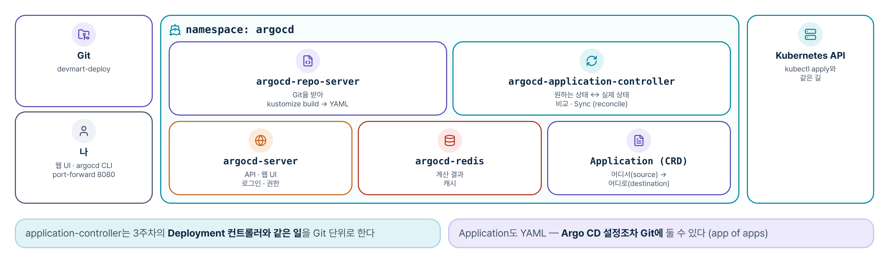

<sub>[🏠 과정 목차](../../README.md) › [4주차](../README.md) › [3일차](README.md) › 3/7교시</sub>

# 3교시 · Argo CD 설치

> [!NOTE]
> **이번 시간에 할 일**
>
> - Argo CD가 **어떤 부품**으로 이루어지는지 이해합니다.
> - values에서 **실습용으로 바꾼 것**을 읽고 Helm으로 설치합니다.
> - 첫 관리자 비밀번호를 꺼내 **웹 UI**에 로그인하고, 비밀번호를 바꿉니다.
> - **`argocd` CLI**를 설치하고 로그인합니다.

## Argo CD의 부품



| 부품 | 하는 일 | 3주차 · 4주차에서 닮은 것 |
|---|---|---|
| **argocd-repo-server** | Git을 받아 kustomize · Helm을 **펼쳐** 최종 YAML을 만든다 | 실습 3의 `kubectl kustomize` |
| **argocd-application-controller** | 펼친 YAML(원하는 상태) ↔ 클러스터(실제 상태)를 **비교하고 맞춘다** | Deployment 컨트롤러의 reconcile |
| **argocd-server** | API · 웹 UI · 로그인 · 권한 | apiserver의 축소판 |
| **argocd-redis** | 펼친 결과와 비교 결과를 캐시 | |
| **argocd-applicationset-controller** | Application을 **찍어 내는** 틀 (클러스터 · 폴더마다) | Helm의 템플릿 |
| **Application** (CRD) | "어느 Git의 어느 폴더를 → 어느 클러스터의 어느 네임스페이스로" | 어제의 PodMonitor처럼 CRD로 받는 설정 |

## values 읽기

```bash
cd ~/devops-lab/k8s/w4d3
cat argocd/argocd-values.yaml
```

```yaml
configs:
  params:
    server.insecure: true          # port-forward를 http로 보기 위해 (실습용 — 운영은 TLS)
  cm:
    timeout.reconciliation: 60s    # Git을 다시 확인하는 주기 (기본 120s)
dex:
  enabled: false                   # 외부 로그인(SSO) 연동 — 오늘은 쓰지 않는다
notifications:
  enabled: false
server:
  resources: …                     # 세 부품 모두 requests · limits (3주차 5일차)
```

| 바꾼 것 | 왜 | 운영이라면 |
|---|---|---|
| `server.insecure: true` | argocd-server는 기본으로 **자기 서명 인증서의 HTTPS**만 연다. port-forward로 볼 때 브라우저 경고와 CLI 옵션이 번거롭다 | Gateway(1일차) 앞에서 TLS를 끝내고, 이 설정은 둔다 |
| `timeout.reconciliation: 60s` | 커밋 후 반영까지 기다리는 시간을 줄인다 | 기본 120초 + **Git 웹훅**으로 즉시 알림 |
| `dex.enabled: false` | GitHub · 구글 계정 로그인(SSO)을 붙이는 부품. 오늘은 admin 하나로 | SSO로 로그인하고 admin 계정은 끈다 |
| `notifications.enabled: false` | 배포 성공 · 실패를 Slack으로 보내는 부품 | 켠다 — 어제의 Alertmanager와 짝 |

## 실습 5 · Helm으로 설치

1일차의 Helm 루프 그대로입니다 — 저장소 등록 → 버전 확인 → values와 함께 설치 → 확인.

```bash
helm repo add argo https://argoproj.github.io/argo-helm
helm repo update
helm search repo argo/argo-cd
```

> **🟢 확인: 확인**
>
> ```text
> NAME          CHART VERSION   APP VERSION   DESCRIPTION
> argo/argo-cd  10.○.○          v3.6.○        A Helm chart for Argo CD, a declarative, GitOps…
> ```
> **APP VERSION이 v3.6.x**인지 봅니다. 차트 버전(CHART VERSION)과 Argo CD 버전(APP VERSION)은 다른 숫자입니다(1일차 podinfo와 같다). 차트는 자주 나오므로 **그날 본 차트 버전을 적어 두고 고정**합니다.

```bash
VER=$(helm search repo argo/argo-cd -o json | python3 -c "import sys,json; print(json.load(sys.stdin)[0]['version'])")
echo "argo-cd 차트 $VER" | tee -a ~/devops-lab/k8s/w4d3/VERSIONS.txt
helm install argocd argo/argo-cd \
  --namespace argocd --create-namespace \
  --version "$VER" \
  -f argocd/argocd-values.yaml \
  --wait --timeout 5m
kubectl get pods -n argocd
```

> **🟢 확인: 확인 (2~3분)**
>
> ```text
> NAME: argocd
> NAMESPACE: argocd
> STATUS: deployed
> REVISION: 1
> …
> NAME                                                READY   STATUS      RESTARTS   AGE
> argocd-application-controller-0                     1/1     Running     0          2m
> argocd-applicationset-controller-6f9b8c7d4-k2m8p    1/1     Running     0          2m
> argocd-redis-5c8d9f7b6-x7q4w                        1/1     Running     0          2m
> argocd-redis-secret-init-q9w2e                      0/1     Completed   0          2m
> argocd-repo-server-7d6c5b8f9-h3n5r                  1/1     Running     0          2m
> argocd-server-8b7c6d5f4-m9p2t                       1/1     Running     0          2m
> ```
> - `-0`으로 끝나는 controller는 **StatefulSet**입니다(어제 Prometheus와 같은 이유 — 이름이 고정되어야 한다).
> - `redis-secret-init`은 설치 때 한 번 도는 **Job**이라 `Completed`가 정상입니다.

```bash
kubectl get crd | grep argoproj
```

> **🟢 확인: 확인**
>
> ```text
> applications.argoproj.io      2026-11-…
> applicationsets.argoproj.io   2026-11-…
> appprojects.argoproj.io       2026-11-…
> ```

> **🛠️ 막혔다면: Pod가 Pending에 멈춘다면**
>
> `kubectl describe pod -n argocd <이름>`의 Events에 `Insufficient memory`가 보이면 노드 메모리가 모자란 것입니다(3주차 5일차). `helm uninstall podinfo-canary -n default`, 그래도 모자라면 `helm uninstall podinfo -n default`로 1일차 연습용 앱을 지웁니다. DevMart · 모니터링은 지우지 않습니다.

## 실습 6 · 웹 UI 로그인

설치하면 Argo CD가 **처음 한 번 쓸 관리자 비밀번호**를 Secret에 만들어 둡니다.

```bash
kubectl -n argocd get secret argocd-initial-admin-secret -o jsonpath='{.data.password}' | base64 -d; echo
kubectl port-forward -n argocd svc/argocd-server 8080:80 >/dev/null 2>&1 &
```

브라우저에서 <http://localhost:8080> → Username `admin`, Password는 위에서 나온 값.

> **🟢 확인: 확인**
>
> "No applications yet" 화면과 **+ NEW APP** 버튼이 보입니다. 왼쪽 메뉴: Applications · Settings · User Info · Documentation.

> [!WARNING]
> **port-forward는 터미널이 열려 있는 동안만**
>
> `&`로 뒤에서 돌린 port-forward는 그 터미널을 닫으면 끊깁니다. 화면이 갑자기 안 뜨면 위 `kubectl port-forward` 줄을 다시 실행합니다. 어제 Grafana(3000)와 동시에 열어 둘 수 있습니다 — 포트만 다르면 됩니다.

## 실습 7 · CLI 설치와 로그인

웹 UI로 다 할 수 있지만, **CLI는 기록이 남고 런북에 옮겨 적을 수 있습니다.** 오늘 실습은 대부분 CLI로 합니다.

**Linux · WSL2 Ubuntu (bash)** — 클러스터에 깔린 서버와 같은 버전을 받습니다.

```bash
ARGO_VER=$(kubectl get deploy argocd-server -n argocd -o jsonpath='{.spec.template.spec.containers[0].image}' | cut -d: -f2)
echo $ARGO_VER
curl -sSL -o /tmp/argocd https://github.com/argoproj/argo-cd/releases/download/$ARGO_VER/argocd-linux-amd64
sudo install -m 555 /tmp/argocd /usr/local/bin/argocd
```

**Mac (터미널 · Homebrew)**

```bash
brew install argocd
```

**확인 (공통)**

```bash
argocd version --client
```

> [!TIP]
> **다른 설치 방법 — winget · 직접 다운로드**
>
> | 방법 | 어디서 | 명령 · 주소 |
> |---|---|---|
> | winget | Windows PowerShell | `winget install -e --id argoproj.argocd` |
> | 직접 다운로드 | 브라우저 | [github.com/argoproj/argo-cd/releases](https://github.com/argoproj/argo-cd/releases) — `argocd-windows-amd64.exe` · `argocd-darwin-arm64` |
>
> winget은 **Windows 쪽**에 설치하므로 PowerShell에서만 보입니다. 수업 명령은 WSL Ubuntu(bash)에서 치므로, Windows 사용자도 위의 **WSL 방법**으로 설치합니다. CLI와 서버의 마이너 버전(3.6)이 같으면 됩니다. 전체 목록은 **부록 A · 도구 설치 가이드**.

> **🟢 확인: 확인**
>
> ```text
> v3.6.○
> argocd: v3.6.○+…
>   BuildDate: 2026-11-…
>   …
> ```
> **서버와 같은 버전**의 CLI를 받았습니다(서버 이미지 태그를 읽어서). 3주차 3일차 kubectl의 "버전 차이 ±1"과 같은 이유입니다. Apple Silicon Mac에서 brew가 아닌 직접 받기라면 `argocd-darwin-arm64`입니다.

```bash
PW=$(kubectl -n argocd get secret argocd-initial-admin-secret -o jsonpath='{.data.password}' | base64 -d)
argocd login localhost:8080 --username admin --password "$PW" --plaintext
argocd account update-password --current-password "$PW"      # 새 비밀번호를 두 번 입력
kubectl -n argocd delete secret argocd-initial-admin-secret   # 처음 비밀번호는 지운다
argocd cluster list
```

> **🟢 확인: 확인**
>
> ```text
> 'admin:login' logged in successfully
> Context 'localhost:8080' updated
> *** Enter new password for user admin:
> *** Confirm new password for user admin:
> Password updated
> Context 'localhost:8080' updated
> secret "argocd-initial-admin-secret" deleted
> SERVER                          NAME        VERSION  STATUS   MESSAGE                                                  PROJECT
> https://kubernetes.default.svc  in-cluster           Unknown  Cluster has no applications and is not being monitored.
> ```
> - `--plaintext`는 `server.insecure: true` 때문입니다 — HTTPS가 아닌 HTTP로 붙는다는 뜻.
> - `in-cluster`는 **Argo CD가 설치된 바로 그 클러스터**입니다. 다른 클러스터(5주차 EKS)도 `argocd cluster add`로 등록할 수 있습니다.
> - `Unknown`은 아직 Application이 없어서입니다. 4교시에 바뀝니다.

> [!IMPORTANT]
> **새 비밀번호는 어디에?**
>
> Argo CD는 바꾼 비밀번호를 `argocd-secret`에 **해시(bcrypt)**로만 저장합니다. 잊어버리면 되돌릴 수 없고, 그 해시를 직접 바꿔야 합니다. 오늘 비밀번호는 3주차부터 쓰는 비밀번호 관리 방식대로 보관합니다. 처음 비밀번호 Secret을 지우는 것은 Argo CD 공식 문서의 권고입니다 — 남겨 두면 그것이 곧 관리자 열쇠입니다.

> **🎓 학술 노트 — 비교의 비용**
>
> Argo CD의 핵심 연산은 "원하는 상태와 실제 상태의 **차이(diff)**"입니다. Kubernetes 리소스에는 사람이 쓰지 않은 필드(기본값, `status`, 다른 컨트롤러가 붙인 값)가 많아, 단순 비교는 늘 "다르다"가 됩니다. 그래서 Argo CD는 apiserver의 **server-side apply**와 **관리 필드(managedFields)** — 어느 필드를 누가 소유하는지 — 를 이용해 "내가 관리하는 필드만" 비교합니다. 이 소유권 개념은 Kubernetes KEP-555(*Server-side Apply*, 2019~2021 GA)에서 정리되었습니다.

> **📈 트렌드 2026 — 대규모 Argo CD**
>
> 수천 개의 Application을 관리하는 회사가 늘면서, 컨트롤러를 **여러 개로 나누는(sharding)** 설정과 메모리 최적화가 Argo CD의 주요 개발 주제가 되었습니다. 3.6의 컨트롤러 메모리 절감도 그 흐름입니다. 또 Argo CD를 직접 운영하지 않고 **관리형**(Akuity · AWS EKS Capabilities의 Argo CD 등)으로 쓰는 선택지도 넓어졌습니다 — 5주차 EKS에서 다시 이야기합니다.

> **✅ 확인 문제**
>
> 1. 원하는 상태와 실제 상태를 비교하는 부품은?
> 2. `server.insecure: true`가 운영에서 문제가 되지 않으려면?
> 3. CLI 버전을 서버 이미지 태그에 맞춘 이유는?
> 4. `argocd-initial-admin-secret`을 지우는 이유는?
>
> <details><summary>정답</summary>
>
> 1. argocd-application-controller
> 2. 앞단(Gateway · 로드밸런서)에서 TLS를 끝내고, argocd-server까지는 클러스터 안에서만 오가게 한다
> 3. 클라이언트와 서버의 버전 차이에서 오는 오동작을 피하려고
> 4. 남겨 두면 그 Secret을 읽을 수 있는 누구나 관리자로 로그인할 수 있기 때문
>
> </details>

## 참고 문헌

- Argo CD Docs. *Architecture*, *Getting Started — Login Using The CLI*. argo-cd.readthedocs.io
- Argo Helm. *argo-cd chart README*. github.com/argoproj/argo-helm
- Kubernetes Enhancement Proposal 555. *Server-side Apply*. github.com/kubernetes/enhancements
- Argo CD Docs. *High Availability — Argo CD Application Controller sharding*. argo-cd.readthedocs.io

---

| 이전 | 목차 | 다음 |
|:--|:--:|--:|
| ⬅️ [2교시 · CI와 CD 나누기 · 배포 저장소](lesson-02.md) | [⬆️ 3일차 목차](README.md) | [4교시 · Application과 Sync](lesson-04.md) ➡️ |
