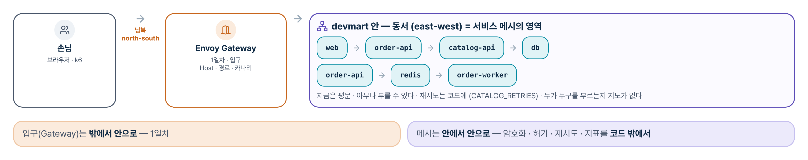
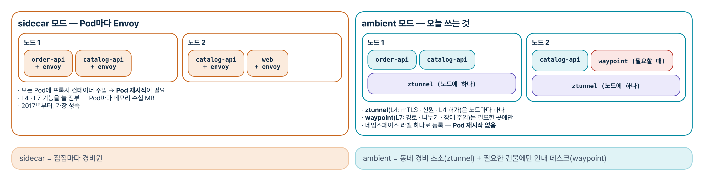

<sub>[🏠 과정 목차](../../README.md) › [4주차](../README.md) › [4일차](README.md) › 1/8교시</sub>

# 1교시 · 3일차 요약 + 서비스 메시

> [!NOTE]
> **이번 시간에 할 일**
>
> - 어제의 GitOps 흐름이 살아 있는지 손으로 확인합니다.
> - **남북**과 **동서** 트래픽을 DevMart에서 구분합니다.
> - 서비스 메시가 **코드 밖에서** 해 주는 일 네 가지를 이해합니다.
> - **sidecar**와 **ambient** 구조를 비교하고, 오늘 ambient를 쓰는 이유를 압니다.

## 3일차 요약 — 손으로 다시 확인

```bash
argocd app get devmart | grep -E "Sync Policy|Sync Status|Health"
cd ~/devmart-deploy && git pull && git log --oneline -3
kubectl scale deploy/web -n devmart --replicas=3; sleep 5; kubectl get deploy web -n devmart
```

> **🟢 확인: 이렇게 나오면 준비 완료**
>
> ```text
> Sync Policy:        Automated (Prune)
> Sync Status:        Synced to main (…)
> Health Status:      Healthy
> …
> NAME   READY   UP-TO-DATE   AVAILABLE   AGE
> web    1/1     1            1           1d
> ```
> 3으로 늘린 web이 **다시 1개**입니다. selfHeal이 살아 있다는 뜻이고, 오늘도 DevMart를 바꾸려면 **커밋**해야 한다는 뜻입니다.

| 3일차 | 오늘 이어지는 곳 |
|---|---|
| 배포 = 배포 저장소의 커밋 | 메시 등록 · 카나리 · 장애 주입 · 보안 정책도 **모두 커밋** |
| 어긋남(drift)을 Argo CD가 보여 준다 | 오늘 넣는 Istio 리소스도 Argo CD 나무에 보인다 |
| Argo CD Health는 "Kubernetes가 보는 건강"까지 | 메시는 **요청 하나하나**의 성공 · 실패 · 시간을 잰다 |

## 남북과 동서



| | 남북 (north-south) | 동서 (east-west) |
|---|---|---|
| 방향 | 클러스터 **밖 → 안** | 클러스터 **안 → 안** (서비스 사이) |
| DevMart 예 | 브라우저 → `localhost:30080/api/orders` | order-api → `catalog-api:8000/api/products/1` |
| 다루는 것 | 1일차 **Envoy Gateway** (Gateway API) | 오늘 **서비스 메시** (Istio) |
| 지금 상태 | Host · 경로 · 카나리 · 지표(2일차) | **평문**, **누구나** 부를 수 있다, 재시도는 **코드에**, 지표 없음 |

order-api의 코드를 다시 봅니다(3주차 1일차).

```python
CATALOG_URL = os.getenv("CATALOG_URL", "http://catalog-api:8000")
CATALOG_TIMEOUT = float(os.getenv("CATALOG_TIMEOUT", "2"))
CATALOG_RETRIES = int(os.getenv("CATALOG_RETRIES", "0"))   # 실패하면 몇 번 더 해 볼까
```

타임아웃 · 재시도가 **앱마다 코드로** 들어 있습니다. 서비스가 20개이고 언어가 셋이면, 같은 규칙을 20번 · 세 가지 방식으로 만들고 고쳐야 합니다.

## 서비스 메시가 하는 일

서비스 메시는 서비스 사이의 통신을 **프록시가 대신 맡게** 해서, 다음을 **코드 밖에서** 정합니다.

| 일 | 메시 없이 | 메시로 | 오늘 |
|---|---|---|---|
| **암호화와 신원** | 앱마다 TLS 인증서를 넣고 갱신 | 프록시끼리 **mTLS**, 인증서 자동 발급 · 교체 | 3 · 6교시 |
| **호출 허가** | 앱 코드에 "누가 불렀나" 검사 | **AuthorizationPolicy** — "devmart 안에서만" | 6교시 |
| **트래픽 다루기** | 재시도 · 타임아웃 코드, 카나리는 입구에서만 | 서비스 사이에도 **나누기 · 재시도 · 타임아웃 · 장애 주입** | 4 · 5교시 |
| **관찰** | 서비스마다 /metrics 직접 구현 | 모든 호출의 요청 수 · 오류 · 시간 · **누가 누구를** 부르나 | 3교시 Kiali |

> **📖 mTLS (mutual TLS, 상호 TLS)**
>
> 보통의 HTTPS는 **서버만** 인증서를 보여 줍니다(브라우저가 서버를 확인). mTLS는 **양쪽 모두** 인증서를 보여 주고 서로 확인합니다. 그래서 암호화와 함께 "**부른 쪽이 누구인가**"가 증명됩니다. 메시는 이 인증서를 Pod마다 자동으로 만들고 짧은 주기로 바꿉니다 — 사람이 인증서를 관리하지 않습니다.

> **❓ 오해 — 클러스터 안은 안전하니 암호화가 필요 없다**
>
> 3주차 4일차에 본 것처럼, 클러스터 안의 **어느 Pod든** 다른 Service의 이름으로 바로 부를 수 있습니다. 공격자가 Pod 하나(취약한 라이브러리를 쓴 web 등)를 손에 넣으면, 그 안에서 catalog-api · db로 가는 평문을 엿보거나 직접 부를 수 있습니다. "안쪽은 믿는다"는 생각을 버리는 것이 **제로 트러스트**입니다(아래 학술 노트).

## sidecar와 ambient



| | sidecar 모드 | ambient 모드 |
|---|---|---|
| 프록시 위치 | **Pod마다** Envoy 컨테이너 | 노드마다 **ztunnel**(L4) + 필요한 곳에만 **waypoint**(L7) |
| 메시에 넣기 | 주입 라벨 → **Pod 재시작** | 네임스페이스 라벨 → **재시작 없음** |
| 자원 | Pod 수 × 프록시 메모리 | 노드 수 × ztunnel + waypoint 몇 개 |
| 기능 | L4 · L7 늘 전부 | L4(mTLS · 신원 · L4 허가)는 늘, L7은 waypoint가 있을 때 |
| 성숙도 | 2017년부터 | 2024년 GA(Istio 1.24), 2026년 멀티클러스터까지 |

오늘은 **ambient**를 씁니다. kind의 작은 노드 셋에서 Pod마다 프록시를 붙이면 메모리가 모자라고, "재시작 없이 넣고 뺀다"가 학습에도 운영에도 편하기 때문입니다. 개념(신원 · mTLS · 정책 · 나누기)은 두 모드가 같습니다.

> **🧩 비유 — 경비원과 경비 초소**
>
> sidecar는 **집집마다 경비원**을 한 명씩 둡니다. 촘촘하지만 집이 늘면 인건비가 늘고, 경비원을 바꾸려면 집마다 문을 열어야(재시작) 합니다. ambient는 **동네 경비 초소**(ztunnel)가 드나드는 사람의 신분증을 확인하고, 복잡한 안내가 필요한 건물에만 **안내 데스크**(waypoint)를 둡니다.

> **🎓 학술 노트 — 제로 트러스트**
>
> "네트워크 안쪽이라고 믿지 않는다"는 생각은 Forrester의 Kindervag가 2010년 *No More Chewy Centers*에서 이름 붙였고, 구글의 **BeyondCorp**(Ward & Beyer, *;login:* 2014)가 실제로 구현해 보였습니다. 미국 NIST는 이를 **SP 800-207 Zero Trust Architecture**(2020)로 표준화했습니다 — 핵심은 "모든 요청을 **신원**으로 인증하고, 요청마다 **허가**한다"입니다. 서비스 메시의 mTLS + AuthorizationPolicy는 이 원칙을 서비스 사이에 적용하는 대표적인 방법이고, NIST SP 800-204A(2020)는 서비스 메시로 마이크로서비스 보안을 구성하는 방법을 따로 다룹니다.

> **📈 트렌드 2026 — 사이드카 없는 메시**
>
> Istio는 2026년 KubeCon 유럽에서 ambient **멀티클러스터** 베타를, 북미에서 **멀티 네트워크 GA**와 sidecar → ambient 이전 지원을 발표했습니다. 8월 31일에 나온 **Istio 1.31**은 AI 에이전트 트래픽용 프록시인 agentgateway를 waypoint로 쓸 수 있게 했습니다. Cilium(eBPF)처럼 커널 단에서 메시 기능을 하려는 흐름과 함께, "Pod마다 프록시"는 기본값에서 물러나고 있습니다.

> **✅ 확인 문제**
>
> 1. DevMart에서 남북 · 동서 트래픽의 예를 하나씩?
> 2. 서비스 메시가 코드 밖에서 해 주는 일 네 가지는?
> 3. mTLS가 보통 TLS보다 더 알려 주는 것은?
> 4. ambient 모드에서 L4와 L7을 맡는 부품은?
>
> <details><summary>정답</summary>
>
> 1. 남북 — 브라우저 → Envoy Gateway → web, 동서 — order-api → catalog-api
> 2. 암호화와 신원(mTLS), 호출 허가, 트래픽 다루기(나누기 · 재시도 · 타임아웃 · 장애 주입), 관찰
> 3. 부른 쪽(클라이언트)의 신원
> 4. L4 — ztunnel(노드마다), L7 — waypoint(필요한 곳에만)
>
> </details>

## 참고 문헌

- Istio Docs. *Ambient mode overview*, *Sidecar or ambient?*. istio.io/latest/docs/ambient
- Rose, S. 외 (2020). *NIST SP 800-207 Zero Trust Architecture*. NIST.
- Chandramouli, R. & Butcher, Z. (2020). *NIST SP 800-204A Building Secure Microservices-based Applications Using Service-Mesh Architecture*. NIST.
- Ward, R. & Beyer, B. (2014). *BeyondCorp: A New Approach to Enterprise Security*. ;login: 39(6).
- Istio (2026-08-31). *Announcing Istio 1.31.0*. istio.io/news
- CNCF (2026-03-25). *Istio brings future-ready service mesh to the AI era*. cncf.io/announcements

---

| 이전 | 목차 | 다음 |
|:--|:--:|--:|
| ⬅️ [4주차 4일차 목차](README.md) | [⬆️ 4일차 목차](README.md) | [2교시 · Istio 설치와 메시 등록](lesson-02.md) ➡️ |
