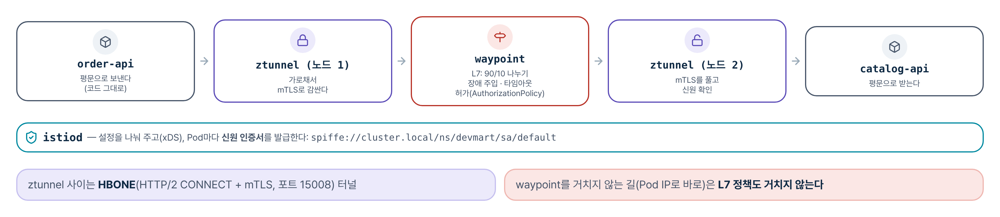

<sub>[🏠 과정 목차](../../README.md) › [4주차](../README.md) › [4일차](README.md) › 6/8교시</sub>

# 6교시 · mTLS STRICT와 호출 허가

> [!NOTE]
> **이번 시간에 할 일**
>
> - **PeerAuthentication STRICT**로 메시 밖의 평문 손님을 막습니다.
> - STRICT가 **입구(Envoy Gateway)까지 막아 버리는** 상황을 겪고 고칩니다.
> - **AuthorizationPolicy**로 "catalog-api는 devmart 안에서만 부를 수 있다"를 정합니다.
> - waypoint를 **우회하는 길**이 남아 있다는 한계를 압니다.

## 두 가지 질문

| 질문 | Istio 리소스 | 비유 |
|---|---|---|
| **신분증을 보여 줬나?** (인증) | PeerAuthentication — mTLS 필수인가 | 출입증 없는 사람은 건물에 못 들어온다 |
| **이 방에 들어와도 되나?** (허가) | AuthorizationPolicy — 누가 무엇을 | 출입증이 있어도 서버실은 허가된 사람만 |

3주차 5일차 Secret · 내일 RBAC의 "인증과 인가"와 같은 구분입니다.

## 실습 16 · STRICT (커밋) — 그리고 사고

3교시의 `plain` Pod(메시 밖)가 아직 catalog-api를 부를 수 있는지 다시 봅니다.

```bash
kubectl exec -n default plain -- curl -s -m 3 -o /dev/null -w '%{http_code}\n' catalog-api.devmart:8000/api/info
```

`200`입니다. STRICT를 넣습니다.

```bash
cat ~/devops-lab/k8s/w4d4/deploy/peer-auth.yaml
cd ~/devmart-deploy
cp ~/devops-lab/k8s/w4d4/deploy/peer-auth.yaml devmart/
sed -i 's/^  - waypoint.yaml.*/&\n  - peer-auth.yaml/' devmart/kustomization.yaml
git add . && git commit -m "devmart mTLS STRICT" && git push
sleep 60
kubectl exec -n default plain -- curl -s -m 3 -o /dev/null -w '%{http_code}\n' catalog-api.devmart:8000/api/info
curl -s -m 3 -o /dev/null -w '%{http_code}\n' localhost:30080/api/products
```

> **🟢 확인: 확인**
>
> ```text
> 000
> 503
> ```
> - `plain`은 `000` — 연결 자체가 끊겼습니다(curl의 `Connection reset`). 메시 밖의 평문은 이제 거절됩니다. **원하던 결과입니다.**
> - 그런데 **사이트도 503**입니다! 브라우저로 <http://localhost:30080>을 열면 상품이 안 나옵니다.

> [!WARNING]
> **무엇이 막혔나**
>
> 입구의 Envoy Gateway(`envoy-gateway-system` 네임스페이스)도 **메시 밖**입니다. 그래서 Envoy → web · catalog-api · order-api로 가는 요청이 `plain`과 똑같이 **평문**으로 취급되어 거절되었습니다. 메시 도입에서 가장 흔한 사고 — "**우리 서비스끼리는 되는데, 밖에서 들어오는 길이 막혔다**" — 입니다. STRICT를 켜기 전에 "**메시 밖에서 이 네임스페이스로 들어오는 것은 누구인가**"를 먼저 세어야 합니다. 3교시의 Kiali 지도와 ztunnel 로그가 그 목록을 줍니다.

## 실습 17 · 입구도 메시에 넣기

Envoy Gateway의 데이터 평면 Pod도 메시에 넣으면, Envoy → devmart 구간이 mTLS가 됩니다.

```bash
kubectl label namespace envoy-gateway-system istio.io/dataplane-mode=ambient
sleep 10
istioctl ztunnel-config workloads | grep envoy-gateway-system
curl -s -o /dev/null -w '%{http_code}\n' localhost:30080/api/products
```

> **🟢 확인: 확인**
>
> ```text
> envoy-gateway-system  envoy-devmart-devmart-…   10.244.2.11  devmart-worker2  None  HBONE
> envoy-gateway-system  envoy-gateway-…           10.244.1.9   devmart-worker   None  HBONE
> 200
> ```
> 사이트가 돌아왔습니다. 이번에는 Pod를 재시작할 필요도 없었습니다(ambient).

> [!TIP]
> **이 라벨은 왜 kubectl로?**
>
> `envoy-gateway-system`은 devmart가 아니라 **플랫폼**(1일차 Helm 설치)의 것입니다. 실무라면 플랫폼 저장소의 네임스페이스 정의나 Envoy Gateway의 Helm values에 넣습니다. 오늘 바꾼 플랫폼 쪽 명령은 `~/devops-lab/k8s/w4d4/platform-changes.md`에 한 줄씩 적어 두세요 — 3일차의 "기록 없는 변경"을 되풀이하지 않기 위해서입니다.

```bash
echo "- $(date +%F) envoy-gateway-system 네임스페이스에 istio.io/dataplane-mode=ambient (devmart STRICT 때문)" >> ~/devops-lab/k8s/w4d4/platform-changes.md
```

> [!TIP]
> **Prometheus는 왜 안 막혔나**
>
> 2일차의 Prometheus(monitoring, 메시 밖)는 devmart Pod를 **직접 긁지 않습니다**(앱에 /metrics가 없다). Envoy 지표는 envoy-gateway-system에서 긁는데, 그곳에는 STRICT를 걸지 않았습니다. Grafana 대시보드가 계속 그려지는지 확인합니다.

## 실습 18 · 호출 허가 (커밋)

이번에는 **메시 안에 있지만 devmart 밖인** 손님을 만듭니다 — 인증(mTLS)은 통과하는 손님입니다.

```bash
kubectl apply -f ~/devops-lab/k8s/w4d4/test/outsider.yaml
kubectl wait -n outsider --for=condition=Ready pod/client
kubectl exec -n outsider client -- curl -s -m 3 -o /dev/null -w '%{http_code}\n' catalog-api.devmart:8000/api/info
```

`200` — STRICT만으로는 **메시 안의 누구나** 부를 수 있습니다. 허가 규칙을 넣습니다.

```bash
cat ~/devops-lab/k8s/w4d4/deploy/catalog-authz.yaml
```

```yaml
apiVersion: security.istio.io/v1
kind: AuthorizationPolicy
metadata:
  name: catalog-api-allow
  namespace: devmart
spec:
  targetRefs:                   # catalog-api Service로 가는 호출에 — waypoint가 검사한다
    - group: ""
      kind: Service
      name: catalog-api
  action: ALLOW                 # 아래에 맞는 것만 허가, 나머지는 거절
  rules:
    - from:
        - source:
            namespaces: ["devmart"]
```

```bash
cd ~/devmart-deploy
cp ~/devops-lab/k8s/w4d4/deploy/catalog-authz.yaml devmart/
sed -i 's/^  - peer-auth.yaml.*/&\n  - catalog-authz.yaml/' devmart/kustomization.yaml
git add . && git commit -m "catalog-api는 devmart 안에서만" && git push
sleep 60
kubectl exec -n outsider client -- curl -s -m 3 -w '\n%{http_code}\n' catalog-api.devmart:8000/api/info
kubectl exec -n devmart client -- curl -s -m 3 -o /dev/null -w '%{http_code}\n' catalog-api:8000/api/info
curl -s -X POST localhost:30080/api/orders -H 'content-type: application/json' -d '{"product_id":1,"quantity":1}' -o /dev/null -w '%{http_code}\n'
```

> **🟢 확인: 확인**
>
> ```text
> RBAC: access denied
> 403
> 200
> 202
> ```
> - outsider → **403** — 신분은 확인됐지만(mTLS) **허가가 없습니다.** 응답 본문의 `RBAC: access denied`는 waypoint(Envoy)가 보낸 것입니다. catalog-api 앱은 이 요청을 받지도 않았습니다.
> - devmart의 client → 200, 주문(order-api → catalog-api) → 202. 허가된 손님은 그대로입니다.

> [!IMPORTANT]
> **허가는 '신원'으로 한다**
>
> 규칙에 IP가 없습니다. `namespaces: ["devmart"]`는 3교시에 본 **SPIFFE ID의 ns 부분**을 보고 판단합니다. Pod IP가 바뀌어도, Pod가 몇 개로 늘어도 규칙은 그대로입니다. 내일 ServiceAccount를 서비스마다 나누면 `principals: ["cluster.local/ns/devmart/sa/order-api"]`처럼 **"order-api만"**으로 좁힐 수 있습니다.

> [!WARNING]
> **우회하는 길 — waypoint를 거치지 않으면**
>
> 이 규칙은 **catalog-api Service로 가는 호출**을 waypoint에서 검사합니다. outsider가 Service 이름이 아니라 **Pod IP로 바로** 부르면 waypoint를 거치지 않아 검사도 거치지 않습니다(그림의 빨간 메모).
> ```bash
> IP=$(kubectl get pod -n devmart -l app=catalog-api -o jsonpath='{.items[0].status.podIP}')
> kubectl exec -n outsider client -- curl -s -m 3 -o /dev/null -w '%{http_code}\n' $IP:8000/api/info    # 200
> ```
> 이 길까지 막으려면 ztunnel이 검사하는 **L4 규칙**(`selector`로 Pod를 지목하고, waypoint와 입구의 신원만 허가)을 함께 두거나, 내일의 **NetworkPolicy**로 네트워크 단에서 막습니다. 보안은 **한 겹이 아니라 여러 겹**(심층 방어)입니다.



> **🎓 학술 노트 — 최소 권한과 심층 방어**
>
> Saltzer와 Schroeder의 *The Protection of Information in Computer Systems*(Proc. IEEE, 1975)는 보안 설계 원칙 여덟 가지를 제시했고, 그중 **최소 권한**(least privilege)과 **완전한 중재**(complete mediation, 모든 접근을 매번 검사)는 오늘의 AuthorizationPolicy가 그대로 따르는 원칙입니다. 우회 경로(Pod IP)는 '완전한 중재'가 깨진 지점이고, 그래서 여러 층의 방어 — **심층 방어**(defense in depth) — 가 필요합니다.

> **📈 트렌드 2026 — 정책을 코드로, 검증을 자동으로**
>
> AuthorizationPolicy가 수백 개가 되면 "지금 누가 무엇을 부를 수 있나"를 사람이 알기 어렵습니다. Istio 1.30은 AuthorizationPolicy의 정규식 처리 취약점(CVE-2026-39350)을 고쳤고, 정책을 배포 전에 시험하는 도구(`istioctl x authz check`, Kiali의 정책 검증)와, 실제 트래픽에서 **허가 규칙을 자동으로 제안**하는 기능이 주목받고 있습니다. 내일의 Kyverno처럼 "정책도 PR로 리뷰하고 시험한다"가 흐름입니다.

> **✅ 확인 문제**
>
> 1. PeerAuthentication과 AuthorizationPolicy는 각각 어떤 질문에 답하나요?
> 2. STRICT를 켜자 사이트가 503이 된 이유와 해결책은?
> 3. outsider가 403을 받았을 때 catalog-api 앱은 그 요청을 받았나요?
> 4. AuthorizationPolicy를 우회할 수 있는 길과 막는 방법은?
>
> <details><summary>정답</summary>
>
> 1. PeerAuthentication — mTLS(신원 증명)가 필수인가(인증), AuthorizationPolicy — 누가 부를 수 있나(허가)
> 2. 메시 밖인 Envoy Gateway가 평문으로 보냈기 때문. envoy-gateway-system을 메시에 넣었다
> 3. 받지 않았다 — waypoint가 먼저 거절했다
> 4. Pod IP로 바로 부르면 waypoint를 거치지 않는다. ztunnel L4 정책(selector)이나 NetworkPolicy를 함께 둔다
>
> </details>

## 참고 문헌

- Istio Docs. *PeerAuthentication*, *Authorization Policy*, *Ambient — Use Layer 7 / Layer 4 authorization policy*. istio.io
- Saltzer, J. H. & Schroeder, M. D. (1975). *The Protection of Information in Computer Systems*. Proceedings of the IEEE 63(9).
- Istio (2026-05-18). *ISTIO-SECURITY-2026 advisories (1.30.0)*. istio.io/news/security

---

| 이전 | 목차 | 다음 |
|:--|:--:|--:|
| ⬅️ [5교시 · 장애 주입 · 타임아웃 · 재시도](lesson-05.md) | [⬆️ 4일차 목차](README.md) | [7교시 · 메시 운영 판단](lesson-07.md) ➡️ |
