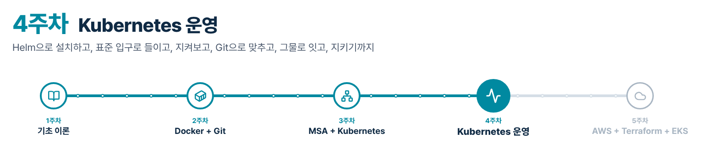

[🏠 과정 목차](../../README.md) › [4주차](../README.md) › [5일차](README.md)

# 4주차 5일차 — Kubernetes 보안

📕 4주차 이북 PDF: [보기](../../downloads/pdf/week4.pdf) · [내려받기](https://github.com/niceguy61/kdt_devops_lecture_2026_rev2/raw/main/downloads/pdf/week4.pdf) &nbsp;|&nbsp; 📊 5일차 슬라이드: [PPTX 내려받기](https://github.com/niceguy61/kdt_devops_lecture_2026_rev2/raw/main/downloads/pptx/week4-day5.pptx)

## 오늘의 목표

어제 배움일기의 마지막 질문은 "DevMart의 Pod들이 **모두 같은 신원**(sa/default)인데, 서비스마다 · 사람마다 할 수 있는 일을 어떻게 나눌까? 그리고 '이미지 태그 latest 금지' 같은 규칙은 누가 지키게 할까?"였습니다. 오늘은 **클러스터를 바꾸는 쪽**(사람 · 프로그램)과 **클러스터 안에서 오가는 쪽**(서비스) 모두에 "누가 무엇을 할 수 있나"를 정하고, 4주차 전체를 장애 훈련으로 묶습니다.

- apiserver 요청이 지나는 **세 관문** — 인증 · 인가 · 입장 제어 — 을 이해합니다.
- **RBAC**로 개발자는 읽기만, 당직자는 재시작까지 — 사람의 권한을 나눕니다.
- **ServiceAccount**를 서비스마다 만들고(Git), 필요 없는 토큰을 빼냅니다.
- 어제의 허가 규칙을 **서비스 신원**으로 좁히고, Pod IP 우회로를 막습니다.
- **Kyverno**로 "latest 금지 · limits 필수 · root 금지"를 정책으로 만들고, Audit → Deny 순서로 도입합니다.
- 4주차의 모든 층이 섞인 **종합 장애 훈련**에서 "**누가 거절했나**"를 찾습니다.
- 4주차를 회고하고 보안 점검표를 채웁니다.

## 시간표

| 교시 | 주제 | 실습 결과물 |
|---|---|---|
| 1교시 | 4일차 요약 + 세 관문 | 요청 하나의 길 |
| 2교시 | RBAC — 사람의 권한 | 개발자 읽기 전용 · 당직자 재시작 |
| 3교시 | ServiceAccount — 프로그램의 신원 | 서비스마다 SA, 토큰 빼기 |
| 4교시 | 서비스 신원으로 허가 | catalog-api는 order-api만, 우회로 막기 |
| 5교시 | Kyverno 정책 | Audit 보고서 → Deny, Argo CD가 막히는 장면 |
| 6교시 | 4주차 종합 장애 훈련 | 장애 보고서 |
| 7교시 | 4주차 회고 + 보안 점검표 | KPT · 점검표 |
| 8교시 | 배움일기 | |

## 교시별 자료

1. [4일차 요약 + 세 관문](lesson-01.md)
2. [RBAC — 사람의 권한](lesson-02.md)
3. [ServiceAccount — 프로그램의 신원](lesson-03.md)
4. [서비스 신원으로 허가](lesson-04.md)
5. [Kyverno 정책](lesson-05.md)
6. [4주차 종합 장애 훈련](lesson-06.md)
7. [4주차 회고 + 보안 점검표](lesson-07.md)

> [!IMPORTANT]
> **오늘 실습 전에 확인할 것**
>
> - Kyverno가 **약 0.3~0.5GB** 더 씁니다.
> - Argo CD 자동 동기화, Istio(STRICT · catalog-api 허가), Grafana가 모두 살아 있어야 합니다: `argocd app get devmart | grep Health`, `curl -s -o /dev/null -w '%{http_code}\n' localhost:30080/api/products`.
> - DevMart의 변경은 계속 **배포 저장소 커밋**입니다. 플랫폼(RBAC · Kyverno 정책)은 `kubectl apply`로 넣고 `platform-changes.md`에 적습니다.
> - 실습 파일은 강의 저장소의 `labs/week4/day5/`입니다.

---

| 이전 | 목차 | 다음 |
|:--|:--:|--:|
| ⬅️ [7교시 · 메시 운영 판단](../day4/lesson-07.md) | [⬆️ 4주차 목차](../README.md) | [1교시 · 4일차 요약 + 세 관문](lesson-01.md) ➡️ |
