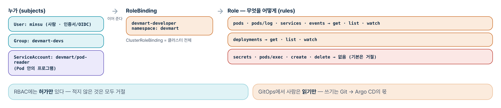

[🏠 과정 목차](../../README.md) › [4주차](../README.md) › [5일차](README.md)

# 2교시 · RBAC — 사람의 권한

> [!NOTE]
> **이번 시간에 할 일**
>
> - Role · ClusterRole · RoleBinding · ClusterRoleBinding의 관계를 이해합니다.
> - 개발자 그룹에 devmart **읽기 전용** 권한을 줍니다.
> - **가장(impersonation)**과 `kubectl auth can-i`로 권한을 시험합니다.
> - 당직자에게 **재시작만** 허락하고, GitOps에서 사람에게 쓰기 권한이 필요 없는 이유를 이해합니다.

## RBAC의 네 리소스



| 리소스 | 범위 | 하는 일 |
|---|---|---|
| **Role** | 네임스페이스 하나 | "devmart의 pods를 get · list · watch" 같은 **규칙 묶음** |
| **ClusterRole** | 클러스터 전체 (또는 여러 네임스페이스에서 재사용) | 노드 · 네임스페이스 같은 클러스터 리소스, 또는 공용 규칙 (`view` · `edit` · `admin` 기본 제공) |
| **RoleBinding** | 네임스페이스 하나 | 누구를 Role(또는 ClusterRole)에 **잇는다** — 그 네임스페이스에서만 |
| **ClusterRoleBinding** | 클러스터 전체 | 누구를 ClusterRole에 잇는다 — **모든 네임스페이스에서** |

규칙은 세 칸입니다 — **apiGroups**(어느 API 묶음) · **resources**(무엇에) · **verbs**(어떤 동사).

| 동사 | kubectl에서 |
|---|---|
| `get` · `list` · `watch` | `get`, `describe`, `logs`(+ `pods/log`), `-w` |
| `create` · `update` · `patch` · `delete` | `apply`, `edit`, `scale`, `rollout restart`(patch), `delete` |
| 하위 리소스 | `pods/log`(로그), `pods/exec`(exec), `deployments/scale` |

## 실습 2 · 개발자 읽기 전용

```bash
mkdir -p ~/devops-lab/k8s/w4d5 && cp -r ~/course/labs/week4/day5/* ~/devops-lab/k8s/w4d5/
cd ~/devops-lab/k8s/w4d5
cat rbac/devmart-developer.yaml
kubectl apply -f rbac/devmart-developer.yaml
echo "- $(date +%F) devmart-developer Role/RoleBinding (devmart-devs 그룹 읽기 전용)" >> ~/devops-lab/k8s/w4d4/platform-changes.md
```

규칙에 **없는 것**이 핵심입니다 — `secrets`, `pods/exec`, 그리고 쓰기 동사. RBAC에는 "거절" 규칙이 없고 **허가만** 있습니다. 적지 않은 것은 모두 거절입니다.

## 실습 3 · 가장해서 시험하기

실제 사용자를 만들려면 인증서를 발급하거나 회사 계정(OIDC)을 연결해야 합니다. 시험만 할 때는 관리자가 다른 사람을 **가장**(impersonate)할 수 있습니다 — `--as`(사용자) · `--as-group`(그룹).

```bash
D="--as=jane --as-group=devmart-devs"
kubectl auth can-i list pods -n devmart $D
kubectl auth can-i get pods --subresource=log -n devmart $D
kubectl auth can-i list secrets -n devmart $D
kubectl auth can-i delete pods -n devmart $D
kubectl auth can-i list pods -n monitoring $D
```

> **🟢 확인: 확인**
>
> ```text
> yes
> yes
> no
> no
> no
> ```

`can-i`는 "할 수 있나"를 물을 뿐입니다. 실제로 해 봅니다.

```bash
kubectl get pods -n devmart $D | head -3
kubectl logs -n devmart deploy/order-api --tail=1 $D
kubectl get secrets -n devmart $D
kubectl delete pod -n devmart -l app=web $D
kubectl auth can-i --list -n devmart $D | head -12
```

> **🟢 확인: 확인**
>
> ```text
> NAME                           READY   STATUS    RESTARTS   AGE
> catalog-api-5d8c7b9f6-2xkq4    1/1     Running   0          2d
> …
> {"event": "order_queued", …}
> Error from server (Forbidden): secrets is forbidden: User "jane" cannot list resource "secrets" in API group "" in the namespace "devmart"
> Error from server (Forbidden): pods "web-…" is forbidden: User "jane" cannot delete resource "pods" in API group "" in the namespace "devmart"
> Resources                                       Non-Resource URLs   Resource Names   Verbs
> selfsubjectreviews.authentication.k8s.io        []                  []               [create]
> pods/log                                        []                  []               [get list watch]
> pods                                            []                  []               [get list watch]
> …
> ```
> `Forbidden` 메시지는 **누가(jane) · 무엇을(list) · 어떤 리소스(secrets) · 어디서(devmart)**를 정확히 말해 줍니다. 6교시 "누가 거절했나"의 첫 번째 모양입니다.

> [!TIP]
> **가장 권한 자체도 RBAC다**
>
> `--as`가 되는 것은 내가 cluster-admin이라 `impersonate` 동사를 가졌기 때문입니다. 아무에게나 주면 그 사람이 cluster-admin을 가장할 수 있으므로, 가장 권한은 관리자에게만 둡니다.

## 실습 4 · 당직자는 재시작까지

장애 중 당직자(minsu)는 "Pod를 다시 띄우기"만 할 수 있어야 한다고 합시다.

```bash
cat rbac/oncall.yaml
kubectl apply -f rbac/oncall.yaml
O="--as=minsu"
kubectl rollout restart deploy/web -n devmart $O
kubectl scale deploy/web -n devmart --replicas=3 $O
kubectl get pods -n devmart $O
```

> **🟢 확인: 확인**
>
> ```text
> deployment.apps/web restarted
> Error from server (Forbidden): deployments.apps "web" is forbidden: User "minsu" cannot update resource "deployments/scale" …
> Error from server (Forbidden): pods is forbidden: User "minsu" cannot list resource "pods" …
> ```
> - `rollout restart`는 Deployment를 읽고(get) **재시작 시각 주석을 patch**하는 것이라 됩니다.
> - `scale`은 **다른 하위 리소스**(`deployments/scale`)라 안 됩니다.
> - minsu는 `devmart-devs` 그룹이 아니라 Pod 목록도 못 봅니다. 권한은 **더해집니다** — 실무에서는 당직자를 개발자 그룹에도 넣어 "읽기 + 재시작"을 갖게 합니다.

> [!WARNING]
> **재시작은 selfHeal과 싸우지 않나?**
>
> `rollout restart`는 Pod 템플릿에 **주석 하나**를 더합니다. Argo CD의 비교는 Git에 있는 필드만 보므로(3일차 3교시 학술 노트) 이 주석은 어긋남으로 치지 않습니다 — 재시작은 그대로 유지됩니다. 반면 `scale`은 Git의 replicas와 다르므로, 권한이 있었어도 selfHeal이 되돌렸을 것입니다.

## GitOps 시대의 사람 권한

```bash
kubectl auth can-i --list --as=system:serviceaccount:argocd:argocd-application-controller | head -5
kubectl get clusterrolebinding -o wide | grep -E "argocd|cluster-admin"
```

> **🟢 확인: 확인**
>
> ```text
> Resources   Non-Resource URLs   Resource Names   Verbs
> *.*         []                  []               [*]
>             [*]                 []               [*]
> …
> argocd-application-controller   ClusterRole/argocd-application-controller   …   argocd/argocd-application-controller
> cluster-admin                   ClusterRole/cluster-admin                   …   system:masters
> ```
> Argo CD의 컨트롤러는 **모든 것에 모든 동사** — 사실상 cluster-admin입니다. 클러스터를 바꾸는 것은 이 컨트롤러 하나이고, 컨트롤러는 **Git의 커밋**만 따릅니다.

| | 사람 | Argo CD |
|---|---|---|
| 클러스터 읽기 | ✓ (개발자 Role) | ✓ |
| 클러스터 쓰기 | ✗ — Git에 PR | ✓ |
| 쓰기의 통제 | PR 리뷰 · 브랜치 규칙 | AppProject로 "어느 저장소 → 어느 네임스페이스만" 제한 |
| 비상 | 당직자의 재시작 · break-glass 계정(기록 · 알림) | 자동 동기화 끄기 (3일차) |

그래서 GitOps에서 가장 귀한 열쇠는 **배포 저장소 쓰기 권한**(3일차 토큰)과 **Argo CD 관리자**입니다. Argo CD의 `default` AppProject는 제한이 없으므로, 실무에서는 팀마다 AppProject를 만들어 `destinations: devmart만`으로 좁힙니다.

> **❓ 오해 — 개발자에게 edit 권한을 줘야 일이 빨라진다**
>
> `edit`(기본 ClusterRole)를 주면 개발자가 `kubectl apply`로 바로 고칠 수 있습니다. 하지만 GitOps에서는 그 변경이 **selfHeal로 되돌려지거나**, 자동 동기화가 꺼진 곳에서는 **기록 없는 어긋남**이 됩니다. 빠른 길은 권한이 아니라 **짧은 PR 리뷰 시간**입니다.

> **🎓 학술 노트 — 최소 권한과 권한 상승**
>
> RBAC를 아무리 좁혀도 **권한 상승 경로**가 남을 수 있습니다. 예를 들어 Pod를 만들 수 있는 사람은 강한 ServiceAccount를 붙인 Pod를 만들어 그 권한을 빌릴 수 있고, RoleBinding을 만들 수 있는 사람은 자기에게 권한을 줄 수 있습니다. Kubernetes는 `escalate` · `bind` 동사로 뒤의 것을 막지만, 앞의 것은 입장 제어(5교시)가 막아야 합니다. Rahman 외의 *Security Misconfigurations in Kubernetes Manifests*(TOSEM 2023)는 오픈소스 매니페스트에서 과한 권한과 기본 ServiceAccount 남용이 가장 흔한 설정 결함임을 보였습니다.

> **📈 트렌드 2026 — 짧게 사는 권한**
>
> "당직자가 1시간만 cluster-admin"처럼 **요청할 때만 잠깐 주는 권한**(just-in-time access)이 표준이 되고 있습니다. Teleport · AWS IAM Identity Center 같은 도구가 승인 → 임시 권한 → 자동 회수 → 기록을 한 흐름으로 묶습니다. EKS는 Access Entries로 IAM 사용자 · 역할을 Kubernetes RBAC 그룹에 직접 잇습니다 — 5주차에 씁니다.

> **✅ 확인 문제**
>
> 1. Role과 ClusterRole, RoleBinding과 ClusterRoleBinding의 차이는?
> 2. 개발자 Role에 secrets가 없는데도 거절되는 이유는?
> 3. `rollout restart`는 되고 `scale`은 안 된 이유는?
> 4. GitOps에서 사람에게 쓰기 권한을 주지 않는 이유는?
>
> <details><summary>정답</summary>
>
> 1. Role · RoleBinding은 네임스페이스 하나, ClusterRole은 클러스터 리소스나 공용 규칙, ClusterRoleBinding은 모든 네임스페이스에 적용
> 2. RBAC는 허가만 있고, 적지 않은 것은 모두 거절이기 때문
> 3. restart는 deployments를 patch하고, scale은 deployments/scale이라는 다른 하위 리소스이기 때문
> 4. 쓰기는 Git → Argo CD로만 해야 기록이 남고 selfHeal과 충돌하지 않기 때문
>
> </details>

## 참고 문헌

- Kubernetes Docs. *Using RBAC Authorization*, *User-facing roles*, *Privilege escalation prevention*. kubernetes.io/docs
- Argo CD Docs. *Projects — AppProject destinations*. argo-cd.readthedocs.io
- Rahman, A. 외 (2023). *Security Misconfigurations in Open Source Kubernetes Manifests: An Empirical Study*. ACM TOSEM 32(4).
- AWS Docs. *Grant IAM users access to Kubernetes with EKS access entries*. docs.aws.amazon.com/eks

---

⬅️ 이전: [1교시 · 4일차 요약 + 세 관문](lesson-01.md) &nbsp;|&nbsp; [⬆️ 5일차 목차](README.md) &nbsp;|&nbsp; 다음: [3교시 · ServiceAccount — 프로그램의 신원](lesson-03.md) ➡️
