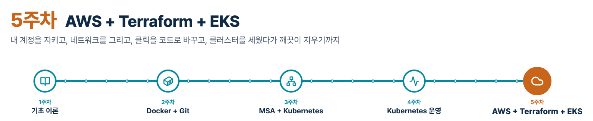

[🏠 과정 목차](../README.md)

# 5주차 · AWS + Terraform + EKS

📕 5주차 이북 PDF: [보기](../downloads/pdf/week5.pdf) · [내려받기](https://github.com/niceguy61/kdt_devops_lecture_2026_rev2/raw/main/downloads/pdf/week5.pdf)

    

| 일차 | 주제 | 교시 | 슬라이드 |
|:--|:--|:--|:--|
| [**1일차**](day1/README.md) | AWS 계정과 VPC 노트북에서 클라우드로 · 계정과 루트 지키기 · 예산 알림 · IAM 사용자 · 그룹 · 역할 · 정책 · aws login · VPC · 서브넷 · 라우팅 · 보안 그룹 | [1](day1/lesson-01.md) [2](day1/lesson-02.md) [3](day1/lesson-03.md) [4](day1/lesson-04.md) [5](day1/lesson-05.md) [6](day1/lesson-06.md) [7](day1/lesson-07.md) [8](day1/lesson-08.md) | [📊 PPTX](https://github.com/niceguy61/kdt_devops_lecture_2026_rev2/raw/main/downloads/pptx/week5-day1.pptx) |
| [**2일차**](day2/README.md) | EC2 · ALB · Auto Scaling · S3 컴퓨트 고르기 · IAM 역할을 붙인 EC2 · user data · Session Manager · 시작 템플릿 · Auto Scaling 그룹 · 대상 그룹과 ALB · 장애와 교체 · S3를 키 없이 · 지우는 순서 | [1](day2/lesson-01.md) [2](day2/lesson-02.md) [3](day2/lesson-03.md) [4](day2/lesson-04.md) [5](day2/lesson-05.md) [6](day2/lesson-06.md) [7](day2/lesson-07.md) [8](day2/lesson-08.md) | [📊 PPTX](https://github.com/niceguy61/kdt_devops_lecture_2026_rev2/raw/main/downloads/pptx/week5-day2.pptx) |
| [**3일차**](day3/README.md) | Terraform 기초 코드로 인프라 · init · plan · apply · destroy · 변수와 for_each · 자원 사이의 참조 · state와 어긋남 · import · 원격 state와 잠금 · 모듈로 VPC · GitHub Actions에서 키 없이 plan | [1](day3/lesson-01.md) [2](day3/lesson-02.md) [3](day3/lesson-03.md) [4](day3/lesson-04.md) [5](day3/lesson-05.md) [6](day3/lesson-06.md) [7](day3/lesson-07.md) [8](day3/lesson-08.md) | [📊 PPTX](https://github.com/niceguy61/kdt_devops_lecture_2026_rev2/raw/main/downloads/pptx/week5-day3.pptx) |
| [**4일차**](day4/README.md) | Terraform으로 EKS EKS의 구조와 비용 · VPC + NAT + EKS 모듈 · 관리형 노드 그룹 · 애드온 · Access Entry와 Pod Identity · Load Balancer Controller · NLB 앞의 Envoy Gateway · EBS · 같은 배포 저장소를 EKS에 · 지우는 순서 | [1](day4/lesson-01.md) [2](day4/lesson-02.md) [3](day4/lesson-03.md) [4](day4/lesson-04.md) [5](day4/lesson-05.md) [6](day4/lesson-06.md) [7](day4/lesson-07.md) [8](day4/lesson-08.md) | [📊 PPTX](https://github.com/niceguy61/kdt_devops_lecture_2026_rev2/raw/main/downloads/pptx/week5-day4.pptx) |
| [**5일차**](day5/README.md) | 통합 · 장애 · 정리 · 회고 5주 지도 · 아침의 재현(up.sh) · 커밋 하나, 클러스터 둘 · 노드와 AZ 장애 · 상태 있는 것의 자리 · 전부 지우기와 남은 것 찾기 · 비용 보고 · 5주 회고 · 다음 걸음 | [1](day5/lesson-01.md) [2](day5/lesson-02.md) [3](day5/lesson-03.md) [4](day5/lesson-04.md) [5](day5/lesson-05.md) [6](day5/lesson-06.md) [7](day5/lesson-07.md) [8](day5/lesson-08.md) | [📊 PPTX](https://github.com/niceguy61/kdt_devops_lecture_2026_rev2/raw/main/downloads/pptx/week5-day5.pptx) |

교시 칸의 숫자는 교시 번호입니다. 처음이라면 1일차 목차부터 열고, 각 페이지 맨 아래의 <b>다음 ➡️</b>를 따라가세요.
