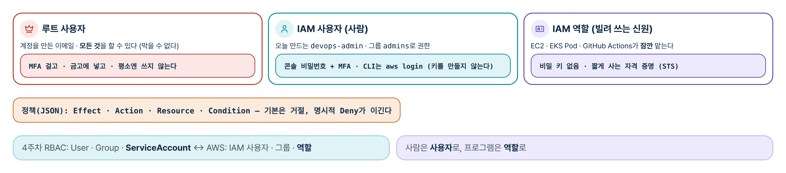

<sub>[🏠 과정 목차](../../README.md) › [5주차](../README.md) › [1일차](README.md) › 3/7교시</sub>

# 3교시 · IAM — 사용자 · 그룹 · 역할 · 정책

> [!NOTE]
> **이번 시간에 할 일**
>
> - IAM의 네 가지 — **사용자 · 그룹 · 역할 · 정책** — 를 4주차 RBAC와 짝지어 이해합니다.
> - 정책 JSON을 **한 줄씩 읽는** 법과, 허가 · 거절이 정해지는 순서를 익힙니다.
> - 매일 쓸 **관리자 사용자** `devops-admin`을 그룹으로 만들고 MFA를 겁니다.
> - 그 사용자로 다시 로그인하고, 이후로는 루트를 쓰지 않습니다.

## 네 가지



| IAM | 뜻 | 4주차 Kubernetes에서 |
|---|---|---|
| **사용자** (User) | 사람 한 명 — 콘솔 비밀번호, (필요하면) 접속 키 | User (인증서 · OIDC) |
| **그룹** (Group) | 사용자 묶음 — 정책을 그룹에 붙인다 | Group (`devmart-devs`) |
| **역할** (Role) | 누군가 **잠깐 맡는** 신원 — 영구 비밀번호 · 키가 없다 | **ServiceAccount** (Pod가 맡는 신원) |
| **정책** (Policy) | 무엇을 할 수 있나 — JSON 문서 | Role의 rules |
| 정책을 붙이기 | 사용자 · 그룹 · 역할에 연결 | RoleBinding |

## 정책 읽기

```bash
mkdir -p ~/devops-lab/aws/w5d1 && cp -r ~/course/labs/week5/day1/* ~/devops-lab/aws/w5d1/
cat ~/devops-lab/aws/w5d1/s3-read-only-policy.json
```

```json
{
  "Version": "2012-10-17",
  "Statement": [
    { "Sid": "ListMyBuckets", "Effect": "Allow", "Action": ["s3:ListAllMyBuckets"], "Resource": "*" },
    { "Sid": "ReadOneBucket", "Effect": "Allow",
      "Action": ["s3:GetObject", "s3:ListBucket"],
      "Resource": ["arn:aws:s3:::devmart-assets-YOUR_ID", "arn:aws:s3:::devmart-assets-YOUR_ID/*"] },
    { "Sid": "NeverDelete", "Effect": "Deny", "Action": ["s3:DeleteObject", "s3:DeleteBucket"], "Resource": "*" }
  ]
}
```

| 칸 | 뜻 | 4주차 Role의 |
|---|---|---|
| `Version` | 정책 문법 버전 — 언제나 `2012-10-17` (날짜가 아니라 문법 이름) | — |
| `Effect` | `Allow` 또는 `Deny` | (Allow만 있었다) |
| `Action` | `서비스:동작` — `s3:GetObject` | verbs + resources |
| `Resource` | 대상의 **ARN** — AWS 자원의 전체 주소 | resourceNames |
| `Condition` | (선택) "MFA로 로그인했을 때만", "서울 리전에서만" | — |

> **📖 ARN (Amazon Resource Name)**
>
> AWS 자원의 전체 이름입니다. `arn:aws:s3:::devmart-assets-niceguy61/*` = "S3의 devmart-assets-niceguy61 버킷 안의 모든 객체". 일반적인 모양은 `arn:aws:서비스:리전:계정번호:자원` 이고, S3처럼 전 세계에서 이름이 하나인 서비스는 리전 · 계정 칸이 비어 있습니다.

### 허가 · 거절이 정해지는 순서

1. 기본은 **거절**(암묵적 거절) — 4주차 RBAC와 같다.
2. 붙은 정책 중 하나라도 **명시적 Deny**에 맞으면 → **거절**. 끝.
3. 아니면, 하나라도 **Allow**에 맞으면 → 허가.
4. 아무것에도 맞지 않으면 → 거절.

위 정책에서 `s3:DeleteObject`는 Allow 목록에 없으니 어차피 거절이지만, **Deny 문장**이 있어서 나중에 누가 이 사용자에게 `AdministratorAccess`를 더 붙여도 **삭제만은 여전히 막힙니다.** Deny가 언제나 이기기 때문입니다. RBAC에는 없던 도구입니다.

## 실습 5 · 관리자 그룹과 사용자 (루트로)

지금은 루트로 로그인되어 있습니다. **루트가 할 마지막 일**입니다.

검색창 `IAM` → **IAM**.

**① 그룹**
1. 왼쪽 **사용자 그룹** → **그룹 생성**
2. 이름 `admins`
3. 권한 정책 연결에서 `AdministratorAccess` 검색 → 체크 → **그룹 생성**

**② 사용자**
1. 왼쪽 **사용자** → **사용자 생성**
2. 이름 `devops-admin`
3. **AWS Management Console에 대한 사용자 액세스 권한 제공** 체크 → **IAM 사용자를 생성하고 싶음**
4. 콘솔 암호: **사용자 지정 암호** — 길고 유일하게, **다음 로그인 시 새 암호 생성** 체크 해제
5. 다음 → **그룹에 사용자 추가** → `admins` 체크 → 다음 → **사용자 생성**
6. 마지막 화면의 **콘솔 로그인 URL**을 복사해 둡니다 (`https://123456789012.signin.aws.amazon.com/console` 모양)

**③ 계정 별칭** (로그인 URL을 외우기 쉽게)
1. IAM **대시보드** → 오른쪽 **AWS 계정** 칸의 **계정 별칭** → **생성** → `devops-lab-이름` (전 세계에서 유일해야 한다)
2. 로그인 URL이 `https://devops-lab-이름.signin.aws.amazon.com/console`이 됩니다.

> **🟢 확인: 확인**
>
> IAM → 사용자 → `devops-admin` → **그룹** 탭에 `admins`, **권한** 탭에 `AdministratorAccess (그룹: admins)`가 보입니다. 권한을 **사용자에게 직접** 붙이지 않고 그룹을 통했습니다 — 사람이 늘면 그룹에 넣기만 하면 됩니다(4주차 `devmart-devs` 그룹과 같은 이유).

## 실습 6 · devops-admin으로 갈아타기

1. 오른쪽 위 → **로그아웃**
2. 위의 **계정 별칭 로그인 URL**로 접속 → 사용자 이름 `devops-admin`, 암호
3. 로그인 후 오른쪽 위 이름 → **보안 자격 증명** → **MFA 디바이스 할당** → 실습 2와 같은 방법(이름 `devops-admin-mfa`)
4. 로그아웃 → 다시 로그인 → MFA 확인

> **🟢 확인: 확인**
>
> 오른쪽 위에 `devops-admin @ devops-lab-이름`이 보입니다. **이제부터 루트로는 로그인하지 않습니다.** 루트 비밀번호는 비밀번호 관리자에.

> [!WARNING]
> **AdministratorAccess도 강하다**
>
> `devops-admin`은 결제 설정 같은 몇 가지를 빼면 거의 모든 것을 할 수 있습니다. 실습 계정이니 괜찮지만, 회사에서는 사람에게 관리자를 상시로 주지 않고 **필요할 때만 역할을 맡는**(assume role) 방식을 씁니다 — 4주차 5일차 트렌드의 'JIT 권한'입니다.

## 역할 — 키 없는 신원

역할에는 비밀번호도 키도 없습니다. 대신 정책이 **둘** 붙습니다.

| 정책 | 묻는 것 | 예 |
|---|---|---|
| **신뢰 정책** (trust policy) | **누가** 이 역할을 맡을 수 있나 | "EC2 서비스", "이 GitHub 저장소의 Actions" |
| **권한 정책** (permission policy) | 맡은 동안 **무엇을** 할 수 있나 | "devmart-assets 버킷 읽기" |

맡으면 **STS**(Security Token Service)가 **몇 분 ~ 몇 시간짜리 임시 자격 증명**을 줍니다. 내일 EC2에 역할을 붙여 키 없이 S3를 읽고(2일차), 3일차에 GitHub Actions가 역할을 맡아 Terraform을 돌리고, 4일차에 EKS의 Pod가 역할을 맡습니다(Pod Identity). 4주차 3교시의 "**비밀 키를 넣지 말고 신원을 증명해 짧은 권한을 받는다**"의 AWS판입니다.

> **❓ 오해 — 서버에 접속 키를 넣으면 간단하다**
>
> EC2 · 컨테이너에 사용자 접속 키(`AKIA…`)를 넣는 것은 3주차 5일차의 "비밀번호를 이미지에 굽기"와 같은 실수입니다. 키는 **만료되지 않고**, 코드 · 이미지 · 로그를 따라 **새어 나가며**, GitHub에 올라간 키는 몇 분 안에 자동 수집기가 찾아 악용합니다. 프로그램에는 언제나 **역할**을 씁니다.

> **🎓 학술 노트 — 정책 평가의 자동 검증**
>
> IAM 정책은 사람이 읽기에 단순해 보여도, 수백 개가 겹치면 "이 버킷을 **밖에서** 읽을 수 있는 경로가 있나?"에 답하기 어렵습니다. AWS는 이 질문을 **SMT 풀이기**(수학적 논리 검증기)로 푸는 도구 Zelkova를 만들었고, Backes 외의 *Semantic-based Automated Reasoning for AWS Access Policies using SMT*(FMCAD 2018)에 정리했습니다. 오늘날 IAM Access Analyzer와 S3의 "퍼블릭" 표시가 이 기술 위에서 동작합니다 — 정책을 **실행해 보지 않고 증명으로** 검사하는 사례입니다.

> **📈 트렌드 2026 — 장기 키의 퇴장**
>
> AWS는 2025년 11월 `aws login`(4교시)으로 개인 개발자도 **접속 키 없이** CLI를 쓰게 했고, IAM 콘솔은 사용자 접속 키를 만들 때 "더 나은 대안"을 먼저 권합니다. CI는 OIDC로 역할을 맡고(3일차), Pod는 Pod Identity로 역할을 맡습니다(4일차). "**사람은 로그인, 기계는 역할, 영구 키는 없음**"이 2026년의 기본값입니다.

> **✅ 확인 문제**
>
> 1. IAM 역할과 Kubernetes ServiceAccount가 닮은 점은?
> 2. 정책에서 Allow와 Deny가 둘 다 맞으면 결과는?
> 3. 권한을 사용자에게 직접이 아니라 그룹으로 준 이유는?
> 4. 역할에 붙는 두 정책의 차이는?
>
> <details><summary>정답</summary>
>
> 1. 사람이 아니라 프로그램(EC2 · Pod)이 맡는 신원이고, 영구 비밀이 없다
> 2. 거절 — 명시적 Deny가 언제나 이긴다
> 3. 사람이 늘거나 바뀌어도 그룹에 넣고 빼기만 하면 되도록 (역할 기반)
> 4. 신뢰 정책은 누가 맡을 수 있나, 권한 정책은 맡은 동안 무엇을 할 수 있나
>
> </details>

## 참고 문헌

- AWS Docs. *IAM identities*, *Policy evaluation logic*, *IAM JSON policy elements reference*. docs.aws.amazon.com/IAM
- AWS Docs. *Amazon Resource Names (ARNs)*. docs.aws.amazon.com
- Backes, J. 외 (2018). *Semantic-based Automated Reasoning for AWS Access Policies using SMT*. FMCAD 2018.

---

| 이전 | 목차 | 다음 |
|:--|:--:|--:|
| ⬅️ [2교시 · 계정 만들기와 루트 지키기](lesson-02.md) | [⬆️ 1일차 목차](README.md) | [4교시 · AWS CLI와 aws login](lesson-04.md) ➡️ |
