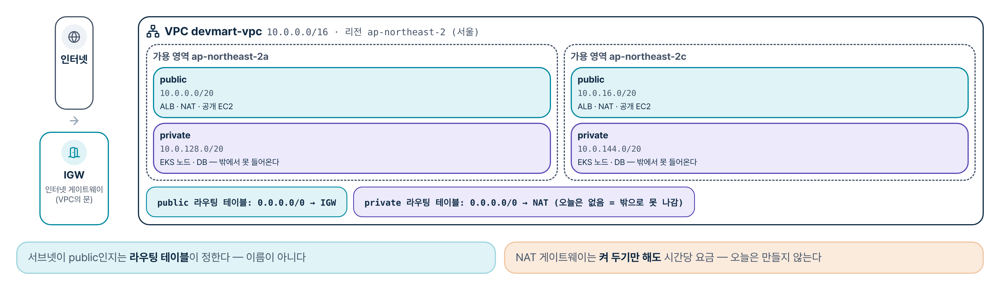

[🏠 과정 목차](../../README.md) › [5주차](../README.md) › [1일차](README.md)

# 5교시 · VPC의 구성 요소

> [!NOTE]
> **이번 시간에 할 일**
>
> - **VPC**가 무엇이고, 1주차 3일차의 네트워크 지식과 어떻게 이어지는지 압니다.
> - 서브넷 · 라우팅 테이블 · 인터넷 게이트웨이 · NAT 게이트웨이의 역할을 구분합니다.
> - **public 서브넷과 private 서브넷**의 차이가 무엇으로 정해지는지 압니다.
> - DevMart용 VPC를 **종이에 먼저** 설계합니다.

## VPC — 클라우드 안의 내 네트워크

**VPC**(Virtual Private Cloud)는 AWS 안에 만드는 **나만의 사설 네트워크**입니다. 1주차 3일차에 집 공유기 아래의 사설망(192.168.0.0/24)을 봤다면, VPC는 그것을 **리전 크기로** 키운 것입니다. 다른 계정 · 다른 VPC와는 기본으로 **격리**됩니다.



| 구성 요소 | 하는 일 | 1주차 · 4주차에서 |
|---|---|---|
| **VPC** | 주소 범위(CIDR) 하나 — `10.0.0.0/16` = 65,536개 | 1주차 3일차 CIDR · 사설 IP |
| **서브넷** | VPC를 쪼갠 조각, **가용 영역 하나에** 속한다 | kind의 노드마다 Pod 대역(10.244.1.0/24 …) |
| **라우팅 테이블** | "이 목적지는 저 문으로" — 서브넷마다 하나 연결 | 1주차 3일차 라우터 |
| **인터넷 게이트웨이 (IGW)** | VPC와 인터넷 사이의 **문** — VPC에 하나 | 공유기의 WAN 포트 |
| **NAT 게이트웨이** | private 서브넷이 **밖으로 나갈 수만** 있게 (들어오지는 못한다) | 1주차 3일차 NAT |
| **VPC 엔드포인트** | 인터넷을 거치지 않고 S3 · ECR 등 AWS 서비스로 가는 **샛길** | — |

## public과 private를 가르는 것

서브넷 이름에 public이 붙었다고 public이 되는 것이 아닙니다. **그 서브넷의 라우팅 테이블**이 정합니다.

| | public 서브넷 | private 서브넷 |
|---|---|---|
| 라우팅 테이블의 `0.0.0.0/0` | → **IGW** | → **NAT** (또는 없음) |
| 밖에서 들어오기 | 공인 IP가 있으면 **가능** | **불가능** |
| 밖으로 나가기 | 가능 | NAT가 있으면 가능, 없으면 불가능 |
| 두는 것 | 로드 밸런서, NAT, 접속용 서버 | **앱 서버 · EKS 노드 · DB** |

> [!IMPORTANT]
> **왜 앱을 private에 두나**
>
> DevMart의 db · catalog-api가 인터넷에서 **직접** 보이면, 4주차에 쌓은 Gateway · 허가 규칙을 우회하는 길이 하나 더 생깁니다. 그래서 손님이 닿는 곳(로드 밸런서)만 public에, 나머지는 private에 둡니다. 4주차의 "입구는 하나"를 **네트워크 수준**에서 지키는 것입니다.

## 가용 영역을 둘 쓰는 이유

1주차 1일차: 가용 영역(AZ) = 전기 · 냉방 · 네트워크가 **독립된** 데이터센터 묶음. 서브넷은 AZ 하나에 속하므로, 한 AZ가 멈춰도 서비스가 살려면 **같은 역할의 서브넷을 AZ마다** 둡니다. EKS는 **서로 다른 AZ의 서브넷 둘 이상**을 요구합니다(4일차). 3주차 3일차에 노드를 셋 둔 이유를 데이터센터 크기로 키운 것입니다.

## 실습 10 · 종이에 설계

DevMart용 VPC를 이렇게 정합니다. 6교시에 콘솔 마법사가 거의 같은 값을 제안합니다.

| 항목 | 값 | 이유 |
|---|---|---|
| 이름 | `devmart` | 마법사가 `devmart-vpc`, `devmart-subnet-public1-…`처럼 붙인다 |
| CIDR | `10.0.0.0/16` | 넉넉하게 — EKS는 Pod마다 VPC IP를 쓴다(4일차) |
| AZ | `ap-northeast-2a`, `ap-northeast-2c` | 둘 |
| public 서브넷 | `10.0.0.0/20`, `10.0.16.0/20` (각 4,096개) | ALB · NAT |
| private 서브넷 | `10.0.128.0/20`, `10.0.144.0/20` | EKS 노드 · Pod |
| NAT 게이트웨이 | **오늘은 없음** | 시간당 요금 — 4일차 Terraform으로 만들었다 지운다 |
| S3 게이트웨이 엔드포인트 | 있음 | **무료** — private에서 S3로 가는 샛길 |

```bash
python3 - <<'PY'
import ipaddress
v = ipaddress.ip_network("10.0.0.0/16")
for s in ["10.0.0.0/20", "10.0.16.0/20", "10.0.128.0/20", "10.0.144.0/20"]:
    n = ipaddress.ip_network(s)
    print(f"{s:16} 주소 {n.num_addresses:>5}개  VPC 안? {n.subnet_of(v)}  첫 주소 {n[0]} ~ 끝 {n[-1]}")
PY
```

> **🟢 확인: 확인**
>
> ```text
> 10.0.0.0/20      주소  4096개  VPC 안? True  첫 주소 10.0.0.0 ~ 끝 10.0.15.255
> 10.0.16.0/20     주소  4096개  VPC 안? True  첫 주소 10.0.16.0 ~ 끝 10.0.31.255
> 10.0.128.0/20    주소  4096개  VPC 안? True  첫 주소 10.0.128.0 ~ 끝 10.0.143.255
> 10.0.144.0/20    주소  4096개  VPC 안? True  첫 주소 10.0.144.0 ~ 끝 10.0.159.255
> ```
> 네 서브넷이 겹치지 않고 VPC 안에 들어갑니다. AWS는 서브넷마다 **5개**(첫 네 개와 마지막 하나)를 예약하므로 실제로 쓸 수 있는 것은 4,091개입니다.

> [!WARNING]
> **CIDR은 나중에 바꾸기 어렵다**
>
> VPC CIDR을 너무 작게(예: /24) 잡으면 EKS Pod가 늘 때 IP가 모자랍니다. 또 회사 네트워크 · 다른 VPC와 **겹치면** 나중에 연결(피어링 · VPN)할 수 없습니다. 1주차 3일차의 사설 대역 중 겹치지 않을 범위를 팀이 미리 정해 두는 것이 실무입니다.

## 기본 VPC는?

4교시에 본 `172.31.0.0/16` 기본 VPC는 계정마다 리전마다 하나씩 자동으로 있습니다. 모든 서브넷이 **public**이고, 띄우는 서버가 **자동으로 공인 IP**를 받습니다. 시작하기는 쉽지만 "앱은 private에"를 지킬 수 없어서, 이번 주는 **쓰지 않고** 내 VPC를 만듭니다. 지우지는 않습니다(일부 서비스가 기본값으로 찾는다).

> **❓ 오해 — private 서브넷이면 안전하다**
>
> private은 **밖에서 직접 들어오는 길**이 없다는 뜻입니다. 같은 VPC 안의 다른 서버, 뚫린 public 서버, 잘못 열린 로드 밸런서를 통해서는 여전히 닿을 수 있습니다. 서브넷은 첫 번째 울타리이고, 보안 그룹(7교시) · 4주차의 메시 정책이 다음 울타리입니다 — 심층 방어.

> **🎓 학술 노트 — 가상 네트워크의 탄생**
>
> 한 물리 네트워크 위에 서로 격리된 여러 논리 네트워크를 만드는 기술은 VLAN(IEEE 802.1Q, 1998)에서 시작해, 데이터센터 규모에서는 **오버레이**(VXLAN, RFC 7348, 2014)와 **SDN**(4주차 4일차 OpenFlow)으로 발전했습니다. AWS VPC는 2009년에 공개되었고, 그 내부 구조(Mapping Service · Nitro 카드의 패킷 처리)는 AWS re:Invent 발표 *A Day in the Life of a Billion Packets*(2013 · 2018)로 일부 알려졌습니다. 우리가 클릭 몇 번으로 '라우터'와 '서브넷'을 만드는 일 뒤에는 이 오버레이가 있습니다.

> **📈 트렌드 2026 — IPv6와 공인 IPv4 요금**
>
> AWS는 2024년 2월부터 **모든 공인 IPv4 주소에 시간당 요금**을 받기 시작했습니다(1교시 표). 그래서 공인 IP를 줄이는 설계 — 앱은 private에, 밖으로 나가는 것은 NAT 하나로, 가능하면 **IPv6 · 듀얼 스택** — 이 비용 면에서도 권장됩니다. EKS도 IPv6 클러스터를 지원합니다. 이번 주는 IPv4로 하되, 공인 IP 개수를 매일 확인합니다.

> **✅ 확인 문제**
>
> 1. 서브넷이 public인지 private인지 정하는 것은?
> 2. NAT 게이트웨이와 인터넷 게이트웨이의 차이는?
> 3. 같은 역할의 서브넷을 AZ마다 두는 이유는?
> 4. VPC CIDR을 정할 때 조심할 두 가지는?
>
> <details><summary>정답</summary>
>
> 1. 그 서브넷에 연결된 라우팅 테이블의 0.0.0.0/0 행선지 (IGW인가)
> 2. IGW는 VPC와 인터넷의 양방향 문, NAT는 private에서 밖으로 나가기만 하게 해 준다
> 3. 한 AZ가 멈춰도 다른 AZ에서 서비스가 살도록 (EKS는 둘 이상 요구)
> 4. 너무 작게 잡지 않기(EKS Pod IP), 다른 네트워크와 겹치지 않기
>
> </details>

## 참고 문헌

- AWS Docs. *How Amazon VPC works*, *Subnets for your VPC*, *Example routing options*. docs.aws.amazon.com/vpc
- Mahalingam, M. 외 (2014). *RFC 7348 Virtual eXtensible Local Area Network (VXLAN)*. IETF.
- AWS (2023-07-28). *New – AWS Public IPv4 Address Charge*. aws.amazon.com/blogs/aws

---

⬅️ 이전: [4교시 · AWS CLI와 aws login](lesson-04.md) &nbsp;|&nbsp; [⬆️ 1일차 목차](README.md) &nbsp;|&nbsp; 다음: [6교시 · 콘솔로 VPC 만들기](lesson-06.md) ➡️
