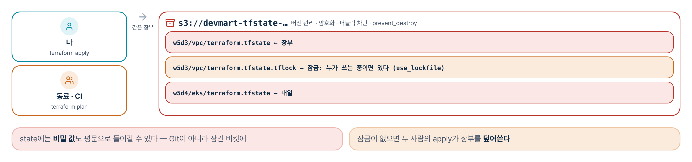

<sub>[🏠 과정 목차](../../README.md) › [5주차](../README.md) › [3일차](README.md) › 5/7교시</sub>

# 5교시 · 원격 state와 잠금

> [!NOTE]
> **이번 시간에 할 일**
>
> - state를 내 노트북이 아니라 **S3**에 두는 이유를 이해합니다.
> - state를 담을 버킷을 Terraform으로 만듭니다(**닭과 달걀** 문제와 함께).
> - 02-hcl의 state를 S3로 **옮깁니다**.
> - 두 터미널에서 동시에 plan해 **잠금**이 동작하는 것을 봅니다.

## 왜 원격인가



| 로컬 state의 문제 | 원격(S3) state |
|---|---|
| 내 노트북이 사라지면 장부도 사라진다 — 만든 것을 지울 방법이 없다 | 버킷에 **버전 관리**까지 |
| 동료 · CI가 같은 인프라를 다룰 수 없다 | 모두가 **같은 장부** |
| 동시에 apply하면 서로 덮어쓴다 | **잠금** — 한 번에 하나만 |
| 비밀 값이 노트북 파일에 평문 | **암호화** · 접근 권한 |

## 실습 7 · state 버킷 만들기

state 버킷을 Terraform으로 만들면, 그 Terraform의 state는 어디에 두나요? — **닭과 달걀**입니다. 실무에서는 이 버킷 하나만 **로컬 state**로 만들고(또는 콘솔로 만들고), 나머지 모든 프로젝트가 이 버킷을 씁니다.

```bash
cd ~/devops-lab/aws/w5d3/terraform/03-backend
ID=$(gh api user -q .login | tr 'A-Z' 'a-z')
terraform init
terraform apply -var owner=$ID
```

> **🟢 확인: 확인**
>
> ```text
> Plan: 4 to add, 0 to change, 0 to destroy.
> …
> Apply complete! Resources: 4 added, 0 changed, 0 destroyed.
> Outputs:
> bucket = "devmart-tfstate-niceguy61"
> ```
> 버킷 + 버전 관리 + 암호화 + 공개 차단 = 4. 이 프로젝트의 장부는 이 폴더의 `terraform.tfstate`(로컬)에 남습니다 — 지우지 마세요.

코드의 이 부분을 짚습니다.

```hcl
resource "aws_s3_bucket" "tfstate" {
  bucket = "devmart-tfstate-${var.owner}"
  lifecycle {
    prevent_destroy = true      # 이 버킷을 지우는 plan은 오류로 막는다
  }
}
```

```bash
terraform plan -destroy -var owner=$ID 2>&1 | grep -A2 "Instance cannot be destroyed"
```

> **🟢 확인: 확인**
>
> ```text
> │ Error: Instance cannot be destroyed
> │ Resource aws_s3_bucket.tfstate has lifecycle.prevent_destroy set, but the plan calls for this resource to be destroyed.
> ```
> 모든 장부가 들어갈 버킷이라 **실수로 지울 수 없게** 했습니다. 마지막 날 지울 때는 이 줄을 지우고 합니다.

## 실습 8 · 02-hcl의 state를 S3로 옮기기

`02-hcl/versions.tf`의 `terraform { … }` 안에 backend 블록을 더합니다.

```bash
cd ../02-hcl
python3 - <<PY
p='versions.tf'; s=open(p).read()
s=s.replace('  required_version = ">= 1.15"', '''  required_version = ">= 1.15"

  backend "s3" {
    bucket       = "devmart-tfstate-$ID"
    key          = "w5d3/hcl/terraform.tfstate"
    region       = "ap-northeast-2"
    use_lockfile = true
    encrypt      = true
  }''',1)
open(p,'w').write(s)
PY
head -12 versions.tf
terraform init -migrate-state
```

> **🟢 확인: 확인**
>
> ```text
> Initializing the backend...
> Do you want to copy existing state to the new backend?
>   Pre-existing state was found while migrating the previous "local" backend to the
>   newly configured "s3" backend. …
>   Enter a value: yes
>
> Successfully configured the backend "s3"! Terraform will automatically
> use this backend unless the backend configuration changes.
> ```

```bash
aws s3 ls s3://devmart-tfstate-$ID/ --recursive
mv terraform.tfstate /tmp/old-local.tfstate      # 이제 로컬 장부는 쓰지 않는다
terraform plan | tail -1
```

> **🟢 확인: 확인**
>
> ```text
> 2026-12-01 13:42:10      15873 w5d3/hcl/terraform.tfstate
> No changes. Your infrastructure matches the configuration.
> ```
> 장부가 버킷으로 옮겨졌고, Terraform은 이제 거기서 읽습니다.

> **📖 backend**
>
> state를 **어디에 두고 어떻게 잠글지** 정하는 설정입니다. `s3`, `gcs`, `azurerm`, HCP Terraform 등이 있습니다. `key`는 버킷 안의 **경로**라서, 프로젝트마다 다른 key를 주면 버킷 하나에 여러 장부를 둘 수 있습니다(그림의 w5d3/vpc, w5d4/eks).

## 실습 9 · 잠금 충돌

터미널을 둘 엽니다. 둘 다 `02-hcl` 폴더에서.

```bash
# 터미널 A — apply를 시작하고 'yes'를 치지 않고 기다린다 (잠금을 쥔 채)
terraform apply
```

```bash
# 터미널 B
aws s3 ls s3://devmart-tfstate-$(gh api user -q .login | tr 'A-Z' 'a-z')/w5d3/hcl/
terraform plan
```

> **🟢 확인: 확인 — 터미널 B**
>
> ```text
> 2026-12-01 13:42:10      15873 terraform.tfstate
> 2026-12-01 13:45:02        412 terraform.tfstate.tflock
> ╷
> │ Error: Error acquiring the state lock
> │
> │ Error message: operation error S3: PutObject, … PreconditionFailed …
> │ Lock Info:
> │   ID:        6f1c2a9e-…
> │   Path:      devmart-tfstate-niceguy61/w5d3/hcl/terraform.tfstate
> │   Operation: OperationTypeApply
> │   Who:       me@my-laptop
> │   Created:   2026-12-01 04:45:01 UTC
> ```
> A가 쥔 **`.tflock` 파일**이 보이고, B는 "누가 · 무엇을 · 언제부터" 쥐고 있는지 알려 주며 거절당합니다. 터미널 A에서 `no`를 치면 잠금이 풀립니다.

> [!WARNING]
> **잠금이 남았을 때**
>
> apply 중에 노트북이 꺼지면 `.tflock`이 남아 아무도 못 할 수 있습니다. 그때는 **정말로 아무도 쓰고 있지 않은지 확인한 뒤** `terraform force-unlock <Lock ID>`를 씁니다. 확인 없이 풀면 두 apply가 겹쳐 장부가 깨질 수 있습니다.

> **❓ 오해 — 잠금에는 DynamoDB 테이블이 필요하다**
>
> 2024년까지의 교재는 S3 backend에 **DynamoDB 테이블**로 잠금을 걸었습니다. Terraform 1.10부터 S3의 **조건부 쓰기**만으로 잠그는 `use_lockfile = true`가 생겼고, 1.11부터 DynamoDB 방식은 폐기 예정입니다. 오늘 쓴 것이 새 방식입니다.

> **🎓 학술 노트 — 조건부 쓰기와 낙관적 동시성**
>
> `use_lockfile`은 S3가 2024년에 추가한 **조건부 쓰기**(`If-None-Match: *` — 그 이름의 객체가 없을 때만 쓴다)를 이용합니다. 이것은 데이터베이스의 **비교 후 교환**(compare-and-swap), Kung과 Robinson의 *On Optimistic Methods for Concurrency Control*(ACM TODS, 1981)이 정리한 **낙관적 동시성 제어**와 같은 원리입니다 — 먼저 쓴 쪽이 이기고, 늦은 쪽은 실패를 확인하고 물러난다. 별도의 잠금 서버 없이 저장소의 원자적 연산 하나로 잠금을 만든 것입니다.

> **📈 트렌드 2026 — state도 플랫폼으로**
>
> 큰 조직은 state를 버킷에 직접 두기보다 HCP Terraform · Spacelift 같은 **플랫폼**에 맡겨, 잠금 · 이력 · 권한 · 정책 검사 · 비용 예측을 한곳에서 다룹니다. OpenTofu는 **state 암호화**를 내장해(1.7+) 버킷 권한이 새도 state를 읽지 못하게 하는 기능을 먼저 넣었습니다.

> **✅ 확인 문제**
>
> 1. 원격 state가 해결하는 문제 넷은?
> 2. state 버킷 자체를 만드는 Terraform의 state는 어디에 두나요?
> 3. `prevent_destroy`가 막은 것은?
> 4. 잠금이 남았을 때 force-unlock 전에 확인할 것은?
>
> <details><summary>정답</summary>
>
> 1. 노트북 분실 시 장부 소실, 협업 불가, 동시 apply 덮어쓰기, 비밀 값 평문 보관
> 2. 로컬(또는 콘솔로 만든다) — 닭과 달걀 문제라 이 하나만 예외
> 3. 그 버킷을 지우는 plan 자체를 오류로 막았다
> 4. 정말로 아무도 apply 중이 아닌지 — 겹치면 장부가 깨진다
>
> </details>

## 참고 문헌

- HashiCorp. *Backend Type: s3 — State Locking (use_lockfile)*, *terraform force-unlock*. developer.hashicorp.com/terraform
- AWS (2024-08-20). *Amazon S3 now supports conditional writes*. aws.amazon.com/about-aws/whats-new
- Kung, H. T. & Robinson, J. T. (1981). *On Optimistic Methods for Concurrency Control*. ACM TODS 6(2).

---

| 이전 | 목차 | 다음 |
|:--|:--:|--:|
| ⬅️ [4교시 · state · 어긋남 · import](lesson-04.md) | [⬆️ 3일차 목차](README.md) | [6교시 · 모듈로 VPC](lesson-06.md) ➡️ |
