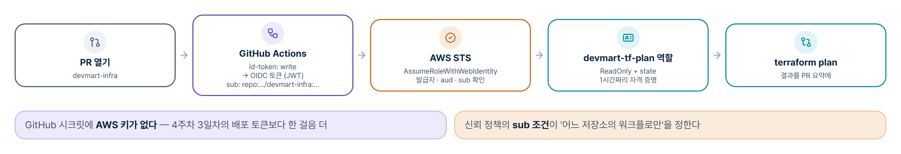

[🏠 과정 목차](../../README.md) › [5주차](../README.md) › [3일차](README.md)

# 7교시 · GitHub Actions에서 plan (OIDC)

> [!NOTE]
> **이번 시간에 할 일**
>
> - GitHub Actions가 **AWS 키 없이** 역할을 맡는 OIDC의 흐름을 이해합니다.
> - 그 역할(읽기 전용 + state)을 **Terraform으로** 만듭니다.
> - 인프라 저장소 `devmart-infra`를 만들고, PR마다 **fmt · validate · plan**이 돌게 합니다.
> - 오늘 만든 것을 정리합니다.

## OIDC — 키 없는 CI

4주차 3일차에 CI가 배포 저장소에 쓰려고 **토큰**을 GitHub 시크릿에 넣었습니다. 오늘은 한 걸음 더 갑니다 — **아무 비밀도 넣지 않습니다.**



1. 워크플로가 `id-token: write` 권한으로 GitHub에게 **OIDC 토큰**(JWT)을 받습니다. 토큰에는 "어느 저장소 · 어느 브랜치 · 어느 이벤트의 워크플로인가"(`sub`)가 서명되어 있습니다.
2. AWS STS에 그 토큰을 내밀며 역할을 맡겠다고 합니다(`AssumeRoleWithWebIdentity`).
3. STS는 ① 발급자가 내 계정에 등록된 GitHub인지, ② `aud`가 `sts.amazonaws.com`인지, ③ `sub`가 **신뢰 정책의 조건**에 맞는지 확인하고, 1시간짜리 자격 증명을 줍니다.

4주차 5일차의 ServiceAccount 토큰(JWT) → apiserver, 1일차의 역할 → STS가 **조직 경계를 넘어** 이어진 것입니다.

## 실습 14 · plan 역할 만들기

```bash
cd ~/devops-lab/aws/w5d3/terraform/05-github-oidc
ID=$(gh api user -q .login | tr 'A-Z' 'a-z')
GH=$(gh api user -q .login)
sed -i "s/YOUR_ID/$ID/" main.tf
grep -n -A3 'StringLike' main.tf
terraform init
terraform apply -var github_owner=$GH -var state_bucket=devmart-tfstate-$ID
```

> **🟢 확인: 확인**
>
> ```text
>       test     = "StringLike"
>       variable = "token.actions.githubusercontent.com:sub"
>       values   = ["repo:${var.github_owner}/devmart-infra:*"] # 이 저장소의 워크플로만
> …
> Plan: 5 to add, 0 to change, 0 to destroy.
> …
> Outputs:
> plan_role_arn = "arn:aws:iam::123456789012:role/devmart-tf-plan"
> ```
> 역할은 **ReadOnlyAccess**(계정 읽기)와 **state 버킷 읽기 · 쓰기**(잠금 파일을 써야 하므로)만 가집니다. plan은 되지만 **apply는 할 수 없습니다** — 인프라를 바꾸는 권한은 여전히 사람에게 있습니다.

> [!WARNING]
> **sub 조건을 빼면**
>
> `sub` 조건이 없으면 **GitHub의 아무 저장소**의 워크플로나 이 역할을 맡을 수 있습니다 — 내 계정 번호와 역할 이름만 알면. 실제로 이 실수로 계정이 노출된 사례들이 보고되었습니다. 신뢰 정책은 **저장소까지**(가능하면 브랜치 · 환경까지) 좁힙니다.

## 실습 15 · 인프라 저장소와 PR plan

```bash
cd ~
gh repo create devmart-infra --public --clone --description "DevMart 인프라 (Terraform)"
cd devmart-infra
mkdir -p terraform .github/workflows
cp -r ~/devops-lab/aws/w5d3/terraform/04-vpc terraform/
cp ~/devops-lab/aws/w5d3/terraform/.gitignore terraform/
rm -rf terraform/04-vpc/.terraform
cp ~/devops-lab/aws/w5d3/workflows/terraform-plan.yml .github/workflows/
gh variable set AWS_PLAN_ROLE_ARN --body "$(cd ~/devops-lab/aws/w5d3/terraform/05-github-oidc && terraform output -raw plan_role_arn)"
git add . && git status --short
git commit -m "VPC 코드와 PR plan 워크플로" && git push -u origin main
```

> **🟢 확인: 확인**
>
> ```text
> A  .github/workflows/terraform-plan.yml
> A  terraform/.gitignore
> A  terraform/04-vpc/.terraform.lock.hcl
> A  terraform/04-vpc/main.tf
> A  terraform/04-vpc/outputs.tf
> A  terraform/04-vpc/versions.tf
> ```
> `.terraform/`과 state는 **없습니다**(`.gitignore`). 잠금 파일은 있습니다. `gh variable`은 **시크릿이 아니라 변수**입니다 — 역할 ARN은 비밀이 아니니까요.

이제 인프라를 바꾸는 PR을 엽니다 — VPC에 태그 하나.

```bash
git switch -c vpc-tag
sed -i 's/  enable_dns_support   = true/  enable_dns_support   = true\n\n  tags = { Day = "w5d3" }/' terraform/04-vpc/main.tf
terraform -chdir=terraform/04-vpc fmt
git commit -am "VPC에 Day 태그" && git push -u origin vpc-tag
gh pr create --fill
gh pr checks --watch
```

> **🟢 확인: 확인**
>
> ```text
> ✓  plan    1m12s
> ```
> PR → **Checks** → `terraform-plan` → 실행 화면 아래 **Summary**에 plan 끝부분이 보입니다.
> ```text
> terraform plan — 04-vpc
>   # module.vpc.aws_vpc.this[0] will be updated in-place
>   ~ resource "aws_vpc" "this" {
>       ~ tags     = {
>           + "Day"  = "w5d3"
> …
> Plan: 0 to add, 9 to change, 0 to destroy.
> ```
> 태그 하나가 모듈의 **여러 자원**(VPC · 서브넷 · 라우팅 테이블 …)에 퍼져 9개가 바뀝니다 — 리뷰어가 코드만 보면 알 수 없는 것을 plan이 알려 줍니다. 그리고 이 모든 것이 **AWS 키 없이** 일어났습니다.

> [!TIP]
> **apply는 누가?**
>
> 오늘은 PR에서 plan만 보고, 합친 뒤 apply는 **사람이 로컬에서** 합니다. 다음 단계는 ① 합치면 CI가 apply(쓰기 권한 역할을 `main` 브랜치에만 신뢰), ② Atlantis · HCP Terraform처럼 PR 댓글로 apply — 둘 다 결국 **OIDC로 맡는 역할**의 신뢰 정책을 브랜치 · 환경으로 좁히는 일입니다. 4주차 3일차의 "CI는 클러스터 열쇠가 없다"를 AWS로 넓히는 설계 문제입니다.

PR은 합치지 않고 닫습니다(오늘 VPC는 곧 지웁니다): `gh pr close --delete-branch`.

## 실습 16 · 정리

| 무엇 | 오늘 | 이유 |
|---|---|---|
| 02-hcl 버킷들 | **destroy** | 연습용 |
| 04-vpc VPC | **destroy** | 내일 EKS 코드가 NAT까지 있는 VPC를 따로 만든다 |
| 03-backend state 버킷 | 남긴다 | 내일 · 모레의 장부 (무료에 가깝다) |
| 05-github-oidc 역할 | 남긴다 | 무료, 내일 plan에도 쓸 수 있다 |
| `devmart-infra` 저장소 | 남긴다 | 내일 EKS 코드를 여기에 |

```bash
cd ~/devops-lab/aws/w5d3/terraform/02-hcl && terraform destroy -auto-approve | tail -1
cd ../04-vpc && terraform destroy -auto-approve | tail -1
aws s3 ls | grep devmart
aws ec2 describe-vpcs --query 'Vpcs[].[Tags[?Key==`Name`]|[0].Value,IsDefault]' --output text
~/devops-lab/aws/w5d1/check-account.sh | tail -4
```

> **🟢 확인: 확인**
>
> ```text
> Destroy complete! Resources: 7 destroyed.
> Destroy complete! Resources: 22 destroyed.
> 2026-12-01 13:40:55 devmart-tfstate-niceguy61
> None    True
> (돈이 나가는 것 — 빈 줄)
> ```
> 2일차에 순서를 고민하며 여섯 줄로 지운 것보다 훨씬 많은 자원이 **명령 두 줄**로, 의존 역순으로 지워졌습니다.

> **❓ 오해 — CI에서 Terraform을 돌리려면 관리자 키가 필요하다**
>
> plan은 **읽기** 권한과 state 접근만 있으면 됩니다. 쓰기 권한 역할은 `main` 브랜치의 apply 단계에만, 그것도 OIDC로 짧게 줍니다. "CI에 관리자 영구 키"는 2026년에는 사고 보고서에나 나오는 구성입니다.

> **🎓 학술 노트 — 연합 신원**
>
> OIDC(OpenID Connect, 2014)는 OAuth 2.0(RFC 6749) 위에 **신원 토큰**(JWT, RFC 7519)을 더한 표준입니다. 한 조직(GitHub)이 발급한 신원을 다른 조직(AWS)이 **비밀을 공유하지 않고** 믿게 하는 것을 **연합 신원**(federated identity)이라 하고, Maler와 Reed의 *The Venn of Identity*(IEEE S&P Magazine, 2008)가 그 설계 공간을 정리했습니다. 워크로드끼리의 연합 — CI ↔ 클라우드, Pod ↔ 클라우드(내일) — 이 2020년대 클라우드 보안의 중심이 되었습니다.

> **📈 트렌드 2026 — 정책을 PR에서**
>
> PR의 plan 결과에 ① 보안 검사(Checkov · Trivy: "0.0.0.0/0에 22번", "암호화 없는 버킷"), ② 비용 예측(Infracost: "+$43/월"), ③ 조직 정책(OPA · Sentinel: "t3.medium보다 큰 인스턴스 금지")을 자동으로 붙이는 것이 표준 파이프라인이 되었습니다. 4주차 5일차의 "PR 단계 검사 + 입장 제어" 이중 구조가 클라우드 인프라에도 그대로 옵니다.

> **✅ 확인 문제**
>
> 1. OIDC로 역할을 맡을 때 STS가 확인하는 셋은?
> 2. plan 역할이 apply를 할 수 없는 이유와, 그렇게 둔 이유는?
> 3. 신뢰 정책에서 sub 조건을 빼면 무슨 일이 생기나요?
> 4. 태그 한 줄이 9개 자원의 변경이 된 것을 무엇이 알려 주었나요?
>
> <details><summary>정답</summary>
>
> 1. 발급자(GitHub OIDC)가 계정에 등록되어 있나, aud가 sts.amazonaws.com인가, sub가 조건(저장소)에 맞나
> 2. ReadOnlyAccess와 state 접근만 있기 때문. 인프라를 바꾸는 권한은 사람(또는 main 브랜치 apply)에게만 두려고
> 3. GitHub의 아무 저장소의 워크플로나 이 역할을 맡을 수 있게 된다
> 4. PR에서 자동으로 돈 terraform plan (모듈이 태그를 여러 자원에 퍼뜨린 결과)
>
> </details>

> [!NOTE]
> **오늘의 배움일기**
>
> - 콘솔 · CLI 스크립트 · Terraform을 한 줄씩, 어제의 경험을 예로
> - plan 기호 넷(+ ~ - -/+) 중 가장 무서운 것과 그 이유
> - 콘솔에서 바꾼 버전 관리 · 태그를 plan이 잡은 장면 — Argo CD의 OutOfSync와 무엇이 같고 다른가
> - state를 S3에 두고 잠금을 건 이유 셋
> - GitHub Actions가 키 없이 AWS에 들어간 순서를 그림으로
> - 내일 전에 궁금한 것: 오늘 VPC는 22개 자원이었다. **EKS 클러스터**를 코드로 만들면 몇 개일까? 그 위에 4주차의 DevMart를 **그대로** 올릴 수 있을까?

## 참고 문헌

- GitHub Docs. *Configuring OpenID Connect in Amazon Web Services*. docs.github.com/actions/security-for-github-actions
- AWS Docs. *Create an OpenID Connect (OIDC) identity provider in IAM*, *AssumeRoleWithWebIdentity*. docs.aws.amazon.com
- Sakimura, N. 외 (2014). *OpenID Connect Core 1.0*. OpenID Foundation.
- Maler, E. & Reed, D. (2008). *The Venn of Identity: Options and Issues in Federated Identity Management*. IEEE Security & Privacy 6(2).

---

⬅️ 이전: [6교시 · 모듈로 VPC](lesson-06.md) &nbsp;|&nbsp; [⬆️ 3일차 목차](README.md) &nbsp;|&nbsp; 다음: [5주차 4일차 목차](../day4/README.md) ➡️
