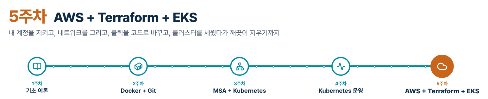

[🏠 과정 목차](../../README.md) › [5주차](../README.md) › [4일차](README.md)

# 5주차 4일차 — Terraform으로 EKS

📕 5주차 이북 PDF: [보기](../../downloads/pdf/week5.pdf) · [내려받기](https://github.com/niceguy61/kdt_devops_lecture_2026_rev2/raw/main/downloads/pdf/week5.pdf) &nbsp;|&nbsp; 📊 4일차 슬라이드: [PPTX 내려받기](https://github.com/niceguy61/kdt_devops_lecture_2026_rev2/raw/main/downloads/pptx/week5-day4.pptx)

## 오늘의 목표

어제 배움일기의 마지막 질문은 "**EKS 클러스터**를 코드로 만들면 몇 개 자원일까? 그 위에 4주차의 DevMart를 **그대로** 올릴 수 있을까?"였습니다. 오늘 둘 다 확인합니다. 3주차 3일차에 `kind create cluster` 한 줄로 만든 것을 이번에는 **AWS에 진짜로** 만들고, 4주차의 배포 저장소를 그 위에 올립니다.

- EKS가 **무엇을 대신 운영하고**, 무엇을 내가 만드는지 구분하고 비용을 계산합니다.
- Terraform 모듈로 **VPC(NAT 포함) + EKS + 노드 그룹 + 애드온**을 만듭니다.
- 사람이 클러스터에 들어가는 길(**Access Entry**)과 Pod가 AWS에 들어가는 길(**Pod Identity**)을 이해합니다.
- **AWS Load Balancer Controller** · **EBS CSI** · **Envoy Gateway** · **Argo CD**로 '플랫폼'을 올립니다.
- 배포 저장소에 `eks/` 폴더 하나를 더해, **같은 매니페스트**로 DevMart를 EKS에 배포합니다.
- Kubernetes가 만든 AWS 자원(NLB · EBS)까지 포함해 **빠짐없이 지웁니다.**

## 시간표

| 교시 | 주제 | 실습 결과물 |
|---|---|---|
| 1교시 | 3일차 요약 + EKS의 구조 | 오늘의 그림 · 비용표 |
| 2교시 | 코드 읽기와 apply | `terraform apply` 시작 (15~20분) |
| 3교시 | 기다리는 동안 — 신원 두 방향 · kubeconfig | `kubectl get nodes` |
| 4교시 | 플랫폼 올리기 | gp3 · LBC · Envoy Gateway(NLB) · Argo CD |
| 5교시 | 같은 배포 저장소를 EKS에 | 인터넷 주소로 열리는 DevMart |
| 6교시 | 클라우드에서 달라진 것 | Pod IP · NLB · EBS를 AWS 쪽에서 보기 |
| 7교시 | 지우는 순서 | 앱 → 입구 → `terraform destroy` |
| 8교시 | 배움일기 | |

## 교시별 자료

1. [3일차 요약 + EKS의 구조](lesson-01.md)
2. [코드 읽기와 apply](lesson-02.md)
3. [기다리는 동안 — 신원 두 방향 · kubeconfig](lesson-03.md)
4. [플랫폼 올리기](lesson-04.md)
5. [같은 배포 저장소를 EKS에](lesson-05.md)
6. [클라우드에서 달라진 것](lesson-06.md)
7. [지우는 순서](lesson-07.md)

> [!WARNING]
> **오늘은 시간당 약 $0.3 — 하루 약 $2**
>
> EKS 컨트롤 플레인 $0.10 + NAT $0.059 + 노드 t3.medium × 2 $0.104 + NLB · 공인 IP. 크레딧에서 나갑니다. **7교시에 반드시 지웁니다.** 수업이 끝나기 전에 지우지 못하면 강사에게 알립니다.

> [!IMPORTANT]
> **오늘 실습 전에 확인할 것**
>
> - `aws login`, `terraform version`(1.15+), `kubectl`, `helm`, `argocd` CLI.
> - 3일차의 state 버킷 `devmart-tfstate-<ID>`와 저장소 `devmart-infra`가 있어야 합니다.
> - 4주차의 배포 저장소 `devmart-deploy`(Argo CD가 보던 것)와 GHCR 이미지(공개)가 그대로여야 합니다.
> - kind 클러스터는 오늘 **꺼 두어도** 됩니다(노트북 메모리 절약). 내일 다시 씁니다.

---

| 이전 | 목차 | 다음 |
|:--|:--:|--:|
| ⬅️ [7교시 · GitHub Actions에서 plan (OIDC)](../day3/lesson-07.md) | [⬆️ 5주차 목차](../README.md) | [1교시 · 3일차 요약 + EKS의 구조](lesson-01.md) ➡️ |
