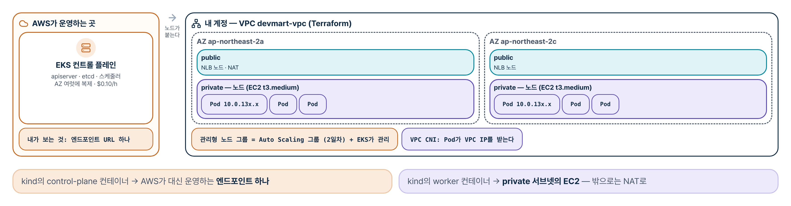

<sub>[🏠 과정 목차](../../README.md) › [5주차](../README.md) › [4일차](README.md) › 1/7교시</sub>

# 1교시 · 3일차 요약 + EKS의 구조

> [!NOTE]
> **이번 시간에 할 일**
>
> - 3일차에 남긴 것(state 버킷 · plan 역할 · devmart-infra)을 확인합니다.
> - EKS에서 **AWS가 운영하는 것**과 **내가 만드는 것**을 나눕니다.
> - kind와 EKS를 짝지어, 무엇이 '플랫폼'이고 무엇이 '앱'인지 정합니다.
> - 오늘의 비용을 계산하고, 지우는 시각을 정해 둡니다.

## 3일차 요약 — 손으로 다시 확인

```bash
ID=$(gh api user -q .login | tr 'A-Z' 'a-z')
aws s3 ls s3://devmart-tfstate-$ID/ --recursive
aws iam get-role --role-name devmart-tf-plan --query Role.Arn --output text
gh repo view $ID/devmart-infra --json name -q .name
~/devops-lab/aws/w5d1/check-account.sh | tail -4
```

> **🟢 확인: 이렇게 나오면 준비 완료**
>
> ```text
> … w5d3/github-oidc/terraform.tfstate
> … w5d3/hcl/terraform.tfstate
> … w5d3/vpc/terraform.tfstate
> arn:aws:iam::123456789012:role/devmart-tf-plan
> devmart-infra
> (돈이 나가는 것 — 빈 줄)
> ```
> 어제 destroy한 프로젝트의 state 파일은 **빈 장부**로 남아 있습니다(자원 0개). 지워도 되지만 이력으로 둡니다.

| 3일차 | 오늘 이어지는 곳 |
|---|---|
| VPC 모듈 (NAT 없음) | 같은 모듈 + **NAT 하나** + 로드 밸런서용 서브넷 표시 |
| 원격 state + 잠금 | `w5d4/eks/` 장부 |
| OIDC로 키 없는 CI | Pod Identity로 **키 없는 Pod** |
| plan을 읽는 습관 | 오늘 plan은 **수십 개** — 무엇을 봐야 하나 (2교시) |

## EKS — 누가 무엇을



| | AWS가 운영 | 내가 만든다 (오늘 Terraform) |
|---|---|---|
| 컨트롤 플레인 | apiserver · etcd · 스케줄러 · 컨트롤러 — **여러 AZ에 복제**, 패치 · 백업 | 버전 선택, 엔드포인트 공개 여부 |
| 노드 | (관리형 노드 그룹이면) AMI · 교체 · 업그레이드 도움 | 인스턴스 유형 · 개수 · 서브넷 |
| 네트워크 | — | VPC · 서브넷 · NAT · 보안 그룹 |
| 애드온 | 버전 · 설치를 EKS가 관리 | 무엇을 켤지 (CNI · DNS · CSI …) |
| 그 위의 모든 것 | — | Ingress · 모니터링 · GitOps · 앱 (4 · 5교시) |

3주차 3일차의 kind와 짝지으면:

| kind (3 · 4주차) | EKS (오늘) |
|---|---|
| `devmart-control-plane` 컨테이너 | AWS가 운영하는 **엔드포인트 하나** — 노드 목록에 보이지 않는다 |
| `devmart-worker` · `worker2` 컨테이너 | **관리형 노드 그룹**의 EC2 2대 (2일차의 Auto Scaling 그룹) |
| kindnet (Pod 네트워크) | **VPC CNI** — Pod가 VPC 주소를 받는다 (6교시) |
| `extraPortMappings` 30080 | **NLB** (4교시) |
| 노드의 폴더 (local-path) | **EBS** 볼륨 (4 · 6교시) |
| kind가 준 관리자 인증서 | **IAM 신원** + Access Entry (3교시) |

> [!IMPORTANT]
> **플랫폼과 앱**
>
> 위 표의 오른쪽 아래 다섯 줄은 모두 **플랫폼**(클러스터를 쓸 수 있게 하는 것)입니다. 4주차의 배포 저장소에 든 **앱**(Deployment · Service · HTTPRoute · 이미지)은 **바뀌지 않습니다.** 오늘의 핵심 확인이 이것입니다 — 플랫폼만 갈아 끼우면 앱은 그대로 옮겨 간다.

## 오늘의 비용

| 자원 | 시간당 | 오늘 6시간 |
|---|---|---|
| EKS 컨트롤 플레인 | $0.10 | $0.60 |
| NAT 게이트웨이 (+ 공인 IP) | $0.059 + $0.005 | $0.38 |
| 노드 t3.medium × 2 (+ EBS 20GB × 2) | $0.104 | $0.64 |
| NLB (+ 공인 IP × 2) | $0.0225 + $0.01 | $0.20 |
| EBS gp3 (db PVC 1GB) | ≈ 0 | ≈ 0 |
| 합계 | **약 $0.30** | **약 $1.8** |

> [!WARNING]
> **지우는 시각을 먼저 정한다**
>
> 오늘 7교시 시작에 `cleanup.sh` → `terraform destroy`를 합니다. 노트북 배터리 · 네트워크가 끊길 일이 있으면 그 전에 지웁니다. **잊으면 하루 $7, 한 달 $200** — 크레딧을 다 씁니다.

> **❓ 오해 — EKS를 쓰면 Kubernetes 운영이 필요 없다**
>
> EKS가 맡는 것은 **컨트롤 플레인**입니다. 노드 · 네트워크 · 입구 · 스토리지 · 모니터링 · 업그레이드 계획 · 앱의 보안은 여전히 우리 몫입니다 — 4주차 전체가 그 일이었습니다. 컨트롤 플레인까지 덜어 내려면 EKS **Auto Mode**(노드 · 일부 애드온까지 AWS가 관리)를 고르지만, 오늘은 무엇이 있는지 **보이게** 관리형 노드 그룹을 씁니다.

> **🎓 학술 노트 — 관리형 서비스의 책임 경계**
>
> 1주차 1일차의 **공유 책임 모델**은 서비스 종류마다 경계가 다릅니다. IaaS(EC2)에서는 OS부터 고객 몫이고, EKS 같은 **관리형 쿠버네티스**에서는 컨트롤 플레인이 공급자 몫으로 넘어갑니다. Burns 외(2016)가 말한 "컨테이너 오케스트레이션은 운영의 경계를 앱 쪽으로 옮긴다"가 클라우드 계약서에서는 이 책임표로 나타납니다. AWS의 *EKS Best Practices Guide*는 이 경계를 보안 · 신뢰성 · 비용 장별로 정리한 실무 문서입니다.

> **📈 트렌드 2026 — EKS의 갈래**
>
> EKS는 ① 관리형 노드 그룹(오늘), ② **Auto Mode**(2024, 노드 · 로드 밸런서 · 스토리지까지 AWS가 관리), ③ **Karpenter**(Pod 요구에 맞춰 EC2를 사고판다), ④ Fargate(서버 없는 Pod), ⑤ **EKS Capabilities**(2025, Argo CD · ACK 등을 관리형으로)로 넓어졌습니다. 1.36(2026년 6월 지원)이 오늘 쓰는 버전입니다. 어떤 갈래든 오늘 배우는 VPC · IAM · 로드 밸런서 · 스토리지의 원리는 같습니다.

> **✅ 확인 문제**
>
> 1. EKS에서 AWS가 운영하는 것과 내가 만드는 것을 둘씩?
> 2. kind의 control-plane 컨테이너는 EKS에서 무엇이 되나요?
> 3. '플랫폼'과 '앱'의 차이와, 오늘 바뀌지 않는 쪽은?
> 4. 오늘 가장 비싼 자원 둘은?
>
> <details><summary>정답</summary>
>
> 1. AWS: 컨트롤 플레인(apiserver · etcd), 애드온 관리. 나: VPC · 노드 그룹 · 입구 · 스토리지 · 앱
> 2. AWS가 운영하는 엔드포인트 하나 — 노드 목록에 보이지 않는다
> 3. 플랫폼은 클러스터를 쓸 수 있게 하는 것(입구 · 스토리지 · 신원), 앱은 배포 저장소의 매니페스트. 앱이 바뀌지 않는다
> 4. 노드(EC2 2대)와 EKS 컨트롤 플레인 (그다음 NAT)
>
> </details>

## 참고 문헌

- AWS Docs. *What is Amazon EKS?*, *Amazon EKS pricing*. docs.aws.amazon.com/eks
- AWS. *Amazon EKS Best Practices Guide*. docs.aws.amazon.com/eks/latest/best-practices
- AWS (2026-06-02). *Amazon EKS and Amazon EKS Distro now supports Kubernetes version 1.36*. aws.amazon.com/about-aws/whats-new

---

| 이전 | 목차 | 다음 |
|:--|:--:|--:|
| ⬅️ [5주차 4일차 목차](README.md) | [⬆️ 4일차 목차](README.md) | [2교시 · 코드 읽기와 apply](lesson-02.md) ➡️ |
