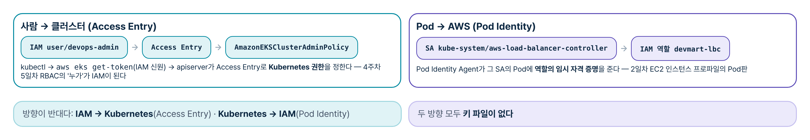

<sub>[🏠 과정 목차](../../README.md) › [5주차](../README.md) › [4일차](README.md) › 3/7교시</sub>

# 3교시 · 기다리는 동안 — 신원 두 방향 · kubeconfig

> [!NOTE]
> **이번 시간에 할 일**
>
> - 사람이 EKS에 들어가는 길 — **IAM → Access Entry → Kubernetes 권한** — 을 이해합니다.
> - Pod가 AWS에 들어가는 길 — **ServiceAccount → Pod Identity → IAM 역할** — 을 이해합니다.
> - apply가 끝나면 kubeconfig를 만들고 노드 · 애드온을 확인합니다.

## 두 방향의 신원



| 방향 | 누가 → 어디로 | 장치 | 3 · 4 · 5주차에서 |
|---|---|---|---|
| **IAM → Kubernetes** | 나(devops-admin) → apiserver | **Access Entry** + 접근 정책 | 4주차 5일차 RBAC의 '누가'가 IAM 신원이 된다 |
| **Kubernetes → IAM** | Pod(ServiceAccount) → AWS API | **Pod Identity** 연결 | 2일차 EC2 인스턴스 프로파일의 Pod판 |

### 사람 → 클러스터

`kubectl`은 kubeconfig에 적힌 대로 `aws eks get-token`을 실행해 **IAM 신원으로 서명한 토큰**을 받고, apiserver는 그 토큰을 STS로 확인해 "이 요청은 `user/devops-admin`"이라고 압니다(1단계 인증). 그다음 **Access Entry**에서 그 IAM 신원에 붙은 **접근 정책**(예: `AmazonEKSClusterAdminPolicy`) 또는 Kubernetes 그룹을 찾아 RBAC로 판단합니다(2단계 인가). 4주차 5일차의 세 관문이 그대로입니다 — 인증만 IAM이 맡습니다.

`enable_cluster_creator_admin_permissions = true`는 "apply한 사람에게 관리자 Access Entry를 만들어라"입니다. 동료를 추가하려면 `access_entries`에 그 사람의 IAM ARN과 정책(읽기 전용이면 `AmazonEKSViewPolicy`)을 더합니다 — 코드 리뷰를 거쳐.

> [!WARNING]
> **예전 방식: aws-auth ConfigMap**
>
> 2023년까지는 `kube-system/aws-auth` ConfigMap에 IAM ↔ Kubernetes 매핑을 적었습니다. 한 줄 오타로 **모두가 잠기는** 사고가 잦아서, AWS는 API로 관리하는 Access Entry를 만들었고 지금은 이것이 기본입니다. 인터넷의 오래된 글에서 aws-auth를 보면 지난 방식입니다.

### Pod → AWS

4교시에 설치할 Load Balancer Controller는 **AWS API로 NLB를 만들어야** 합니다. 그 권한은:

```hcl
module "lbc_pod_identity" {
  source = "terraform-aws-modules/eks-pod-identity/aws"
  name   = "devmart-lbc"
  attach_aws_lb_controller_policy = true          # LBC에 필요한 IAM 정책 묶음
  associations = {
    lbc = {
      cluster_name    = module.eks.cluster_name
      namespace       = "kube-system"
      service_account = "aws-load-balancer-controller"   # 이 SA의 Pod만
    }
  }
}
```

**Pod Identity 연결**(association)이 "devmart 클러스터의 `kube-system/aws-load-balancer-controller` SA로 뜬 Pod는 `devmart-lbc` 역할을 맡는다"를 정합니다. 노드마다 도는 Pod Identity Agent가 그 Pod에 역할의 **임시 자격 증명**을 줍니다. 같은 노드의 **다른 Pod는 이 권한이 없습니다** — 2일차처럼 노드(EC2)에 역할을 붙였다면 노드의 모든 Pod가 NLB를 만들 수 있었을 것입니다.

> [!IMPORTANT]
> **왜 노드 역할에 권한을 주지 않나**
>
> 노드 역할은 **그 노드의 모든 Pod**가 함께 씁니다(메타데이터 주소로). web(nginx)이 뚫리면 NLB를 지우고 EBS를 떼는 권한까지 함께 뚫립니다. Pod Identity는 권한을 **ServiceAccount 단위**로 좁힙니다 — 4주차 5일차 3교시에 "서비스마다 SA"를 만든 이유가 클라우드 권한에서 다시 나옵니다.

## 실습 4 · kubeconfig와 첫 확인

apply가 끝났으면:

```bash
cd ~/devmart-infra/terraform/eks
terraform output -raw kubeconfig_command | bash
kubectl config current-context
kubectl get nodes -o wide
kubectl get pods -A
aws eks list-access-entries --cluster-name devmart --output text
aws eks list-pod-identity-associations --cluster-name devmart --query 'associations[].[namespace,serviceAccount]' --output text
```

> **🟢 확인: 확인**
>
> ```text
> Added new context arn:aws:eks:ap-northeast-2:123456789012:cluster/devmart to /home/me/.kube/config
> arn:aws:eks:ap-northeast-2:123456789012:cluster/devmart
> NAME                                              STATUS   ROLES    AGE   VERSION               INTERNAL-IP    EXTERNAL-IP   OS-IMAGE
> ip-10-0-131-52.ap-northeast-2.compute.internal    Ready    <none>   4m    v1.36.○-eks-○○○○○○○   10.0.131.52    <none>        Amazon Linux 2023…
> ip-10-0-150-17.ap-northeast-2.compute.internal    Ready    <none>   4m    v1.36.○-eks-○○○○○○○   10.0.150.17    <none>        Amazon Linux 2023…
> NAMESPACE     NAME                                  READY   STATUS    RESTARTS   AGE
> kube-system   aws-node-4qk2m                        2/2     Running   0          4m
> kube-system   coredns-…                             1/1     Running   0          6m
> kube-system   ebs-csi-controller-…                  6/6     Running   0          3m
> kube-system   ebs-csi-node-…                        3/3     Running   0          3m
> kube-system   eks-pod-identity-agent-…              1/1     Running   0          4m
> kube-system   kube-proxy-…                          1/1     Running   0          4m
> kube-system   metrics-server-…                      1/1     Running   0          3m
> …
> arn:aws:iam::123456789012:user/devops-admin
> arn:aws:iam::123456789012:role/devmart-ng-…   (노드 그룹)
> kube-system  aws-load-balancer-controller
> kube-system  ebs-csi-controller-sa
> ```
> - 노드 **둘**뿐입니다 — 컨트롤 플레인은 목록에 없습니다(1교시).
> - 노드 IP가 **10.0.128.0/20 · 10.0.144.0/20** — private 서브넷, AZ 둘. `EXTERNAL-IP`가 없습니다(인터넷에서 직접 닿지 않는다).
> - `aws-node`가 VPC CNI입니다.
> - Access Entry에 **나**와 **노드 그룹 역할**(노드가 클러스터에 붙는 신원)이 있습니다.

```bash
kubectl config get-contexts
```

kind 컨텍스트(`kind-devmart`)와 EKS 컨텍스트가 **둘 다** 있습니다. `kubectl`이 어느 클러스터를 향하는지 항상 확인합니다 — 내일 둘을 오갑니다.

> [!TIP]
> **컨텍스트 이름을 짧게**
>
> `kubectl config rename-context arn:aws:eks:ap-northeast-2:123456789012:cluster/devmart eks-devmart` 하면 `kubectl --context eks-devmart`처럼 쓸 수 있습니다. 프롬프트에 현재 컨텍스트를 띄우는 도구(kube-ps1 등)도 실수를 줄입니다.

> **❓ 오해 — 클러스터를 만든 사람이면 언제나 들어갈 수 있다**
>
> 예전 EKS는 '만든 IAM 신원'에게 숨겨진 관리자 권한을 줬고, 그 사람이 퇴사하면 아무도 못 들어가는 사고가 있었습니다. 지금은 Access Entry로 **보이게** 관리하며, 오늘처럼 Terraform 코드에 적어 두면 누가 관리자인지 **리뷰 가능한 기록**이 됩니다.

> **🎓 학술 노트 — 워크로드 신원의 범위**
>
> 권한을 "기계(노드) 단위"가 아니라 "**워크로드**(Pod · 서비스) 단위"로 주는 것은 4주차 4일차의 SPIFFE와 같은 생각입니다. NIST SP 800-207(제로 트러스트)은 접근 결정의 주체를 "네트워크 위치"가 아니라 "**자원을 요청하는 주체**"로 두라고 합니다. Pod Identity는 클라우드 API 접근에서 그 주체를 Pod로 좁힌 구현입니다.

> **📈 트렌드 2026 — IRSA에서 Pod Identity로**
>
> EKS의 Pod → IAM 연결은 2019년의 **IRSA**(OIDC 기반, 역할의 신뢰 정책에 클러스터 OIDC를 적는다)에서 2023년의 **Pod Identity**(클러스터 밖의 설정 없이 EKS API로 연결)로 옮겨 가고 있습니다. terraform-aws-modules v21도 Karpenter 등에서 IRSA 대신 Pod Identity를 기본으로 바꿨습니다. IRSA는 여전히 동작하고 EKS 밖(자체 클러스터)에서도 쓸 수 있다는 장점이 있습니다.

> **✅ 확인 문제**
>
> 1. kubectl이 EKS에 인증하는 과정을 단계로?
> 2. Access Entry와 aws-auth ConfigMap의 차이는?
> 3. LBC 권한을 노드 역할이 아니라 Pod Identity로 준 이유는?
> 4. `kubectl get nodes`에 컨트롤 플레인이 없는 이유는?
>
> <details><summary>정답</summary>
>
> 1. aws eks get-token이 IAM 신원으로 서명한 토큰 → apiserver가 STS로 확인(인증) → Access Entry의 정책 · 그룹으로 RBAC 판단(인가)
> 2. Access Entry는 EKS API로 관리하는 항목(코드 · 리뷰 가능, 오타로 잠기지 않음), aws-auth는 ConfigMap 한 줄 오타로 모두가 잠길 수 있던 예전 방식
> 3. 노드 역할은 그 노드의 모든 Pod가 함께 써서, 다른 Pod가 뚫리면 LB 권한까지 뚫리기 때문 — SA 단위로 좁힌다
> 4. AWS가 운영하는 엔드포인트라 내 계정의 노드가 아니기 때문
>
> </details>

## 참고 문헌

- AWS Docs. *Grant IAM users access to Kubernetes with EKS access entries*. docs.aws.amazon.com/eks
- AWS Docs. *Learn how EKS Pod Identity grants pods access to AWS services*. docs.aws.amazon.com/eks
- terraform-aws-modules. *eks-pod-identity*. registry.terraform.io/modules/terraform-aws-modules/eks-pod-identity/aws

---

| 이전 | 목차 | 다음 |
|:--|:--:|--:|
| ⬅️ [2교시 · 코드 읽기와 apply](lesson-02.md) | [⬆️ 4일차 목차](README.md) | [4교시 · 플랫폼 올리기](lesson-04.md) ➡️ |
