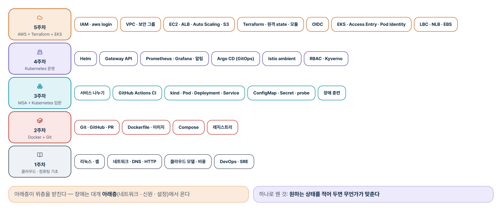

[🏠 과정 목차](../../README.md) › [5주차](../README.md) › [5일차](README.md)

# 1교시 · 4일차 요약 + 5주 지도

> [!NOTE]
> **이번 시간에 할 일**
>
> - 어제 깨끗이 지웠는지 확인합니다.
> - 다섯 주를 **층으로 쌓은 지도**로 다시 봅니다.
> - 다섯 주를 꿰는 **한 가지 생각**과, 장애가 어느 층에서 오는지 정리합니다.

## 4일차 요약 — 손으로 다시 확인

```bash
mkdir -p ~/devops-lab/aws/w5d5 && cp -r ~/course/labs/week5/day5/* ~/devops-lab/aws/w5d5/
~/devops-lab/aws/w5d5/leftovers.sh
```

> **🟢 확인: 이렇게 나오면 준비 완료**
>
> ```text
> == 태그 Project=devmart 가 붙은 자원 (모든 리전)
> [ap-northeast-2] arn:aws:s3:::devmart-tfstate-niceguy61
> [ap-northeast-2] arn:aws:iam::…:role/devmart-tf-plan            (IAM은 리전이 없어 여러 번 보일 수 있다)
> [ap-northeast-2] arn:aws:iam::…:oidc-provider/token.actions.githubusercontent.com
> == 서울 리전 — 시간당 요금이 나가는 것
> EKS:
> EC2:
> NAT:
> EIP:
> LB:
> EBS:
> ```
> 남은 것은 **일부러 남긴** state 버킷 · plan 역할 · OIDC 공급자뿐(모두 무료에 가깝다). 5교시에 이것도 지웁니다.

| 4일차 | 오늘 이어지는 곳 |
|---|---|
| apply 16분 + 플랫폼 8분 + 앱 3분 | 스크립트 하나로 — 몇 분? (2교시) |
| `eks/` 오버레이 | 같은 커밋이 두 클러스터에 (3교시) |
| EBS는 AZ에 묶인다 | 그 AZ를 막아 본다 (4교시) |
| 지우는 순서 | 한 번에, 그리고 모든 리전에서 확인 (5교시) |

## 다섯 주의 지도



| 주 | 질문 | 답한 도구 |
|---|---|---|
| 1주차 | 컴퓨터 · 네트워크 · 클라우드는 무엇인가? | 리눅스 · 셸 · HTTP · DNS · 클라우드 모델 |
| 2주차 | 내 앱을 **어디서나 같게** 돌리려면? | Git · Docker · Compose |
| 3주차 | 앱이 **여럿**이고, **여러 대**에서 돌면? | MSA · CI · Kubernetes 기초 |
| 4주차 | 그것을 **운영**하려면 — 설치 · 입구 · 관찰 · 배포 · 연결 · 보안? | Helm · Gateway · Prometheus · Argo CD · Istio · RBAC |
| 5주차 | 그 모든 것을 **클라우드에, 코드로** 올리려면? | IAM · VPC · Terraform · EKS |

> [!IMPORTANT]
> **다섯 주를 꿰는 한 가지**
>
> **원하는 상태를 적어 두면, 무언가가 실제를 그쪽으로 맞춘다.**
> - Dockerfile → 이미지 (2주차)
> - Deployment `replicas: 2` → ReplicaSet 컨트롤러 (3주차)
> - Git의 매니페스트 → Argo CD (4주차)
> - `.tf` 코드 → Terraform (5주차)
> - Auto Scaling 원하는 용량 → Auto Scaling 그룹 (5주차)
>
> 그리고 운영자의 일은 ① 원하는 상태를 **정확히 적고**, ② 맞추는 장치가 **제대로 도는지 지켜보고**(관찰), ③ 실제와 어긋났을 때 **어느 쪽이 맞는지 판단**하는 것입니다.

> **❓ 오해 — 위층 도구를 알면 아래층은 몰라도 된다**
>
> 5주 동안의 장애를 돌아보면 원인 대부분이 **아래층**에 있었습니다 — 포트 · DNS 이름 오타(1 · 3주차), 이미지 태그(2주차), Secret · 설정(3주차), 보안 그룹 · 라우팅 · 신원(5주차). 위층 도구는 아래층을 **감출** 뿐 없애지 않습니다. 그래서 1주차가 지도의 맨 아래에 있습니다.

> **🎓 학술 노트 — 추상화의 누수**
>
> Spolsky의 *The Law of Leaky Abstractions*(2002)는 "모든 쓸 만한 추상화는 어느 정도 샌다"고 했습니다 — TCP가 신뢰성을 약속해도 케이블이 끊기면 앱이 그것을 겪는다. Kubernetes · EKS · Terraform도 같습니다. Pod IP 상한(4일차 6교시), EBS의 AZ(오늘 4교시), 장부 밖의 NLB(4일차 7교시)는 모두 아래층이 위로 **새어 나온** 순간입니다. 좋은 엔지니어는 추상화를 쓰되, 샐 때 **한 층 아래를 볼 줄** 압니다.

> **📈 트렌드 2026 — 플랫폼 엔지니어링**
>
> 이 지도의 4 · 5주차 층을 회사 안에서 **제품처럼** 만들어 개발자에게 제공하는 일을 **플랫폼 엔지니어링**이라 부르고, CNCF의 *Platforms White Paper*(2023)와 Gartner의 예측 이후 많은 조직이 전담 팀을 두었습니다. 개발자는 "서비스 하나 만들기" 버튼(Backstage 같은 개발자 포털)을 누르고, 그 뒤에서 오늘 배운 Terraform · Argo CD · 정책이 돕니다. 여러분이 5주 동안 만든 것이 그 플랫폼의 축소판입니다.

> **✅ 확인 문제**
>
> 1. 다섯 주를 꿰는 생각을 한 문장으로? 예 셋과 함께.
> 2. 이 과정의 장애 원인 대부분이 아래층이었던 예 셋은?
> 3. '추상화의 누수'를 5주차에서 찾으면?
>
> <details><summary>정답</summary>
>
> 1. 원하는 상태를 적어 두면 무언가가 맞춘다 — Deployment/ReplicaSet, Git/Argo CD, .tf/Terraform, ASG 원하는 용량 중 셋
> 2. 포트 · DNS 이름 오타, 이미지 태그, Secret · 설정, 보안 그룹 · 라우팅 · 신원 중 셋
> 3. Pod IP 상한, EBS의 AZ 묶임, Terraform 장부 밖의 NLB · EBS 중 하나
>
> </details>

## 참고 문헌

- Spolsky, J. (2002). *The Law of Leaky Abstractions*. joelonsoftware.com
- CNCF TAG App Delivery (2023). *CNCF Platforms White Paper*. tag-app-delivery.cncf.io

---

⬅️ 이전: [5주차 5일차 목차](README.md) &nbsp;|&nbsp; [⬆️ 5일차 목차](README.md) &nbsp;|&nbsp; 다음: [2교시 · 아침의 재현](lesson-02.md) ➡️
