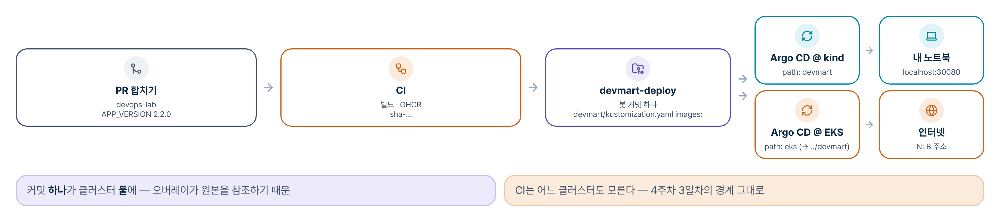

<sub>[🏠 과정 목차](../../README.md) › [5주차](../README.md) › [5일차](README.md) › 3/8교시</sub>

# 3교시 · 커밋 하나, 클러스터 둘

> [!NOTE]
> **이번 시간에 할 일**
>
> - kind와 EKS의 Argo CD가 **같은 배포 저장소**를 보고 있다는 것을 확인합니다.
> - 코드 PR 하나(APP_VERSION 2.2.0)가 **두 클러스터에 함께** 배포되는 것을 봅니다.
> - 한 번에 다 바뀌는 것의 위험을 알고, 오버레이로 **환경 승격**(kind 먼저 → EKS 나중)을 해 봅니다.

## 지금의 그림



```bash
for c in kind-devmart eks-devmart; do
  printf '%-13s ' $c
  kubectl --context $c get application devmart -n argocd -o jsonpath='{.spec.source.path} {.status.sync.revision}{"\n"}' | cut -c1-30
done
```

> **🟢 확인: 확인**
>
> ```text
> kind-devmart  devmart 5a7c9e2d…
> eks-devmart   eks 5a7c9e2d…
> ```
> 폴더는 다르지만 **같은 커밋**(`5a7c9e2`)을 보고 있습니다. `eks/`는 `../devmart`를 참조하므로, `devmart/kustomization.yaml`의 `images:`가 바뀌면 **둘 다** 바뀝니다.

## 실습 2 · 2.2.0을 두 곳에

터미널 A — 두 손님을 나란히:

```bash
NLB=$(kubectl --context eks-devmart get gateway devmart -n devmart -o jsonpath='{.status.addresses[0].value}')
while true; do
  k=$(curl -s -m 2 localhost:30080/api/info | grep -o '"version":"[^"]*"')
  e=$(curl -s -m 2 http://$NLB/api/info | grep -o '"version":"[^"]*"')
  echo "$(date +%T)  kind $k   eks $e"; sleep 2
done
```

터미널 B — 4주차 3일차 7교시와 같은 흐름:

```bash
cd ~/devops-lab && git switch main && git pull
git switch -c feat/catalog-2.2.0
grep -n APP_VERSION devmart-msa/catalog-api/Dockerfile
sed -i 's/APP_VERSION=2.0.0/APP_VERSION=2.2.0/' devmart-msa/catalog-api/Dockerfile   # Mac: sed -i ''
git commit -am "catalog-api 2.2.0" && git push -u origin feat/catalog-2.2.0
gh pr create --fill && gh pr checks --watch && gh pr merge --squash --delete-branch
gh run watch
```

> **🟢 확인: 확인 — 터미널 A**
>
> ```text
> 14:20:02  kind "version":"2.0.0"   eks "version":"2.0.0"
> …
> 14:25:40  kind "version":"2.2.0"   eks "version":"2.0.0"
> 14:25:52  kind "version":"2.2.0"   eks "version":"2.2.0"
> ```
> PR **하나**가 노트북의 kind와 서울 리전의 EKS를 **함께** 바꿨습니다. 두 Argo CD가 각자 60초마다 Git을 보므로 몇십 초 차이가 납니다. CI는 어느 클러스터도 몰랐습니다.

> **🛠️ 막혔다면: update-manifest job이 실패하면**
>
> 4주차 3일차의 배포 저장소 토큰(`DEPLOY_REPO_TOKEN`)은 **30일** 기한이었습니다. 만료되었다면 같은 방법으로 새로 만들어 `gh secret set`합니다. 3일차 7교시의 OIDC처럼 **기한 없는 키를 두지 않는** 대가입니다 — 실무에서는 GitHub App으로 이 갱신을 없앱니다.

## 함께 바뀌는 것의 위험

2.2.0에 버그가 있었다면? **개발 환경과 운영 환경이 동시에** 망가집니다. 그래서 실무는 **승격**(promotion)을 합니다 — 낮은 환경에서 먼저 돌려 보고, 확인한 **같은 이미지**를 다음 환경으로 올립니다(4주차 3일차의 "한 번 빌드, 모든 환경").

| 지금 | 승격 |
|---|---|
| 태그가 `devmart/`에 하나 — 둘 다 따라간다 | `eks/`가 **자기 태그를 고정**하고, 확인 뒤 PR로 올린다 |

## 실습 3 · 오버레이로 승격

`eks/`에 **지금 태그를 고정**합니다.

```bash
cd ~/devmart-deploy && git pull
TAG=$(grep -A1 devmart-catalog-api devmart/kustomization.yaml | grep newTag | awk '{print $2}'); echo $TAG
ID=$(gh api user -q .login | tr 'A-Z' 'a-z')
cat >> eks/kustomization.yaml <<YAML
# 운영(EKS)은 승격 PR로만 태그가 바뀐다 — CI 봇은 devmart/(kind)만 바꾼다
images:
  - name: ghcr.io/$ID/devmart-catalog-api
    newTag: $TAG
  - name: ghcr.io/$ID/devmart-order-api
    newTag: $TAG
  - name: ghcr.io/$ID/devmart-order-worker
    newTag: $TAG
YAML
kubectl kustomize eks | grep 'image: ghcr' | sort -u
git commit -am "EKS: 이미지 태그 고정 (승격 방식)" && git push
```

이제 2.3.0을 내보냅니다(터미널 A는 계속 켜 둔다).

```bash
cd ~/devops-lab && git switch main && git pull && git switch -c feat/catalog-2.3.0
sed -i 's/APP_VERSION=2.2.0/APP_VERSION=2.3.0/' devmart-msa/catalog-api/Dockerfile
git commit -am "catalog-api 2.3.0" && git push -u origin feat/catalog-2.3.0
gh pr create --fill && gh pr checks --watch && gh pr merge --squash --delete-branch && gh run watch
```

> **🟢 확인: 확인 — 터미널 A**
>
> ```text
> 14:41:10  kind "version":"2.3.0"   eks "version":"2.2.0"
> ```
> kind(개발)만 바뀌고 EKS(운영)는 그대로입니다. kind에서 확인했다고 치고, **승격**합니다.

```bash
cd ~/devmart-deploy && git pull
NEW=$(grep -A1 devmart-catalog-api devmart/kustomization.yaml | grep newTag | awk '{print $2}')
git switch -c promote/eks-$NEW
sed -i "/^images:/,\$ s/newTag: .*/newTag: $NEW/" eks/kustomization.yaml
git diff
git commit -am "승격: EKS를 $NEW 로" && git push -u origin promote/eks-$NEW
gh pr create --fill --title "승격: EKS를 $NEW 로" && gh pr merge --squash --delete-branch
```

> **🟢 확인: 확인 — 터미널 A (1분 안에)**
>
> ```text
> 14:46:30  kind "version":"2.3.0"   eks "version":"2.3.0"
> ```
> 운영 배포가 **사람이 읽고 합친 PR 하나**가 되었습니다. 되돌리기는 이 PR의 revert입니다. 터미널 A는 `Ctrl+C`.

> [!IMPORTANT]
> **승격 PR이 담는 것**
>
> 승격 PR의 diff는 **태그 세 줄**뿐입니다. 그 태그는 이미 kind에서 돌던 **같은 이미지**입니다 — 다시 빌드하지 않았습니다. 리뷰어는 "이 태그가 개발 환경에서 문제없었나(대시보드 · 알림)"만 판단하면 됩니다. 4주차 2일차의 관찰과 3일차의 GitOps가 여기서 만납니다.

> **❓ 오해 — 환경이 여럿이면 브랜치도 여럿이어야 한다**
>
> `dev` · `prod` **브랜치**로 환경을 나누면, 브랜치 사이를 병합하다 의도하지 않은 변경이 함께 넘어가기 쉽습니다. 오늘처럼 **한 브랜치(main) + 환경별 폴더(오버레이)**가 GitOps에서 권장되는 모양입니다 — 환경의 차이가 폴더의 diff로 **보이기** 때문입니다.

> **🎓 학술 노트 — 점진적 배포의 위계**
>
> 카나리(4주차 1 · 4일차)가 **한 환경 안에서** 일부 트래픽으로 위험을 나눈다면, 환경 승격은 **환경 사이에서** 시간으로 위험을 나눕니다. Humble과 Farley(2010)의 배포 파이프라인은 이를 '단계마다 신뢰를 쌓는 관문'으로 설명했고, 구글의 *SRE Workbook* 16장은 카나리 → 단계적 롤아웃 → 전체의 순서를 실무 규칙으로 정리했습니다. 두 방법은 대립이 아니라 겹쳐 씁니다.

> **📈 트렌드 2026 — 승격의 자동화**
>
> Kargo(Akuity) · Argo CD의 Source Hydrator · Flux의 이미지 자동화는 "개발 환경의 지표가 30분 동안 정상이면 자동으로 다음 환경 승격 PR을 연다" 같은 규칙을 지원합니다. 사람은 PR을 **합칠지만** 판단합니다. 오늘 손으로 한 승격이 그 규칙의 내용입니다.

> **✅ 확인 문제**
>
> 1. 커밋 하나가 두 클러스터에 배포된 이유는?
> 2. 두 환경이 함께 바뀌는 것의 위험은?
> 3. 승격 방식에서 CI 봇이 바꾸는 곳과 사람이 바꾸는 곳은?
> 4. 환경을 브랜치가 아니라 폴더로 나누는 이유는?
>
> <details><summary>정답</summary>
>
> 1. eks/ 오버레이가 ../devmart를 참조해서, devmart/의 images: 변경이 두 곳에 함께 반영되었기 때문
> 2. 버그가 있으면 개발과 운영이 동시에 망가진다
> 3. 봇은 devmart/(kind) 태그, 사람은 eks/(운영)의 태그를 승격 PR로
> 4. 브랜치 병합 때 의도하지 않은 변경이 넘어가기 쉽고, 폴더는 환경 차이가 diff로 보이기 때문
>
> </details>

## 참고 문헌

- Argo CD Docs. *Best Practices — Separating environments*. argo-cd.readthedocs.io
- Kargo Docs. *Concepts — Promotion*. docs.kargo.io
- Beyer, B. 외 (2018). *The Site Reliability Workbook*, Ch. 16 "Canarying Releases". O'Reilly.

---

| 이전 | 목차 | 다음 |
|:--|:--:|--:|
| ⬅️ [2교시 · 아침의 재현](lesson-02.md) | [⬆️ 5일차 목차](README.md) | [4교시 · 클라우드 장애 훈련 — 노드와 AZ](lesson-04.md) ➡️ |
